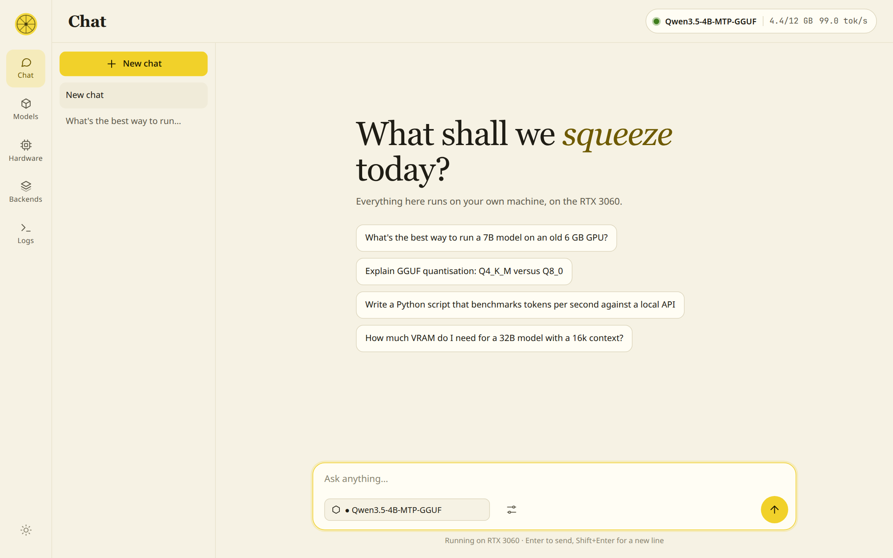
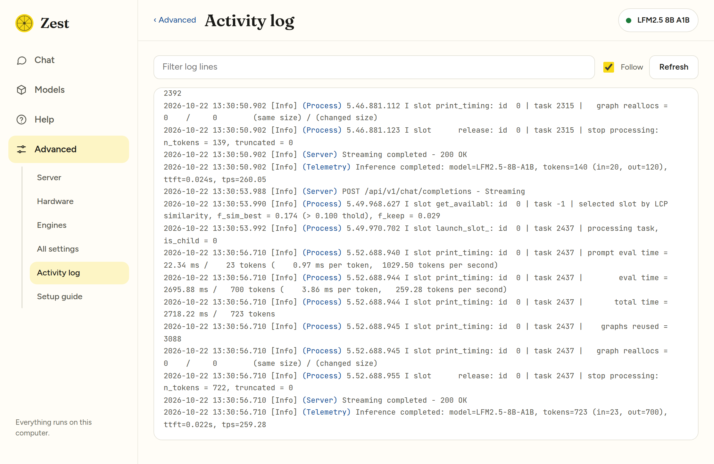

# Zest

**A friendly console for [Lemonade Server](https://lemonade-server.ai).** Chat with your local models, see at a glance which ones fit your GPUs, choose which devices run them (and in what order), switch backends, and watch the server, all from one clean page.


Zest is a small, dependency-free web app. It talks to a Lemonade Server you already have running, and changes nothing about how that server works.

## Features

- **Chat** with streaming replies, markdown and code blocks with copy buttons, collapsible reasoning for "thinking" models, and tokens-per-second and time-to-first-token on every answer. Conversations are kept in your browser.
- **Models** shows everything Lemonade can run. Each card has a fit meter that compares the model with the VRAM that is actually *free* on the devices Lemonade is set to use, so you can tell *before* loading whether it will fit, spill into system RAM, or fail because another program is holding the memory. Load with a context size you choose.
- **Hardware** shows every device llama.cpp can see as a live VRAM tank with utilisation, temperature, power, a short history, and which processes are holding its memory. **Pick which devices to use and put them in order**, then apply.
- **Backends** lists every Lemonade engine (llama.cpp, Whisper.cpp, StableDiffusion.cpp and more) with the backends each supports (CUDA, Vulkan, ROCm, CPU…). Choose one per engine, or install and update missing ones, just as you can in Lemonade itself.
- **Logs** tails the Lemonade service log with a filter and follow mode.
- Light and dark themes, keyboard-friendly, works on a phone-width screen.

## Screenshots

### Chat
Streaming answers with speed stats, a model picker, and per-chat settings.



### Models
The meter on each card is the size of the model against the VRAM that is free right now, so you can see what will fit before you load it. If another program is using the card, Zest warns you and names it.


### Hardware
Select GPUs and set their order. The first device is the primary one. Each card shows how much VRAM is free and which processes are using it (here, Lemonade running a model split across both cards). Nothing changes until you press **Apply**.


### Backends
Pick a backend per engine, or install the ones you're missing.


### Logs



*Screenshots were taken on a machine with an RTX 3060 and an RTX 4080 SUPER. Zest shows whatever devices your machine has.*

## Quick start

You need a running Lemonade Server (default `127.0.0.1:13305`) and the `lemonade` command-line tool on your `PATH`; both come with a normal Lemonade install.

### AppImage (Linux x86_64)

1. Download `Zest-<version>-x86_64.AppImage` from the [latest release](../../releases/latest).
2. Make it executable and run it:

   ```bash
   chmod +x Zest-*-x86_64.AppImage
   ./Zest-*-x86_64.AppImage
   ```

Zest opens in your browser. It bundles its own Python, so there is nothing else to install. Closing the browser tab quits it after about three minutes; launching it again while it is running just reopens the page.

If your system has no FUSE support, run `./Zest-*-x86_64.AppImage --appimage-extract-and-run` instead.

### From source

Python 3, standard library only (developed on 3.12):

```bash
git clone https://github.com/yudhanjaya/Zest.git
cd Zest
python3 zest/server.py
```

Then open <http://127.0.0.1:13306> (it opens automatically unless you pass `--no-browser`).

## Options

| Flag | Environment variable | Default | Meaning |
| --- | --- | --- | --- |
| `--port` | `ZEST_PORT` | `13306` | Port Zest listens on |
| `--host` | `ZEST_HOST` | `127.0.0.1` | Address Zest listens on |
| `--lemonade HOST:PORT` | `LEMONADE_HOST`, `LEMONADE_PORT` | `127.0.0.1:13305` | Where Lemonade Server is |
| (none) | `LEMONADE_API_KEY` | none | API key, if your Lemonade needs one |
| (none) | `LEMONADE_BIN` | `lemonade` on `PATH` | Path to the `lemonade` CLI |
| `--no-browser` | | | Don't open a browser tab |
| `--app` | | | Quit automatically once the tab is closed (the AppImage does this) |

> **Security.** Zest has no login of its own and can change your Lemonade configuration. It listens on `127.0.0.1` by default. Only use `--host 0.0.0.0` on a network you trust.

## How it works

Zest is one Python file (`zest/server.py`) and one HTML file (`zest/index.html`).

- `/api/*` is passed straight through to Lemonade, so the page needs no CORS changes. Chat uses the OpenAI-compatible `/api/v1/chat/completions` stream.
- Device and backend changes are written with `lemonade config set llamacpp.device=…` and `lemonade config set <engine>.backend=…`; installs run `lemonade backends install <engine>:<backend>`. These are the same settings Lemonade's own CLI changes.
- Device order matters: llama.cpp numbers devices differently from `nvidia-smi` (CUDA puts the fastest card first). Zest asks the llama.cpp binary for its own list so the names and IDs line up.
- Live GPU numbers come from `nvidia-smi`. Logs come from `journalctl -u lemond`.

### Good to know

- **Telemetry is NVIDIA-only for now.** AMD and Intel devices are listed and selectable, but show capacity without live usage, and the fit meter treats them as empty.
- **Process names are shown on the Hardware page.** They come from `nvidia-smi` (name only, not the full path) and are only displayed in your own browser.
- **Device discovery needs a llama.cpp binary Zest can run.** That works when `llamacpp.<backend>_bin` points at one, or `llamacpp.prefer_system` is on. With Lemonade's bundled build, which lives where an ordinary user can't read it, Zest falls back to assuming CUDA order equals `nvidia-smi` order and says so on the Hardware page.
- **Logs need systemd.** On other setups the Logs page will tell you it couldn't read the service log.
- Tested on Linux with NVIDIA GPUs. The Vulkan and ROCm paths follow Lemonade's own backend data but haven't been tried on real hardware yet. Reports welcome.

## Building the AppImage

```bash
./packaging/build-appimage.sh
```

This downloads a relocatable Python and `appimagetool` (both pinned by SHA-256), assembles the image and writes `dist/Zest-<version>-x86_64.AppImage` plus a checksum. Pushing a tag that starts with `v` runs the same script in GitHub Actions and attaches the result to the release.

To cut a release: bump `VERSION` in `zest/server.py`, then `git tag vX.Y.Z && git push --tags`.

## License

[MIT](LICENSE)
