<h1 align="center">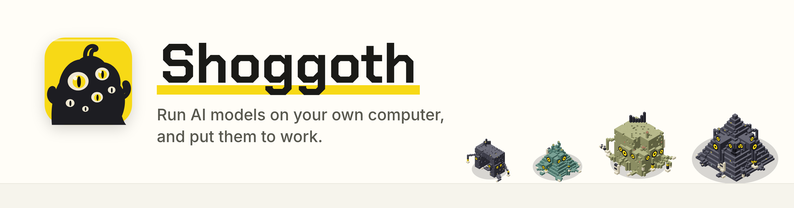</h1>

<p align="center">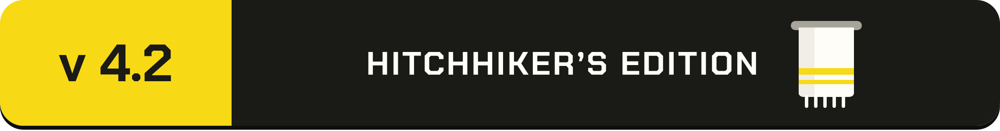</p>

[](https://github.com/yudhanjaya/Shoggoth/releases)
[](https://github.com/yudhanjaya/Shoggoth/releases)
[](LICENSE)


[](https://github.com/yudhanjaya/Shoggoth/commits/main)
[](https://github.com/yudhanjaya/Shoggoth/issues)
[](https://github.com/yudhanjaya/Shoggoth)

**Run AI models on your own computer and put them to work, with one download.**

Shoggoth is an app for running open-weights language models on your own hardware. You don't need technical know-how. You can chat, draw diagrams, write documents, or let a model read and change the files in a folder while you watch.

Under the hood, Shoggoth drives three open-source programs:

- [Lemonade](https://lemonade-server.ai) runs small and medium models.
- [Strata](https://github.com/Niko1221/Strata) runs very large ones.
- [Pi](https://pi.dev) lets a model read files, edit them and run commands.

You never choose an engine. Shoggoth starts the right one for the model you pick. The AppImage includes Lemonade and Pi, and sets up Strata the first time you want a large model. Shoggoth runs on Linux only, for now.

Shoggoth used to be called Zest. It draws every model as a many-eyed creature in a glass tube, wired to a bench of lab equipment. A model's name decides its shape and colour, and the bigger the model, the bigger the creature, with more eyes and more hands. You can turn them off.


*Working in a folder: the model found why two tests failed, fixed it with a one-line change (shown as a diff) and ran the tests again.*

**Contents:** [What you can do](#what-you-can-do-with-shoggoth) · [Install and run](#install-and-run) · [Finding your way around](#finding-your-way-around) · [Your first conversation](#your-first-conversation) · [Model pictures](#model-pictures) · [Choosing and managing models](#choosing-and-managing-models) · [Skills](#skills) · [Use your models in other apps](#use-your-models-in-other-apps) · [Keeping everything up to date](#keeping-everything-up-to-date) · [Advanced tools](#advanced-tools) · [Themes](#themes) · [Your data and privacy](#your-data-and-privacy) · [For developers](#for-developers)

## What you can do with Shoggoth

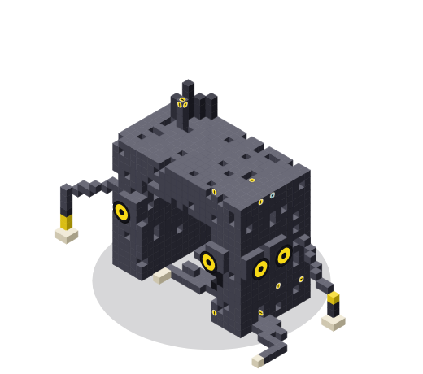

- **Chat with an AI that runs on your computer.** Nothing you type leaves it. The one exception is web search, and the model asks before every search.
- **Let it work on your files.** Choose a folder. The model can read, search, edit and run things there while you watch. It asks before it changes anything.
- **Hand it a bigger job.** A job runs in the background, round after round, and checks its own progress. You review its changes before they touch your folder.
- **Draw diagrams and write documents.** Ask for a picture or a README, and it appears in the chat.
- **Teach it new tricks with skills.** A skill is a short instruction sheet. Skills make small models far more dependable. Add more by pasting a link.
- **Pick and manage models.** Shoggoth tells you which models will run well on your computer, and downloads them for you.
- **See what your models are.** Each model is drawn as a creature grown from its name. The Hardware and Server pages show your graphics cards, and the apps using them, as a lab bench.
- **Make it look the way you like.** Choose from fifteen themes under **Advanced > Themes**.
- **Use your models in other apps.** Shoggoth can share them with tools such as opencode, or any app that talks to an OpenAI-style server.

Setup takes no technical steps: download one file and follow a few short screens. The **Docs** tab inside the app explains everything in plain language. Its text lives in [shoggoth/docs.md](shoggoth/docs.md).

## Install and run

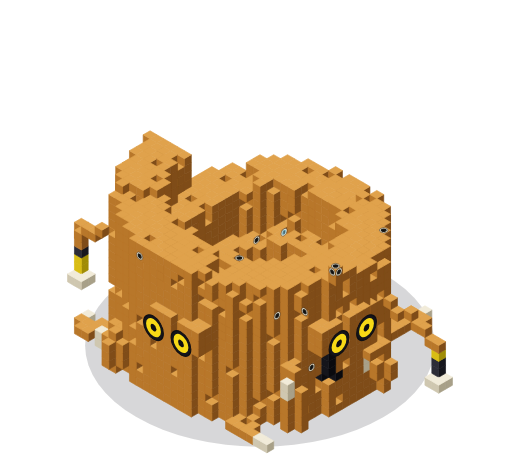

1. **Download** `Shoggoth-<version>-x86_64.AppImage` from the [latest release](../../releases/latest).
2. **Run it:**

   ```bash
   chmod +x Shoggoth-*-x86_64.AppImage
   ./Shoggoth-*-x86_64.AppImage
   ```

3. **Let Shoggoth get ready.** Shoggoth opens in your browser on a screen called **Getting ready**. It asks one question and does the rest:

   - **Where should your models live?** Models are big. Shoggoth lists your disks with their free space and picks the one with the most room. One click accepts it. Everything goes in one folder called Models on that disk. If you already have models or a running engine, Shoggoth finds them and skips this question.
   - **The checklist.** Shoggoth looks at your computer and downloads the part that runs AI (a small download, with progress). Then it fits that part to your graphics card: CUDA for NVIDIA, Vulkan for most other cards, and the processor as a fallback.
   - **Choose your first model.** You get one suggestion per size:
     - **Small:** LFM2.5 8B A1B. Fast, to the point, good with tools, and happy on almost any computer.
     - **Medium:** Qwen3.6 35B A3B MTP or Gemma 4 26B A4B. The general pick, and the recommended one when it fits.
     - **Large:** for big computers. It takes a couple of minutes to start.

     Press **Get it** on one, and the download shows its progress. **I already have models** brings in models you already have.
   - **Start chatting.** The button names the model it will use. The model works in your home folder unless you choose another.

   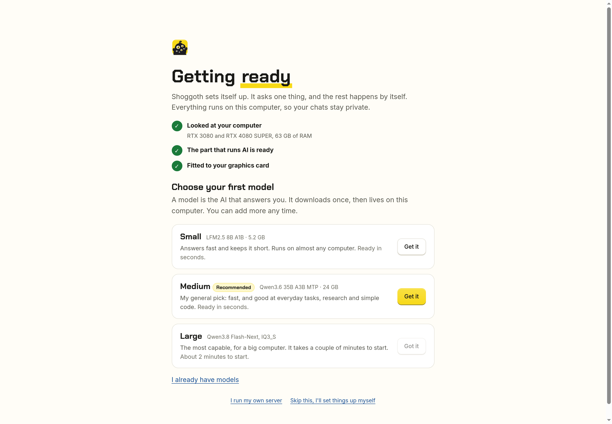

*The first-run screen ends with a button that opens the chat.*

If you already have models, or run your own Lemonade or Strata, Shoggoth finds them and you can skip the first-run screen. Three places help here:

- The few choices are spread to where they belong: **Models** holds where models live, **Hardware** holds how long big models stay in memory, the chat's **Memory** menu holds how much a chat remembers, and **Advanced > Engines** holds updates.
- **Add models from other sources** on the Models page brings in models you already have. It finds LM Studio, Ollama, llama.cpp and other folders for you.
- **Advanced > Engines > My own server** connects a Lemonade you run yourself.

### What you need

- **Linux on x86_64.** The AppImage carries the glibc 2.38+ its built-in Lemonade needs, so it runs on older systems too (Ubuntu 22.04 and the like). Running from source on a system older than glibc 2.38, Shoggoth says so and you can connect it to a Lemonade you install yourself.
- **A few common system libraries:** OpenSSL 3, zstd and libdrm. Almost every desktop Linux has them. If one is missing, Shoggoth names it.
- **Your graphics driver,** to use the GPU. Shoggoth and Lemonade download everything else.
- **Internet access** for the first-run downloads: the backend and your models.

If your system has no FUSE support, run `./Shoggoth-*-x86_64.AppImage --appimage-extract-and-run` instead.

Closing the browser tab quits Shoggoth, and its Lemonade, after about three minutes. Launching Shoggoth again while it runs just reopens the page.

## Finding your way around

The menu on the left has six places, and your chats are listed beneath it. A newcomer needs only the first five. Everything technical, including the theme picker, sits under **Advanced**.

| Menu item | What it is for |
| --- | --- |
| **Chat** | Talk to a model, or choose a folder and let it work on your files. |
| **Models** | Every model on your computer in one list, grouped into Small, Medium and Large. Shoggoth recommends the ones that will run well. Get new models, add ones you have, and change a model's settings. |
| **Skills** | Switch skills on and off, and add more from a GitHub link. |
| **Docs** | A plain-language guide to all of this, inside the app. |
| **Help** | Short answers to common questions, and a button to see the first-run screen again. |
| **Advanced** | Server, Hardware, Engines, Engine settings, Tuning and Themes. **Engines** is where everything updates in one button, and where you can use a server you run yourself. You never need these just to chat. |

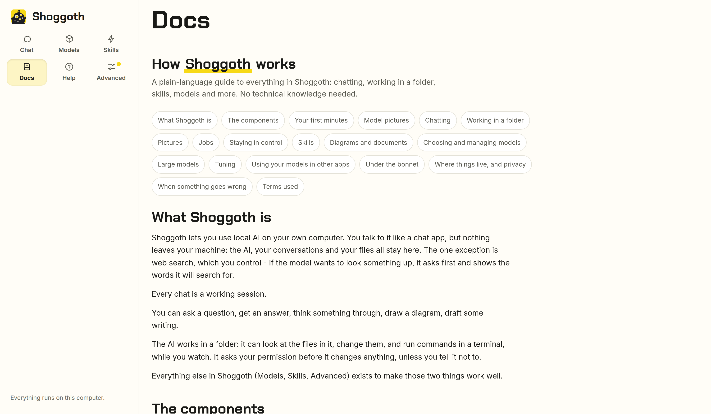

*The menu on the left, with the Docs tab open.*

## Your first conversation

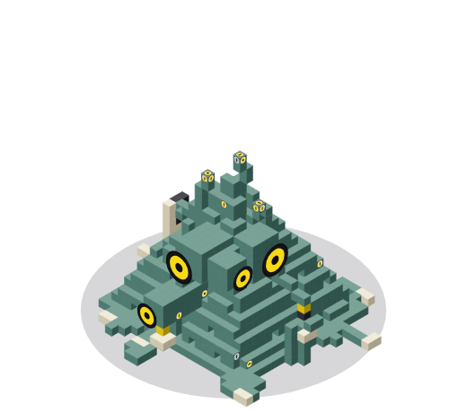

Open **Chat** and type. The bar under the title shows which model will answer and whether it is in memory. If it isn't, Shoggoth loads it when you send your first message. That first answer takes a little longer.

Chat runs on [Pi](https://pi.dev), a coding-agent harness that ships inside Shoggoth. Every chat is a working session in a folder:

- The model can read, search, edit and run commands there (it has a terminal) while you watch.
- Pick a folder, or leave it and the model works in your home folder. The top of the chat says which.
- In your home folder, a chat starts on **Ask first**, and jobs need a project folder.
- It answers questions like a normal chat too. It asks before it changes anything.
- Tool cards show each step. Edits show a diff.

You can choose how careful the model is in each chat: **Ask first**, **Edit freely**, **Do everything** or **Look only**. You can also add folders it may read or change, switch models, watch how much of the context window is in use, and add notes while it works.

For bigger work, press **Start a job…**. It is always there under the message box. Say what should get done and how Shoggoth can tell it is done, such as a test command that passes. A job needs a project folder, and the form asks you to choose one if the chat has none. You can also just describe the work in the chat: the model asks what done looks like, then fills the form in for you. It never starts the job itself; you read the form and press **Start job**.

If the model you chose can see pictures, an **Add a picture…** button appears next to it. You can also paste or drag pictures into the message box, up to four at a time. Shoggoth shrinks big ones first. Models that can't see pictures don't get the button.

- The job runs in the background, round after round.
- It stops when the check passes, when it reaches its round or time limit, or when it stops making progress.
- By default it works on a copy of your folder. The **Changes** tab shows what it changed, and you apply what you want.
- Jobs are listed under their chat. You can keep chatting while they work.

Chats and jobs are saved and pick up where they left off. See [docs/COWORK.md](docs/COWORK.md).

### Chat

Replies stream in as the model writes them.

- **The model bar** under the title shows the model that answers and its Memory (128k by default). It also shows a short status, **Load** when the model isn't in memory, and **Unload**.
- **Thinking:** a reasoning model's thinking appears live above its answer, then folds away when it is done.
- **Formatting:** Markdown and code blocks come with copy buttons.
- **The working strip** shows what the model is doing: reading, thinking, writing, working, or waiting for your OK. A line in italics under the strip says the same thing in a more unsettling way. It always names the model that is running.

### Working in a folder

Every chat works in a folder: your home folder, unless you choose one. The model can read, search, edit and run things there. Tool cards show each step, and edits show a diff. In **Ask first** and **Edit freely** modes, it stops and asks before it runs a command.

In the screenshots below, the model was asked to fix a folder whose tests were failing. It read the tests and the code, made a one-line change and ran the tests again.


## Model pictures

Shoggoth draws every model as a creature, so you can tell your models apart at a glance. A creature is grown from the model's name, so the same model always looks the same:

- **Shape and colour** come from the name. Models of one family (every Gemma 4, say) share them, whatever their size or compression. There are 17 shapes, and any model can get any of them.
- **Size** follows the biggest number before a "B" in the name, which is the parameter count. The bigger the model, the bigger the creature.
- **Camera eyes.** Every creature has large camera eyes, and more of them as it grows: three on a small model, up to seven on a big one.
- **Hands.** Every creature holds pens. Bigger ones have more hands, up to eight, and take up papers and then keyboards.
- **Skin** shows compression, read from the name (Q4_K_M, IQ3_S and so on). Rougher skin means smaller and a little less exact.

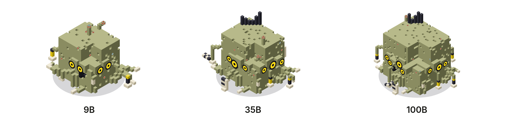

*One family at three sizes: the shape and colour stay, and the creature grows more eyes and hands.*

The creatures are pictures, not measurements. Eyes and hands say nothing about what a model can see or do: the card says that. A model with no parameter count in its name, such as some Large ones, is drawn at a size worked out from its download.

The chat's model sits in a glass tube at the top of the Chat page, wired to the model bar. The tube is empty until a model is loaded. The creature drops in when it loads, and the liquid shows how full your graphics memory is. It stirs while the model thinks and writes.

Click the tube to open the model list. It is the same list as the model menu in the bar, with models from every engine.

The **Hardware** and **Server** pages put the same creatures on a lab bench. See [Advanced tools](#advanced-tools) and [Use your models in other apps](#use-your-models-in-other-apps).

To hide the pictures, switch off **Show model pictures** in the chat's right sidebar. Nothing else changes.

## Choosing and managing models

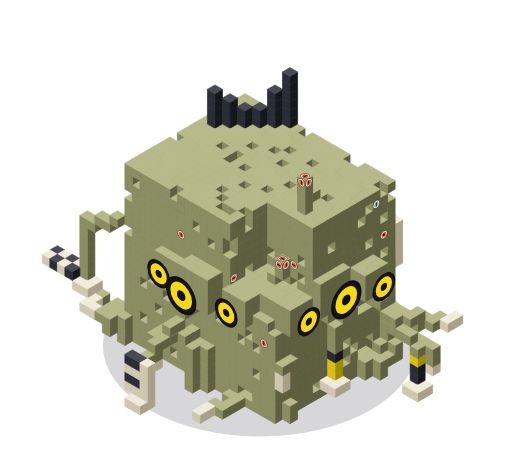

The **Models** is one list of every model on your computer, whichever engine runs it. It is also where you get new ones.

You don't pick an engine. Shoggoth runs small and medium models on [Lemonade](https://lemonade-server.ai) and large ones on [Strata](https://github.com/Niko1221/Strata). It starts the engine your model needs and frees the memory of whatever else was running. Each card names its engine on the **Details** row.


*Models while Lemonade isn't running yet: the picks show anyway, and **Set up and get it** sets Lemonade up first. Each card has its creature beside the name.*

Models has three tabs:

- **Installed** lists what you have, by size:
  - **Small:** under 10 GB of graphics memory. Ready in seconds.
  - **Medium:** 10 to 24 GB.
  - **Large:** for computers with about 64 GB of RAM. They take a couple of minutes to start.
- **Recommended for this computer** leads with the models I've tested and recommend, plus any Large model that fits. Each card says what it is, how much memory it needs, which engine runs it, and whether it can use tools or see pictures. The picks show even before Lemonade is installed: choosing one sets Lemonade up first, then gets the model. Models that aren't ready yet sit greyed out under **Coming soon**. The picks and their text live in `shoggoth/recommendations/models.yaml`. There are no speed figures on them, because speed depends on your computer.
- **All models** is everything Lemonade offers, tested or not, with a filter for pictures, speech and sound.

Every model you have shows whether it is tuned (**Tuned**, **Not tuned**, or **Tuning out of date**). Tune it on the Tuning page. A model that won't load gets a plain explanation, such as "This model needs a newer engine" when llama.cpp doesn't know its design yet.

Each card shows whether the model fits in the graphics memory that is free right now. If another program is using that memory, Shoggoth says so and names it.

**Getting models**

- **Get it** downloads a model in the background, with a progress bar. You can keep using Shoggoth meanwhile. All downloads share one "Getting models" strip. If a model needs something extra, such as Strata for the first Large model, Shoggoth sets it up as part of the same step.
- **Add models from other sources** brings in models from three places:
  - a Hugging Face link. Shoggoth lists the repository's GGUF versions with their sizes and a plain label such as "A good balance".
  - any folder.
  - the usual places other programs keep models: LM Studio, llama.cpp's cache, GPT4All, Jan, Ollama, `~/models` and `~/Downloads`.

  Nothing is copied. Shoggoth gives each engine a folder of links to your files, so you use no extra disk space and your originals stay where they are.
- **Where models live.** You choose one folder, once, on the **Models** page or on the first-run screen. Shoggoth keeps new models there, in a **Models** folder with a subfolder for each engine. It moves nothing you already have.
- **When an engine refuses a model,** Shoggoth explains why in plain language, with the technical details tucked underneath. Common reasons: the architecture isn't supported yet, the model needs a login, it can't be found, or memory or disk is short.

**Choosing the right one**

- **How do I choose a model?** This button in Models, and the matching entry in Help, explains how to pick. Will it fit? What is it for? How much does it need to remember? It links to places to compare models: Luke's Dev Lab, Artificial Analysis, LMArena, Aider, the Berkeley Function-Calling Leaderboard, SWE-bench, LiveBench, BenchLM, LLM Stats, r/LocalLLaMA and the Level1Techs forum.
- **Start here: LFM2.5 8B A1B.** Very fast, runs on almost anything, calls tools well, and keeps answers short.
- **My general pick: Qwen3.6 35B A3B MTP.** Fast and competent at everyday tasks, research and agent work.
- **If Qwen 3.6 won't run: GLM 4.7 Flash.** It is fast, but it makes things up, so it comes with a warning.
- **Bigger and slower dense models: Gemma 4 31B MTP and Qwen3.8 27B.** Good answers, but slow.
- **Large:** with a GPU and 64 GB of RAM, the Large group runs models far bigger than your graphics card. **Qwen3.8 Flash-Next (IQ3_S)** is the pick, and the IQ2_XS size is its smaller version for computers with less RAM. **Qwen3.8 Flash-Next Coder** (code only, about 32 GB of RAM) and **Swift 1.5** (a fine-tune that thinks less) are offered but never suggested. **DeepSeek V4.1 Flash** is for very big computers only: an 8K window and 257 GB of disk.
- **Make any model better:** I recommend OpenChamber as the app, and obra/superpowers for skills.

**Loading and freeing memory**

- **You load a model by choosing it.** Pick a model in the chat's model bar. Shoggoth gets it ready and frees the previous model's memory. Sending a message to a model that isn't in memory also loads it.
- **Unload** in the model bar unloads the model, and **Load** loads the one you picked.
- **Context window: 128k by default.** Chat loads a model with a 128k (131,072-token) context window. That is a good size for long chats and agent work. The **Memory** menu in the model bar changes it, and it is also the default for new chats. A bigger window needs more graphics memory.
- **Delete from this computer** is under **Details** on a card. It asks first, says how much disk it frees, and unloads the model if it is running. You can download it again later.

### Settings for one model

Press **Settings** on any downloaded card. You can set the backend and devices, and tune `llama-server` with tick boxes and dropdowns instead of flags.

- Rows you have changed are highlighted.
- The dialog shows the exact arguments Shoggoth will pass.
- Anything your `llama-server` doesn't understand is flagged.

**Save** keeps your changes. They apply the next time the model loads. For a model that is in memory, press **Unload** and send a message to load it again.


### Large models (experimental)

Some models are far too big for a graphics card. Shoggoth runs them anyway, through [Strata](https://github.com/Niko1221/Strata). Strata keeps part of the model in RAM and on the SSD. These models are slower than one that fits, and they need a lot of RAM and disk.

- **You use them like any other model.** Shoggoth suggests the best Large model that fits your RAM, graphics memory and free disk. A card only shows when it would fit, including the disk space for the download. **Get it** downloads it. The first time, Shoggoth also sets up Strata:
  1. It downloads Strata's installer.
  2. It checks the installer against the checksum Strata publishes.
  3. It runs the installer.
  4. It saves a setup for the model with a 128k context window. (DeepSeek V4.1 is fixed at 8K.)

  Pick the model in Chat, and a card shows it starting.
- **Memory is shared.** Only one big model runs at a time. Picking one frees whatever else was running. Picking a small one frees the big one, unless it is answering right now. Before a big model starts, Shoggoth checks there is enough free memory. If there isn't, it says how much is missing and which programs use the most, with a **Start anyway** button.
- **It frees itself.** A big model Shoggoth started stops after 20 idle minutes. The next chat starts it again. Change the time under **Memory** on the **Hardware** page, or set 0 to keep it ready.
- **Shoggoth finds Strata installs you already have.** If Strata is installed, or a model is already running, its models show up in Models and in Chat with no setup. A running model counts whether `strata launch`, the Strata app or you by hand started it on a local port.
  - Strata frees its model's memory when idle and loads it again on the next request. Meanwhile, Shoggoth keeps listing the model, and your next message wakes it.
  - To use a Strata on another computer, open **Advanced > Engines**, then Strata's card, then **Connect to a Strata on another computer**.
  - Shoggoth never stops, restarts or updates a Strata you started yourself. It shows a **Stop** button, with a confirmation, only when you ask for one. While your own Strata is running, Shoggoth won't start a second big model beside it.
- **Updates.** Strata's engine and Control update from Strata's own signed feed. Strata test-starts a new engine before it switches over. **Check and update everything** in **Advanced > Engines** includes Strata. If the Strata that Shoggoth started is running, Shoggoth stops it, updates it, and starts it again when a chat needs it. A bigger jump, to a new Control series, is yours to take with `strata update`.

### Tuning

**Advanced > Tuning** makes a model answer faster on your computer. It measures the model as it is, tries changes one at a time, and keeps only the ones that clearly help. Answers stay the same: tuning never changes how a model is compressed.

- **Large models** use Strata's own tuner (`strata tune auto`). Choose quick (about 20 minutes) or thorough (up to 2 hours), and tune for chat or for coding with long prompts. The result is saved and used every time the model starts. **Switch off** keeps the result but goes back to the standard settings.
- **Small and medium models** that run on llama.cpp are tuned by Shoggoth. It tries batch sizes, flash attention, threads, the backend and which graphics cards to use. It tests each change by loading the model with it. It keeps a change only if the gain beats the measuring noise and is at least 3%. **Undo** puts the old settings back.
- **Every model shows one of four states:** tuned (with its speed and the gain), tuned but the standard settings were already the fastest (shown as a result, not as 0%), out of date (the engine or llama.cpp changed since), or not tuned. Strata keeps its own tunings, and Shoggoth only reads them.
- **Test speed** (small and medium models) loads a model once and measures it, without changing anything. **Leave some graphics memory free** is a choice on every model card. Large models start with 1.5 GB kept free by default, so your desktop stays responsive, and if a model needs the whole card it starts without it and says so. Small and medium models keep nothing back unless you choose an amount. Keeping memory free can leave a few of a large model's experts on the CPU, which costs a little speed.
- **Each reply shows how fast it was written**, in tokens a second. It is the engine's own figure when there is one, and marked with a ~ when it is worked out from the time.
- **Tuning needs the graphics cards to itself.** Shoggoth shows the plan first, with the time it takes and what it will stop, and waits for your go-ahead.
  - It stops what Shoggoth started, and waits while a chat is answering.
  - It won't start while a Strata you started yourself is running.
  - You can cancel at any time, and nothing changes.

## Skills

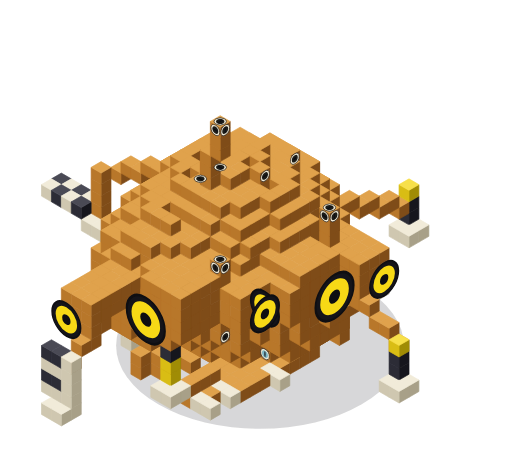

A **skill** is a short instruction sheet the model reads when a job calls for it.

Shoggoth comes with three:

- **Superpowers,** a trimmed copy of [obra/superpowers](https://github.com/obra/superpowers). It teaches a working method: ask what the person really wants, plan, test first, find a bug's cause before fixing it, and prove something works before saying so.
- **Diagrams.** The model writes Mermaid, and Shoggoth draws it in the chat with **Copy** and **Save as image** buttons. If a diagram doesn't draw, one button asks the model to fix it.
- **Markdown writing.**

**To add more,** open **Skills**, paste a link to a GitHub repository (or to one folder in it), and press **Add skills**. Any repository that follows the [Agent Skills](https://agentskills.io) format works. [Hermes Atlas](https://hermesatlas.com/ecosystem/) lists many.

You can switch skills on and off one at a time or by set. In a conversation with a folder, type `/` to pick a skill by name. Only add skills from people you trust. See [docs/COWORK.md](docs/COWORK.md).

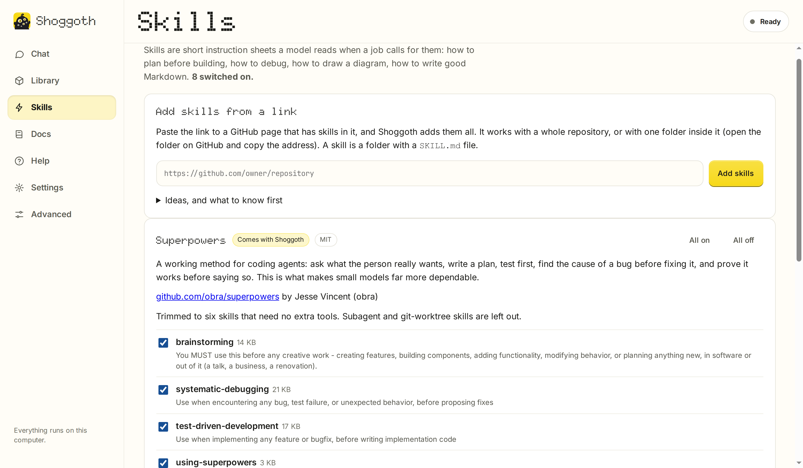

## Use your models in other apps

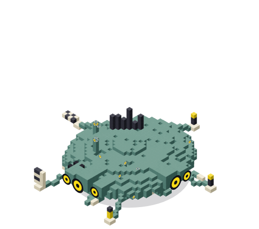

**Advanced > Server** lets other apps use the models on your computer. Tools such as [opencode](https://opencode.ai) and Hermes work, and so does any chat app, coding assistant or agent that talks to an OpenAI-compatible server.

The page gives you an address, a key, and copy-paste setup. In the other app, enter the address (`http://127.0.0.1:13308/v1` by default), the key and a model name. The key stays hidden until you press **Show**, including in the code samples.


*The lab bench on the Server page, just after **Send a test message**: the loaded model in its jar, a flask for the request, and a card underneath with how long it took.*

The same page shows what those apps are doing:

- **Right now.** A lab bench shows the model in its jar, piped to a flask for each request in progress. The flask bubbles while the model thinks, and fills as it writes the answer. A card for each request gives the app's name and a line such as "Thought for 7.2 s, about 415 words". **Send a test message** sends one to the model that is in memory. With **Show what models are saying** on, each card also quotes the line the model is writing. The number of requests today sits underneath.
- **The last minute.** One lane per app, with a pill for each request. Each pill is split into reading the question (grey), thinking (dotted) and writing the answer (yellow). You can see who was waiting for whom.
- **Requests.** A list with the app, the model, how long each request took and whether it worked. You can filter it by app. Shoggoth names each app from the `User-Agent` it sends, such as "Hermes agent" or "opencode", or from an `X-Shoggoth-App` header if the app sets one. (`X-Zest-App` still works.)
- **Show what models are saying** is off by default. When it is on, you can open a request to read the question and the answer. Shoggoth holds that text in memory only. It is gone when Shoggoth closes.

Other apps never talk to Shoggoth's own page. Shoggoth opens a second, much smaller door on its own port (13308).

- It serves only the chat-style `/v1` endpoints: models, chat, completions, embeddings, responses, audio, images, reranking, and loading or unloading a model.
- It always asks for the key.
- It can't pull, delete or install anything, or change settings.
- It listens on this computer only.

**Other devices on my network** turns on listening on your local network. Anyone there with the key can then use your models, and the traffic is not encrypted. Use it only on a network you trust. **Make a new key** cancels the old key at once.

## Keeping everything up to date

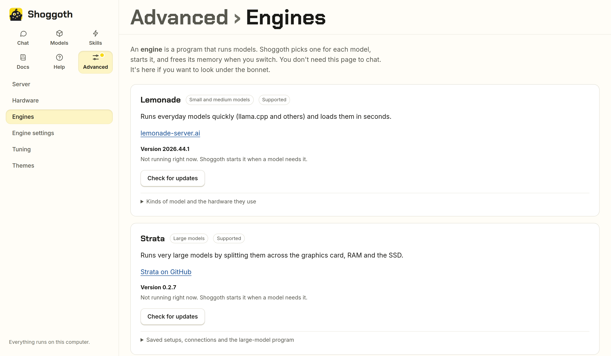

*Advanced > Engines, where updates and the own-server option live.*

**Check and update everything** on the Engines page looks for newer versions of Shoggoth, Lemonade, Pi and Strata (if you use it). It checks each download against its published checksum and installs what it finds.

A new Shoggoth is saved as a new AppImage next to the current one, which Shoggoth keeps. **Restart Shoggoth to finish** switches over to it.

The sections below cover Lemonade and Pi on their own.

### Lemonade

The AppImage ships with a recent Lemonade. Lemonade moves quickly, so Shoggoth can update its own copy without a new Shoggoth.

- On Lemonade's card under **Advanced > Engines**, press **Check for updates**. If a newer stable release exists, one button downloads it. Shoggoth checks it against the checksum GitHub publishes for that file, installs it, and offers to restart Lemonade on the new version.
- Shoggoth can also look for an update when it opens, and put a dot on **Advanced** if there is one. A checkbox switches this off.
- Updates are kept in your own data folder, because the AppImage itself is read-only. The version that came with Shoggoth is never touched, so **Go back to the version that came with Shoggoth** is always one click away.

### Pi, the agent helper

Pi lets a model read files, make edits and run steps. It updates separately, from **The agent helper** under **Advanced > Engines**. **Check and update everything** includes it.

- Press **Check for Pi updates**. If a newer release exists, one button downloads it from the npm registry. Shoggoth checks it against the checksum npm publishes, unpacks it, and starts it once to make sure it works with Shoggoth. Shoggoth only offers a Pi that passes. Otherwise it installs nothing.
- Your next message uses the new Pi. A task that is running right now finishes on the old one.
- Downloads live in your own data folder. The Pi that came with Shoggoth is never touched, so **Go back to the version that came with Shoggoth** is always one click away.
- Shoggoth only offers updates within the same major version of Pi, because that is what it was tested with. A release that needs a newer Node.js than the one inside Shoggoth waits for a newer Shoggoth.
- The same **Look for updates when Shoggoth opens** checkbox covers both.

## Advanced tools

Everything under **Advanced** is optional.


- **Server** lets other apps use your models (see [above](#use-your-models-in-other-apps)), with a live picture of what they ask for. The address and key are at the top. Lemonade's **activity log**, with a filter and a follow mode, is at the bottom.
- **Hardware** is a lab bench. Each machine at the back is one graphics card. Its lights show how hard it is working, and its screen names the model on it. The beaker shows memory used across all your cards. The gauge shows the hottest card. The coil sparks as the cards work harder, and the radio has a meter for each card. Below the bench is every device llama.cpp can see, with its memory, load, temperature and the processes holding it. Pick which devices to use, put them in order, and apply.
- **Engines** has one card per engine: Lemonade for small and medium models, Strata for large ones, and any you add. Each card shows:
  - what the engine is, its version, and whether it is running and who started it;
  - **Check for updates** and **Update**;
  - **Stop it**, for an engine Shoggoth started. Never one you started yourself.

  Inside each card, folded away, are the details for that engine. Lemonade's card lists every kind of model it runs (llama.cpp, Whisper.cpp, StableDiffusion.cpp and more) with the hardware each can use (CUDA, Vulkan, ROCm, CPU). You can choose or install a backend for each kind. Strata's card has your saved setups, connections to a Strata on another computer, and the installer.

  Below the cards are **The agent helper** (Pi) and **Add an engine**. To add an engine, put a folder with a `provider.yaml` file in the engines folder shown there, and press **Reload**. Shoggoth asks once before an engine you added runs a program. It lists any folder it couldn't load, with the line to fix. [docs/ENGINES.md](docs/ENGINES.md) is the guide to writing one ("Add an engine in ten minutes"). Use `Shoggoth.AppImage providers new` and `providers check` to start and test it.
- **Engine settings** edits everything in Lemonade's own configuration. It is searchable, and every value can be reset to its default.
- **Themes** changes how Shoggoth looks (see [below](#themes)).

**Advanced > Engines** is where you update everything. Its **My own server, and the first-run screen** section checks Lemonade's version, connects to a Lemonade you run yourself, and shows the first-run screen again. **Help > Run the welcome steps again** also shows the first-run screen.


*Advanced > Hardware with nothing loaded: an RTX 3080 and an RTX 4080 SUPER, with only the desktop using any memory. Load a model and the beaker fills, the lights on the cards climb and the gauge warms.*

### Using a Lemonade you already run

If you already run Lemonade Server, for example as a system service, open **Advanced > Engines > My own server, and the first-run screen** and choose **A Lemonade I already run**. Enter its address and, if needed, its API key. Shoggoth uses it instead of starting its own, and leaves the built-in copy alone. Switching back takes one click. Starting Shoggoth with `--lemonade HOST:PORT` does the same without saving anything.

Two things work differently with your own Lemonade:

- Shoggoth can't update it. Use your package manager.
- If it runs as a system service, it may not be allowed to read model files in your home folder.

## Themes

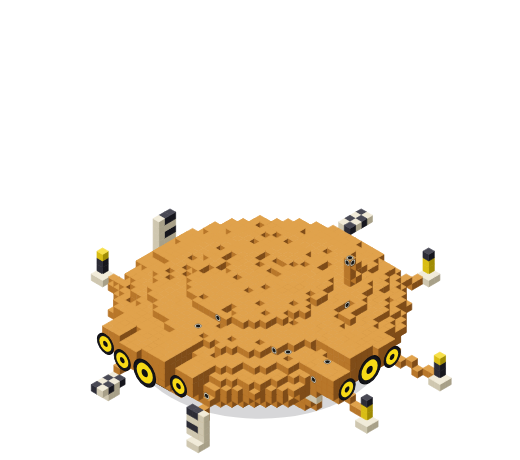

Open **Advanced > Themes** and pick one. Shoggoth remembers your choice on this computer. Only the colours and surfaces change. Every button, panel and menu stays where it was. The pictures below are the Models page in each theme.

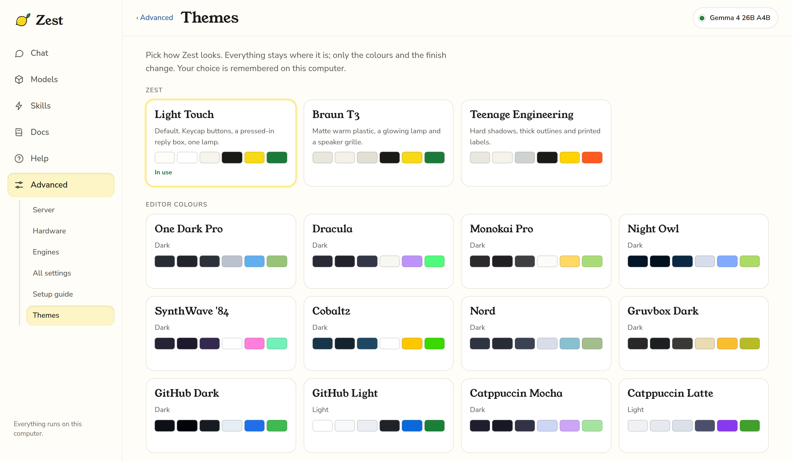

**Light Touch** is the default: a calm cream page with a little hardware about it. It has keycap buttons, a pressed-in reply box, and a small lamp that lights when a model is loaded. Two themes go further. The rest use colour schemes from popular code editors.

| | |
| --- | --- |
| 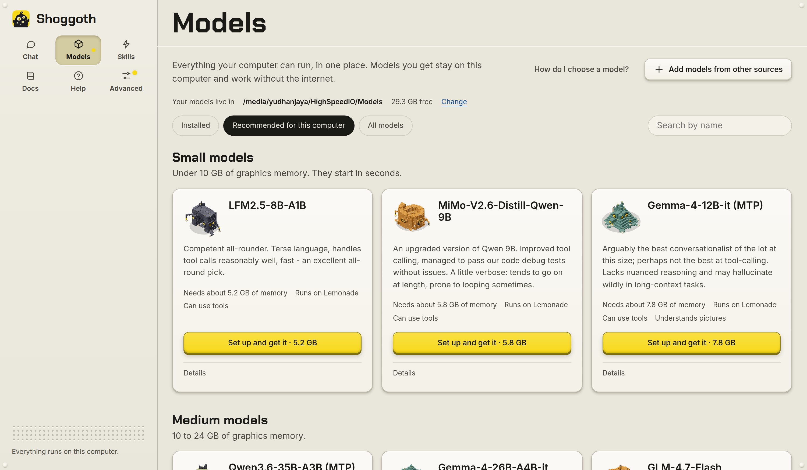 | 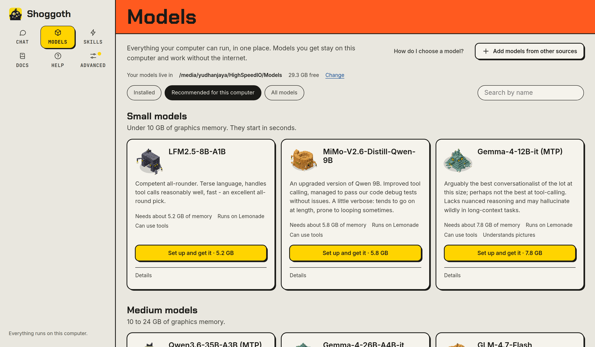 |
| **Braun T3**: matte warm plastic, a glowing lamp and a speaker grille. | **Teenage Engineering**: hard shadows, thick outlines and an orange bar. |
| 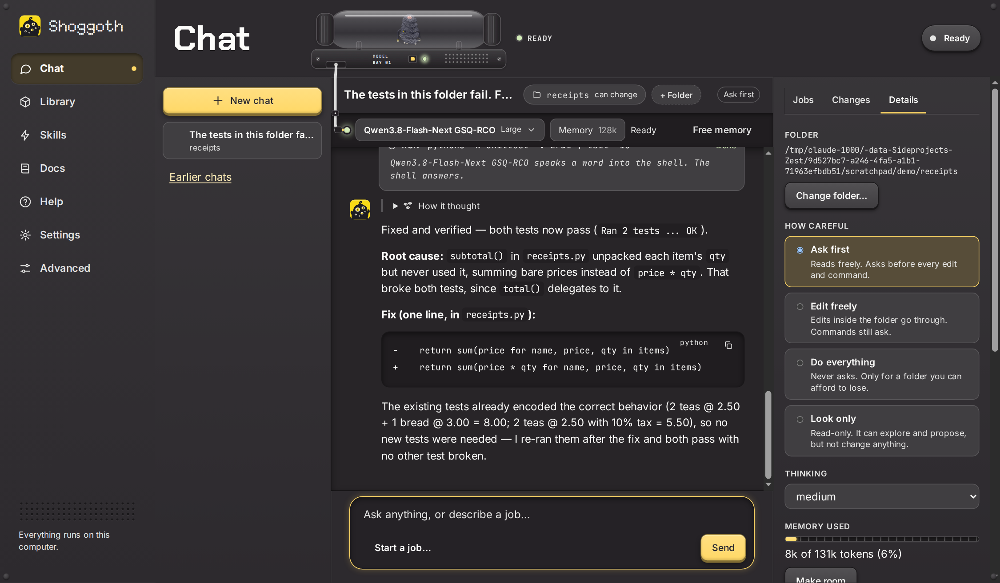 | 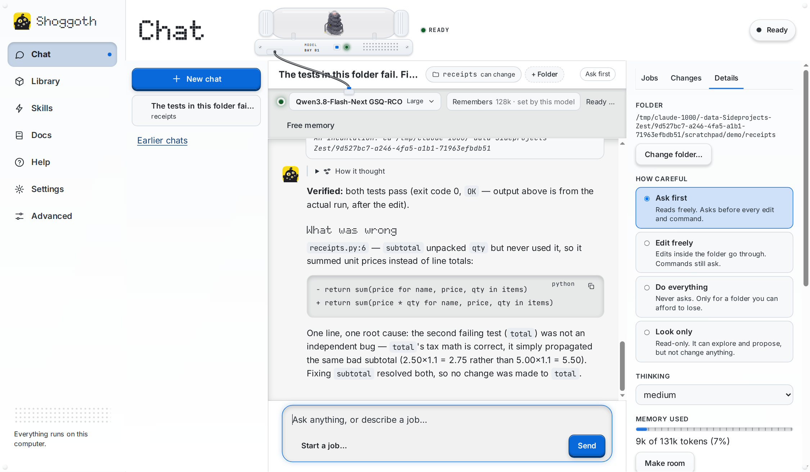 |
| **Monokai Pro**: dark and warm, with raised keys and a recessed chat. | **GitHub Light**: clean and bright, in GitHub's blue. |

The same picker has One Dark Pro, Dracula, Night Owl, SynthWave '84, Cobalt2, Nord, Gruvbox Dark, GitHub Dark, and Catppuccin Mocha and Latte.

## Your data and privacy

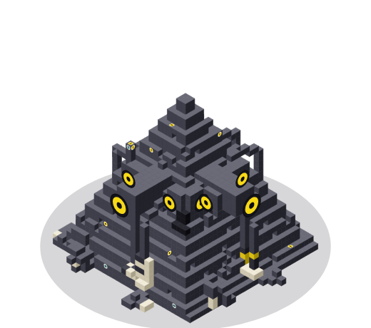


### Where Shoggoth keeps things

| What | Where |
| --- | --- |
| Shoggoth's settings, including the built-in Lemonade's API key and the key for other apps (file mode `600`) | `~/.config/shoggoth/settings.json` |
| The secret that lets a browser into Shoggoth's own page (file mode `600`) | `~/.config/shoggoth/ui-token` |
| Lemonade updates you've downloaded | `~/.local/share/shoggoth/lemonade/<version>/` |
| The built-in Lemonade's own config and the backends it installs | `~/.local/share/shoggoth/lemonade-data/` |
| Its log (shown at the bottom of Advanced > Server) | `~/.local/share/shoggoth/lemond.log` |
| Links to models you chose to bring in, and each engine's view of your Models folder | `~/.local/share/shoggoth/` (`imported-models/`, `views/`) |
| Models you download | the folder you chose (a **Models** folder with a subfolder for each engine), or the Hugging Face cache if you kept that |
| Skills you added, and which are switched on | `~/.local/share/shoggoth/skills/` |
| Newer versions of Pi that you downloaded | `~/.local/share/shoggoth/pi/<version>/` |
| Chat conversations, jobs, their transcripts, the folders Shoggoth has worked in (and the commands you always allow there), work copies of folders awaiting review, and Pi's configuration (rewritten at each start) | `~/.local/share/shoggoth/cowork/` |
| Display preferences | your browser's local storage |

Shoggoth respects `XDG_CONFIG_HOME` and `XDG_DATA_HOME`.

**Coming from Zest?** The first time Shoggoth starts, it moves `~/.config/zest` and `~/.local/share/zest` to the names above. It keeps everything in them: chats, skills, settings and keys. Apps that use a `zest-` key keep working, and Shoggoth still reads old `ZEST_*` environment variables.

To start from scratch, delete `~/.config/shoggoth` and `~/.local/share/shoggoth`. Downloaded models are not in there, unless you chose a folder inside them.

### Privacy

Nothing you type into a chat leaves your computer, with one exception you control: web search.

- The model has a web search tool. Every search asks first and shows the exact words it wants to search for. Those words, and only those, go to the search provider.
- You can switch web search off for good in the chat's **Details** panel.
- The default provider is DuckDuckGo. It needs no key, but it has no official search service, so it can refuse automated searches. Shoggoth makes one request per search and never retries. If DuckDuckGo refuses, Shoggoth suggests a free [Brave Search](https://brave.com/search/api/) or [Tavily](https://app.tavily.com/) key. You paste the key into the same panel, and Shoggoth stores it in its settings file on this computer.

Apart from search, a chat with a folder runs locally. Pi starts offline, with telemetry and update checks off, and talks only to your Lemonade. If you add your own extensions, MCP servers or web tools to Pi, those can reach the network.

Shoggoth and Lemonade contact these services:

- **html.duckduckgo.com, api.search.brave.com or api.tavily.com:** only when you let the model search the web, and only with the words of that search.
- **codeload.github.com:** only when you paste a link under Skills, to download that repository's skills.
- **registry.npmjs.org:** to look for and download Pi updates. The automatic-check switch covers it.
- **api.github.com and github.com:** to look for and download Shoggoth and Lemonade updates (you can switch off the automatic check), for Lemonade to download the backends you install, and, if you use large models, for Strata's installer and its checksum list. Strata checks for its own engine updates from its own feed.
- **Hugging Face:** your engines download the models you choose from there, and Shoggoth reads a repository's public file list when you add one by link. Gated models, which need a login, aren't supported yet.
- **Benchmark and community sites:** the links in **How do I choose a model?** open in your browser only when you click them. Shoggoth never contacts those sites itself.

## For developers

### Running from source

You need Python 3 and its standard library only. Shoggoth is developed on 3.12.

```bash
git clone https://github.com/yudhanjaya/Shoggoth.git
cd Shoggoth
python3 shoggoth/server.py
```

Diagrams in Chat need Mermaid. Run `./packaging/fetch-vendor.sh` once. It downloads 26 MB and checks it against its published checksum. The AppImage already includes Mermaid.

Chat's agent features need [Pi](https://pi.dev), which needs Node 22.19 or newer. Install it with `npm install -g @earendil-works/pi-coding-agent`, or point `SHOGGOTH_PI` at a `pi` binary. The AppImage already includes Pi and Node.

Then open <http://127.0.0.1:13306>. It opens by itself unless you pass `--no-browser`. A source checkout doesn't include Lemonade. On the first-run screen, **Download Lemonade** fetches it (about 7 MB), or you can connect to one you already run.

| Flag | Environment variable | Default | Meaning |
| --- | --- | --- | --- |
| `--port` | `SHOGGOTH_PORT` | `13306` | Port Shoggoth listens on |
| `--host` | `SHOGGOTH_HOST` | `127.0.0.1` | Address Shoggoth listens on |
| `--lemonade HOST:PORT` | `LEMONADE_API_KEY` for its key | the choice saved in Shoggoth's settings | Use this Lemonade and skip the welcome screen |
| `--no-browser` | | | Don't open a browser tab |
| `--app` | | | Quit automatically once the tab is closed (the AppImage does this) |
| (none) | `SHOGGOTH_LEMONADE_DIR` | none | A folder containing a `lemond` to use as the built-in Lemonade |

> **Security.** Shoggoth's own page can change settings, start engines and run commands in a folder, so it doesn't accept everything that can reach its port.
>
> - Shoggoth keeps a secret in `~/.config/shoggoth/ui-token` (mode 600).
> - The window Shoggoth opens carries a one-time code. The code is good for two minutes, once. The server swaps it for an HttpOnly, SameSite=Strict cookie.
> - Every other request is refused with 401. A browser that hasn't been let in sees a page saying to start Shoggoth again.
> - A script can send the secret as `Authorization: Bearer <secret>`. `SHOGGOTH_AUTH=off` switches all this off, for a machine only you use.
> - Running Shoggoth a second time asks the running one for a fresh code.
> - By default it listens on `127.0.0.1` only, and refuses requests whose `Host` header isn't this computer. This defends against DNS rebinding.
> - The built-in Lemonade is private. It has its own port and a random API key that only Shoggoth knows.
> - Other apps use the separate key-protected door described above, never the page itself.
>
> Only use `--host 0.0.0.0` on a network you trust.

### How it works

Shoggoth is a small Python program with no dependencies (`shoggoth/server.py` plus a few modules) and one HTML page (`shoggoth/index.html`).

- `shoggoth/gateway.py` is the door for other apps and the request recorder. Both it and Shoggoth's own chat forward requests through one function. That function streams the answer back untouched, and notes whether the model is waiting, thinking (`reasoning_content`, or text inside `<think>` tags) or writing.
- `shoggoth/agent.py` runs Pi (`pi --mode rpc`, one process per task) against Lemonade through Shoggoth's own `/api/v1` proxy. It relays Pi's JSON events to the page as server-sent events. `shoggoth/pi/zest-gate.js` is the Pi extension that makes Pi ask before it edits or runs commands. It keeps its old name so existing setups find it. Details are in [docs/COWORK.md](docs/COWORK.md).
- `shoggoth/hf.py` reads a Hugging Face repository's file list and groups the GGUF files by quantisation.
- `/api/*` passes straight through to Lemonade, so the page needs no CORS changes. Chat uses the OpenAI-compatible `/api/v1/chat/completions` stream. Model downloads use Lemonade's background download jobs.
- Everything Shoggoth changes in Lemonade goes through Lemonade's own HTTP API: `/internal/config` and `/internal/set` for settings, `/v1/models/{id}/options` for per-model options, and `/v1/install` for backends. Shoggoth doesn't need the `lemonade` command-line tool.
- The built-in Lemonade is the project's official "embeddable" build. Shoggoth starts it as `lemond <data folder> --port … --no-broadcast`, with a random `LEMONADE_API_KEY`. If a previous Shoggoth left one running, the new Shoggoth reuses it instead of starting a second.
- Device order matters. llama.cpp numbers devices differently from `nvidia-smi`: CUDA puts the fastest card first. Shoggoth asks the llama.cpp binary for its own list, so the names and IDs line up.
- Live GPU numbers come from `nvidia-smi` for NVIDIA cards, and from the Linux `amdgpu` driver's sysfs files for AMD cards: VRAM used and total, load, temperature, power, fan, and which processes hold memory. The log is Lemonade's own output, or `journalctl -u lemond` for a system service.

### Good to know

- **Live telemetry covers NVIDIA and AMD, on Linux.** Intel devices are listed and selectable, but show capacity without live usage, and the fit meter treats them as empty. The AMD numbers come from the kernel, so they need no extra tools. They have only been tested against a simulated amdgpu sysfs tree and a screenshot from a two-Radeon VII machine, not on AMD hardware here. Two identical AMD cards are matched to llama.cpp's devices by order, so their usage can appear swapped.
- **Shoggoth hands a Hugging Face download to Lemonade as a custom model:** `user.<name>-<quant>`, with the checkpoint `org/repo:QUANT` and the `llamacpp` recipe. Check this against your Lemonade version, because this part of its API has changed before.
- **The Hardware page shows process names.** They come from `nvidia-smi` or the amdgpu driver (the name only, not the full path), and only your own browser displays them.
- **Devices appear once a backend is installed,** because Shoggoth asks llama.cpp itself for the list rather than guessing.
- **Testing so far:** Linux with NVIDIA GPUs. The Vulkan and ROCm paths follow Lemonade's own backend data, but haven't run on real hardware yet. Reports are welcome.

### Adding an engine

An engine is one folder with one `provider.yaml`, plus a `provider.py` only when YAML can't describe it. Nothing in Shoggoth's own code needs to change to add one.

- `shoggoth/providers/_template/` is the annotated starting point.
- `shoggoth/providers/_examples/llama-server/` is a complete YAML-only engine around a plain `llama-server`, tested end to end with a real one.
- [docs/ENGINES.md](docs/ENGINES.md) explains every setting.
- `python3 shoggoth/server.py providers check <folder>` validates a folder the way Shoggoth itself reads it.
- `providers new <id> [--from llama-server]` creates a new engine folder, and `providers list` lists them.
- `providers doctor` asks the installed Lemonade and Strata the questions Shoggoth asks, and says if their answers have changed. Run it before a release.

### Building the AppImage

```bash
./packaging/build-appimage.sh
```

The script downloads a relocatable Python, Node.js, the Pi agent, Lemonade's official embeddable build and `appimagetool`, all pinned by SHA-256. It assembles the image and writes `dist/Shoggoth-<version>-x86_64.AppImage` plus a checksum. To bundle a newer Lemonade, change the version and checksum at the top of the script.

Pushing a tag that starts with `v` runs the same script in GitHub Actions and attaches the result to the release, along with a `Zest-` named copy so Zest 3.x installs can update themselves.

To cut a release, bump `VERSION` in `shoggoth/server.py`, then run `git tag vX.Y.Z && git push --tags`.

## Shoggoth is built on

- **[Pi](https://github.com/earendil-works/pi)** (MIT), bundled unmodified in the AppImage. Its licence is included alongside it.
- **[Lemonade](https://github.com/lemonade-sdk/lemonade)** (Apache-2.0), bundled unmodified in the AppImage. Its licence is included alongside it.
- **[llama.cpp](https://github.com/ggml-org/llama.cpp)** (MIT) and the other backends, which Lemonade downloads when you install them.
- **[Chakra Petch](https://github.com/m4rc1e/Chakra-Petch), [Doto](https://github.com/oliverlalan/Doto), [Inter](https://rsms.me/inter/) and [JetBrains Mono](https://www.jetbrains.com/lp/mono/)** (SIL Open Font License), embedded in the page. Their licences are in `docs/plans/assets/fonts` and ship in the AppImage.
- **[Python](https://www.python.org)** (PSF licence), via a relocatable build from [python-build-standalone](https://github.com/astral-sh/python-build-standalone), bundled so the AppImage needs no system Python.

## License

Shoggoth is [MIT](LICENSE) licensed.
