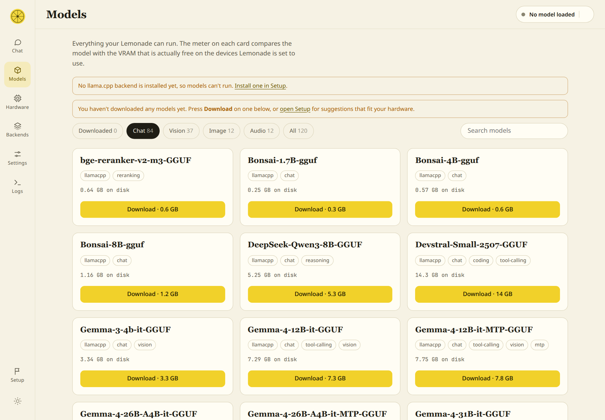

# Zest

**Run AI models on your own computer, with one download.** Zest is a friendly console for [Lemonade](https://lemonade-server.ai), the open-source engine that runs language models locally. The Zest AppImage **includes Lemonade**, so there is nothing to install first: open it, follow the short welcome screen, and you're chatting with a model that never leaves your machine.


## Getting started

1. **Download** `Zest-<version>-x86_64.AppImage` from the [latest release](../../releases/latest).
2. **Run it:**

   ```bash
   chmod +x Zest-*-x86_64.AppImage
   ./Zest-*-x86_64.AppImage
   ```

3. **Follow the welcome screen.** It opens in your browser and walks you through four steps, showing what's done and what's next:

   | Step | What happens |
   | --- | --- |
   | **Engine** | Zest starts its own private copy of Lemonade. You can update it from here with one click. |
   | **Backend** | Lemonade downloads the program that suits your hardware (CUDA for NVIDIA, Vulkan for most cards, CPU as a fallback). One button. |
   | **Models** | Keep models in the standard Hugging Face cache or any folder you choose, bring in models you already have (LM Studio, Ollama, llama.cpp and others are found for you), or download one with live progress. |
   | **Chat** | Pick a model, press a button, start talking. |


The welcome screen is also the **Setup** page, reachable any time from the bottom of the left-hand menu. That is where you update Lemonade, add a backend, or change where models live.

### Requirements

- **Linux, x86_64.** The built-in Lemonade needs a reasonably recent system (glibc 2.38 or newer: Ubuntu 24.04, Debian 13, Fedora 39 or later). On an older system Zest tells you so and you can connect it to a Lemonade you install yourself instead.
- A few common system libraries that almost every desktop Linux already has (OpenSSL 3, zstd, libdrm). If one is missing, Zest names it.
- For GPU use, your graphics driver. Zest and Lemonade download everything else.
- Internet access for the first-run downloads (the backend and your models).

If your system has no FUSE support, run `./Zest-*-x86_64.AppImage --appimage-extract-and-run` instead. Closing the browser tab quits Zest (and its Lemonade) after about three minutes; launching it again while it's running just reopens the page.

## Keeping Lemonade up to date

The AppImage ships with a recent Lemonade, but Lemonade moves quickly, so Zest can update its own copy without you downloading a new Zest.

- Press **Check for Lemonade updates** on the Setup page. If a newer stable release exists, one button downloads it, **checks it against the checksum GitHub publishes for that file**, installs it and offers to restart Lemonade onto it.
- Zest can also look for an update when it opens and put a dot on **Setup** if there is one. You can switch that off with the checkbox.
- Updates are kept in your own data folder, because the AppImage itself is read-only. The version that came with Zest is never touched, so **"Go back to the version that came with Zest"** is always one click away.
- Updating Zest itself is just downloading a newer AppImage.

## Models

Lemonade handles models; Zest gives you the choices:

- **Where they live.** The default is the **Hugging Face cache** (`~/.cache/huggingface/hub`, or wherever `HF_HOME` points), so downloads are shared with other AI tools. Or choose **any folder** as the place new downloads go.
- **Models you already have.** **Look on this computer** checks the usual places (LM Studio, llama.cpp's cache, GPT4All, Jan, Ollama, `~/models`, `~/Downloads`) and lists what it finds. Tick what you want, or add any folder yourself. **Nothing is copied**: Zest gives Lemonade a folder of links to your files, so there's no extra disk use and your originals stay where they are.
- **Downloading.** Press **Download** on any model. It runs in the background with a progress bar, and you can keep using Zest. Zest's suggestions are the models that fit your hardware's free memory.

## Features

- **Chat** with streaming replies, markdown and code blocks with copy buttons, collapsible reasoning for "thinking" models, and tokens-per-second and time-to-first-token on every answer. Conversations are kept in your browser.
- **Models** shows everything Lemonade can run. Each card has a fit meter that compares the model with the VRAM that is actually *free* on the devices Lemonade is set to use, so you can tell *before* loading whether it will fit, spill into system RAM, or fail because another program is holding the memory.
- **Per-model options, no flags to memorise.** Every card has an **Options** button: context window, backend, devices and memory settings, plus tick boxes, dropdowns and number fields (each with a plain-English explanation) for the things you'd otherwise pass to `llama-server` as flags, such as flash attention, cache precision, keeping expert layers in system RAM, GPU splitting, thinking, and speculative decoding. Zest builds the arguments for you and shows exactly what it will pass. The full list of options your `llama-server` supports is searchable underneath, and a free-text box covers anything else. Everything is checked against your own `llama-server` before you load, so a typo or a vLLM-only flag is caught up front instead of failing the load.
- **Settings** edits everything in Lemonade's own configuration (storage folders, eviction, logging, engine arguments and more), searchable, with a reset-to-default for every value.
- **Hardware** shows every device llama.cpp can see as a live VRAM tank with utilisation, temperature, power, a short history, and which processes are holding its memory. **Pick which devices to use and put them in order**, then apply.
- **Backends** lists every Lemonade engine (llama.cpp, Whisper.cpp, StableDiffusion.cpp and more) with the backends each supports (CUDA, Vulkan, ROCm, CPU…). Choose one per engine, or install and update missing ones.
- **Logs** tails the Lemonade log with a filter and follow mode.
- Light and dark themes, keyboard-friendly, works on a phone-width screen.

## Screenshots

### Models
Models you haven't downloaded yet have a **Download** button with the size. The meter on each card shows what will fit in the VRAM that's free right now; if another program is using the card, Zest warns you and names it.




### Chat
Streaming answers with speed stats, a model picker, and per-chat settings.


### Model options
Set the context window, backend and devices for one model, and tune `llama-server` with tick boxes and dropdowns instead of flags. Highlighted rows are the ones you've changed. Zest shows the exact arguments it will pass, warns when one isn't understood by your `llama-server` (for example a vLLM-only flag), and offers **Save and reload** for a model that's already running.


### Settings
Lemonade's global configuration, searchable and saved as you edit.


### Hardware
Select GPUs and set their order. The first device is the primary one. Each card shows how much VRAM is free and which processes are using it (here, Lemonade running a model split across both cards). Nothing changes until you press **Apply**.


### Backends
Pick a backend per engine, or install the ones you're missing.


### Logs


*Screenshots were taken on a machine with an RTX 3060 and an RTX 4080 SUPER. Zest shows whatever devices your machine has.*

## Using a Lemonade you already run

Already have Lemonade Server installed (for example as a system service)? On the Setup page choose **A Lemonade I already run**, enter its address and, if needed, its API key. Zest will use it instead of starting its own, and won't touch the built-in copy. Switching back later is one click. Starting Zest with `--lemonade HOST:PORT` does the same without saving anything.

A few things work differently with a Lemonade you run yourself: Zest can't update it (use your package manager), and if it runs as a system service it may not be allowed to read model files in your home folder.

## Running from source

Python 3, standard library only (developed on 3.12):

```bash
git clone https://github.com/yudhanjaya/Zest.git
cd Zest
python3 zest/server.py
```

Then open <http://127.0.0.1:13306> (it opens automatically unless you pass `--no-browser`). A source checkout doesn't include Lemonade: on the Setup page, **Download Lemonade** fetches it (about 7 MB), or you can connect to one you already run.

| Flag | Environment variable | Default | Meaning |
| --- | --- | --- | --- |
| `--port` | `ZEST_PORT` | `13306` | Port Zest listens on |
| `--host` | `ZEST_HOST` | `127.0.0.1` | Address Zest listens on |
| `--lemonade HOST:PORT` | `LEMONADE_API_KEY` for its key | the choice saved in Zest's settings | Use this Lemonade and skip the welcome screen |
| `--no-browser` | | | Don't open a browser tab |
| `--app` | | | Quit automatically once the tab is closed (the AppImage does this) |
| (none) | `ZEST_LEMONADE_DIR` | none | A folder containing a `lemond` to use as the built-in Lemonade |

> **Security.** Zest has no login of its own and can change Lemonade's configuration, so it listens on `127.0.0.1` only by default and refuses requests whose `Host` header isn't this computer (a defence against DNS-rebinding). Its built-in Lemonade is private: its own port, protected by a random API key that only Zest knows. Only use `--host 0.0.0.0` on a network you trust.

## Where Zest keeps things

| What | Where |
| --- | --- |
| Zest's settings, including the built-in Lemonade's API key (file mode `600`) | `~/.config/zest/settings.json` |
| Lemonade updates you've downloaded | `~/.local/share/zest/lemonade/<version>/` |
| The built-in Lemonade's own config and the backends it installs | `~/.local/share/zest/lemonade-data/` |
| Its log (shown on the Logs page) | `~/.local/share/zest/lemond.log` |
| Links to models you chose to bring in | `~/.local/share/zest/imported-models/` |
| Models you download | the Hugging Face cache, or the folder you chose |
| Chats and display preferences | your browser's local storage |

(`XDG_CONFIG_HOME` and `XDG_DATA_HOME` are respected.) To start from scratch, delete `~/.config/zest` and `~/.local/share/zest`. Downloaded models are not in there unless you chose a folder inside it.

## What uses the network

Nothing you type into a chat leaves your computer. Zest and Lemonade do contact these, only when you ask or enable it:

- **api.github.com and github.com**: looking for and downloading Lemonade updates (the automatic check can be switched off), and Lemonade downloading the backends you install.
- **Hugging Face**: Lemonade downloading the models you choose.

## How it works

Zest is a small Python program with no dependencies (`zest/server.py` plus a few modules) and one HTML page (`zest/index.html`).

- `/api/*` is passed straight through to Lemonade, so the page needs no CORS changes. Chat uses the OpenAI-compatible `/api/v1/chat/completions` stream, and model downloads use Lemonade's background download jobs.
- Everything Zest changes in Lemonade goes through Lemonade's own HTTP API: `/internal/config` and `/internal/set` for settings, `/v1/models/{id}/options` for per-model options, `/v1/install` for backends. Zest does not need the `lemonade` command-line tool.
- The built-in Lemonade is the project's official "embeddable" build, started as `lemond <data folder> --port … --no-broadcast` with a random `LEMONADE_API_KEY`. If a previous Zest left one running, the new Zest reuses it instead of starting a second.
- Device order matters: llama.cpp numbers devices differently from `nvidia-smi` (CUDA puts the fastest card first). Zest asks the llama.cpp binary for its own list so the names and IDs line up.
- Live GPU numbers come from `nvidia-smi`. The log is Lemonade's own output (or `journalctl -u lemond` for a system service).

### Good to know

- **Telemetry is NVIDIA-only for now.** AMD and Intel devices are listed and selectable, but show capacity without live usage, and the fit meter treats them as empty.
- **Process names are shown on the Hardware page.** They come from `nvidia-smi` (name only, not the full path) and are only displayed in your own browser.
- **Devices appear once a backend is installed**, because Zest asks llama.cpp itself for the list rather than guessing.
- Tested on Linux with NVIDIA GPUs. The Vulkan and ROCm paths follow Lemonade's own backend data but haven't been tried on real hardware yet. Reports welcome.

## Building the AppImage

```bash
./packaging/build-appimage.sh
```

This downloads a relocatable Python, Lemonade's official embeddable build, and `appimagetool` (all pinned by SHA-256), assembles the image and writes `dist/Zest-<version>-x86_64.AppImage` plus a checksum. To bundle a newer Lemonade, change the version and checksum at the top of the script. Pushing a tag that starts with `v` runs the same script in GitHub Actions and attaches the result to the release.

To cut a release: bump `VERSION` in `zest/server.py`, then `git tag vX.Y.Z && git push --tags`.

## Third-party software

- **[Lemonade](https://github.com/lemonade-sdk/lemonade)** (Apache-2.0, © AMD and contributors) is bundled unmodified in the AppImage; its licence is included alongside it.
- **llama.cpp** (MIT) and the other backends are downloaded by Lemonade when you install them, not bundled.
- **[Python](https://www.python.org)** (PSF licence), via a relocatable build from [python-build-standalone](https://github.com/astral-sh/python-build-standalone), is bundled so the AppImage needs no system Python.

## License

Zest is [MIT](LICENSE) licensed.
