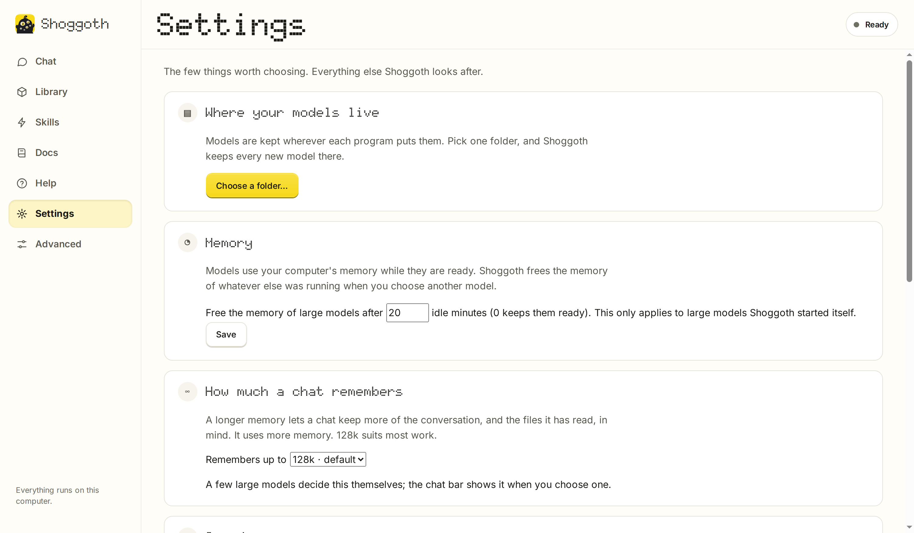

# Zest

[](https://github.com/yudhanjaya/Zest/releases)
[](https://github.com/yudhanjaya/Zest/releases)
[](https://github.com/yudhanjaya/Zest/actions/workflows/release.yml)
[](LICENSE)


[](https://github.com/yudhanjaya/Zest/commits/main)
[](https://github.com/yudhanjaya/Zest/issues)
[](https://github.com/yudhanjaya/Zest)

**Run AI models on your own computer, and put them to work, with one download.** Zest is a friendly interface for open-source engines that run language models locally ([Lemonade](https://lemonade-server.ai) for small and medium models, [Strata](https://github.com/Niko1221/Strata) for very large ones) and for [Pi](https://pi.dev), a coding-agent harness. You never have to choose an engine: Zest picks and starts the right one for the model you choose. The Zest AppImage **includes Lemonade and Pi**, and sets up Strata the first time you want a large model. Linux-only for now.

The idea is to provide a user interface that people who aren't necessarily steeped in technical know-how can still navigate to get open-weights models running on their own hardware, and then do real work with them: chat, draw diagrams, write documents, or let a model read and change the files in a folder while they watch. Download Zest, and you're good to go.


*Chat, working in a folder: it read the code, fixed a bug with a one-line change (shown as a diff) and ran the tests again, step by step.*

**Contents:** [What you can do](#what-you-can-do-with-zest) · [Install and run](#install-and-run) · [Finding your way around](#finding-your-way-around) · [Your first conversation](#your-first-conversation) · [Choosing and managing models](#choosing-and-managing-models) · [Skills](#skills) · [Use your models in other apps](#use-your-models-in-other-apps) · [Keeping everything up to date](#keeping-everything-up-to-date) · [Advanced tools](#advanced-tools) · [Themes](#themes) · [Your data and privacy](#your-data-and-privacy) · [For developers](#for-developers)

## What you can do with Zest

- **Chat with an AI that runs on your own computer.** Nothing you type leaves it, unless you let the model search the web: it asks first, every time.
- **Let it work on your files.** Choose a folder and the model can read, search, edit and run things there while you watch. It asks before it changes anything.
- **Hand it a bigger job.** A job keeps working in the background, round after round, and checks its own progress. You review what it changed before anything touches your folder.
- **Draw diagrams and write documents.** Ask for a picture or a README and get one, shown right in the chat.
- **Teach it new tricks with skills.** Short instruction sheets that make small models far more dependable. Add more by pasting a link.
- **Pick and manage models.** Zest tells you which ones will run comfortably on your computer and downloads them for you.
- **Make it look the way you like.** Fifteen themes, from soft plastic to Dracula and Nord, under **Advanced > Themes**.
- **Use your models in other apps.** Zest can share them with tools such as opencode or any app that talks to an OpenAI-style server.

Zest runs on Linux. It needs no technical setup: you download one file and follow a few short steps. The **Docs** tab inside the app explains everything in plain language (its text lives in [zest/docs.md](zest/docs.md)).

## Install and run

1. **Download** `Zest-<version>-x86_64.AppImage` from the [latest release](../../releases/latest).
2. **Run it:**

   ```bash
   chmod +x Zest-*-x86_64.AppImage
   ./Zest-*-x86_64.AppImage
   ```

3. **Let Zest get ready.** Zest opens in your browser on one screen called **Getting ready**. It asks one question and does the rest itself:

   - **Where should your models live?** Models are big, so Zest lists your disks with their free space, preselects the one with the most room, and one click accepts it. Zest keeps everything in one folder called Models there. If you already have models or an engine running, Zest finds them and skips the question.
   - **Then it works down a short checklist by itself:** it looks at your computer, gets the part that runs AI (a small download, with progress), and fits it to your graphics card (CUDA for NVIDIA, Vulkan for most cards, the processor as a fallback).
   - **Choose your first model.** One suggestion per size: **Small** (LFM2.5 8B A1B: fast, to the point, good with tools, happy on almost any computer), **Medium** (Qwen3.6 35B A3B MTP or Gemma 4 26B A4B, the general pick and the recommended one when it fits) and **Large** (for big computers; it takes a couple of minutes to start). Press **Get it** on one; the download shows its progress right there. **I already have models** brings in the ones you have.
   - **Start chatting.** The button names the model it will use. The model works in your home folder unless you choose another folder.

   

*The first-run screen ends with a button that opens the chat.*

People who already have models, or run their own Lemonade or Strata, can skip the first-run screen: Zest finds what is already there. **Settings** holds the few choices (where models live, how long big models stay in memory, how much a chat remembers, updates), the Library's **Add models** brings in models you already have (LM Studio, Ollama, llama.cpp and others are found for you), and **Settings > My own server** connects a Lemonade you run yourself.

### What you need

- **Linux, x86_64.** The built-in Lemonade needs a reasonably recent system (glibc 2.38 or newer: Ubuntu 24.04, Debian 13, Fedora 39 or later). On an older system Zest tells you so and you can connect it to a Lemonade you install yourself instead.
- A few common system libraries that almost every desktop Linux already has (OpenSSL 3, zstd, libdrm). If one is missing, Zest names it.
- For GPU use, your graphics driver. Zest and Lemonade download everything else.
- Internet access for the first-run downloads (the backend and your models).

If your system has no FUSE support, run `./Zest-*-x86_64.AppImage --appimage-extract-and-run` instead. Closing the browser tab quits Zest (and its Lemonade) after about three minutes; launching it again while it's running just reopens the page.

## Finding your way around

The left-hand menu has seven places. Everything a newcomer needs is in the first six; everything technical sits behind **Advanced**, and so does the choice of theme.

| Menu item | What it is for |
| --- | --- |
| **Chat** | Talk to a model, or choose a folder and let it work on your files. |
| **Library** | Every model on your computer in one list, grouped Small, Medium and Large, with the ones that will run well recommended. Get new ones, add ones you have, change a model's settings. |
| **Skills** | Switch skills on and off, and add more from a GitHub link. |
| **Docs** | A plain-language guide to all of this, inside the app. |
| **Help** | Short answers to common questions, and a button to see the first-run screen again. |
| **Settings** | Where your models live, how long large models stay in memory, how much a chat remembers, a link to tuning, and one button to update everything. |
| **Advanced** | Server, Hardware, Engines, Engine settings, Tuning and Themes. You never need these just to chat. |


*The menu on the left, with the Docs tab open.*

## Your first conversation

Open **Chat** and type. The bar under the title shows which model will answer and whether it is in memory. If it isn't, Zest loads it when you send your first message, so that answer takes a little longer.

**Chat** runs on [Pi](https://pi.dev), a coding-agent harness that ships inside Zest. Every chat is a co-working session: the model reads, searches, edits and runs commands (it has a terminal) in a folder while you watch. Pick the folder, or leave it and it works in your home folder, and says so at the top of the chat; there it starts on **Ask first**, and jobs need a project folder. It answers questions like a normal chat too, and asks before it changes anything (tool cards show each step; edits show a diff). Choose how careful it is per chat (**Ask first**, **Edit freely**, **Do everything**, **Look only**), add more folders it can look at or change, switch models, watch how much of the context window is used, and add notes while it works.

For bigger work, press **Start a job…**. Say what should get done and how Zest can tell it is done, such as a test command that passes. The job runs in the background, round after round, and stops when the check passes, when it hits its round or time limit, or when it stops making progress. By default it works on a copy of your folder; the **Changes** tab shows what it changed and you apply what you want. Jobs are listed under their chat, and you can keep chatting while they work. Chats and jobs are saved and pick up where they left off. See [docs/COWORK.md](docs/COWORK.md).

### Chat

Replies stream in as they are written. The bar under the title shows which model answers, how much context it has (128k by default) and whether it is in memory, with **Load**, **Unload** and **Reload**. A reasoning model's thinking appears live above its answer and folds away when it is done. Markdown and code blocks come with copy buttons, and a small strip shows what the model is doing: 📖 reading, 🤔 thinking, ✍️ writing, 🛠️ working.


### Working in a folder

Every chat works in a folder (your home folder unless you choose one) and can read, search, edit and run things there. Tool cards show each step, edits show a diff, and in **Ask first** and **Edit freely** modes it stops and asks before it runs a command. Here it was asked to fix a folder whose tests were failing: it read the tests and the code, made a one-line change and ran the tests again to confirm.


## Choosing and managing models

The **Library** is one list of every model on your computer, whichever engine runs it, and the place you get new ones. You don't pick an engine: Zest runs small and medium models on [Lemonade](https://lemonade-server.ai) and large ones on [Strata](https://github.com/Niko1221/Strata), starts whichever the model you chose needs, and frees the memory of whatever else was running. The engine's name sits, small, at the foot of each card.


**Installed** lists what you have, grouped by size: **Small** (under 10 GB of graphics memory, ready in seconds), **Medium** (10 to 24 GB) and **Large** (for computers with about 64 GB of RAM; they take a couple of minutes to start). **Recommended for this computer** leads with the models I've tested and recommend, plus any Large model that fits. **Everything** is the full list, with a filter for pictures, speech and sound. Each card shows whether the model fits in the memory that is *free* on your graphics cards right now; if another program is using it, Zest says so and names it.

**Getting models**

- **Get it** downloads a model in the background with a progress bar, and you can keep using Zest. Downloads share one "Getting models" strip. A model that needs something extra, such as the first Large model, sets it up for you as part of the same step.
- **Add models** brings in models from a Hugging Face link (a repository's GGUF versions are listed with their sizes and a plain label such as "A good balance"), from any folder, or from the usual places other programs keep them (LM Studio, llama.cpp's cache, GPT4All, Jan, Ollama, `~/models`, `~/Downloads`). **Nothing is copied.** Zest gives each engine a folder of links to your files, so there's no extra disk use and your originals stay where they are.
- **Where they live.** You choose one folder, once (**Settings**, or the first-run screen). Zest keeps new models there, in a **Models** folder with a subfolder for each engine, and moves nothing you already have.
- When an engine refuses a model (its architecture isn't supported yet, it needs a login, it can't be found, or memory or disk is short), Zest shows a plain-language message with the technical details tucked underneath.

**Choosing the right one**

- **How do I choose a model?** A button in the Library (and an entry in Help) explains how to pick: will it fit, what is it for, how much it needs to remember. It links to places to compare and learn about models: Luke's Dev Lab, Artificial Analysis, LMArena, Aider, the Berkeley Function-Calling Leaderboard, SWE-bench, LiveBench, BenchLM, LLM Stats, r/LocalLLaMA and the Level1Techs forum.
- **Start here: LFM2.5 8B A1B.** Very fast, runs on almost anything, calls tools well, and keeps answers short.
- **My general pick: Qwen3.6 35B A3B MTP.** Fast and competent at everyday tasks, research and agent work.
- **If Qwen 3.6 won't run: GLM 4.7 Flash.** Fast, but it makes things up, so it comes with a warning.
- **Bigger and slower, dense models: Gemma 4 31B MTP and Qwen3.8 27B.** Good answers, but slow.
- **Large:** with a GPU and 64 GB of RAM, the Large group runs models far bigger than your graphics card.
- **Make any model better:** OpenChamber as the app I recommend, and obra/superpowers for skills.

**Loading and unloading**

- **Load, unload and reload live in the chat.** A bar under the chat's title shows the model, the context size and whether the model is in memory, with **Load**, **Unload** and **Reload**. Pick a different model there and Zest gets it ready and frees the previous one's memory. Sending a message to a model that isn't in memory loads it for you.
- **Context window: 128k by default.** Chat loads a model with a 128k (131,072-token) context window, a good threshold for usefulness in long chats and agentic work. The context menu in the chat's model bar changes it, and **Settings** has a default for every chat. A bigger window needs more graphics memory.
- **Delete from this computer** is under **Details** on a card. It asks first, says how much disk it frees, and unloads the model if it is running. You can download it again later.

### Settings for one model

Press **Settings** on any downloaded card. Set the backend and devices, and tune `llama-server` with tick boxes and dropdowns instead of flags. Rows you have changed are highlighted, the exact arguments Zest will pass are shown, and anything your `llama-server` does not understand is flagged. **Save** keeps it; for a model that is in memory, press **Reload** in the chat's model bar to use the new settings.


### Large models (experimental)

Some models are far too big for a graphics card. Zest runs them anyway, through [Strata](https://github.com/Niko1221/Strata), which keeps part of the model in RAM and on the SSD. They are slower than a model that fits, and need a lot of RAM and disk.

- **You use them like any other model.** Zest suggests the best Large model that fits your RAM, graphics memory and free disk. **Get it** downloads it and, the first time, sets up Strata for you: it downloads Strata's installer, checks it against the checksum Strata publishes, runs it and saves a setup for the model with a 128k context window (DeepSeek V4.1 is fixed at 8K). Pick the model in Chat and a card shows it starting.
- **Memory is shared.** Only one big model runs at a time. Picking one frees whatever else was running; picking a small one frees the big one, unless it is answering right now. Before a big model starts, Zest checks there is enough free memory and, if not, says how much is missing and which programs are using the most (with a **Start anyway** button).
- **It frees itself** after 20 idle minutes (change it under **Memory** in **Settings**, or set 0 to keep it ready). The next chat starts it again.
- **Existing Strata installs are found by themselves.** If you already have Strata installed, or a model running (started with `strata launch`, by the Strata app, or by hand on a local port), its models show up in the Library and in Chat with no setup. To use a Strata on another computer, open **Advanced > Engines**, then Strata's card, then **Connect to a Strata on another computer**. Zest never stops, restarts or updates a Strata you started yourself, and has a **Stop** button (with a confirmation) only when you ask for one. While one of yours is running, Zest won't start a second big model beside it.
- **Updates.** Strata's engine and Control update from its own signed feed, and Strata test-starts a new engine before switching to it. **Check and update everything** in Settings includes Strata. If the Strata Zest started is running, Zest stops it, updates, and it starts again when a chat needs it. A bigger jump (a new Control series) is left for you to take with `strata update`.

### Tuning

**Advanced > Tuning** makes a model answer faster on your computer. It measures the model as it is, tries changes one at a time, and keeps only those that clearly help. Answers stay the same: tuning never changes how a model is compressed.

- **Large models** are tuned by Strata's own tuner (`strata tune auto`), quick (about 20 minutes) or thorough (up to 2 hours), for chat or for coding with long prompts. The result is saved and used every time the model starts. **Switch off** keeps it but goes back to the standard settings.
- **Small and medium models** that run on llama.cpp are tuned by Zest: batch sizes, flash attention, threads, which backend and which graphics cards. Each is tried by loading the model with it, and a change is kept only if it beats the measuring noise (and at least 3%). **Undo** puts the old settings back.
- Tuning needs the graphics cards to itself, so Zest shows the plan first (time, and what it will stop) and waits for your go-ahead. It stops what Zest started and waits while a chat is answering. It will not start while a Strata you started yourself is running. You can cancel at any time and nothing is changed.

## Skills

**Skills** are short instruction sheets the model reads when a job calls for them. Zest comes with Superpowers (a trimmed copy of [obra/superpowers](https://github.com/obra/superpowers): ask what you really want, plan, test first, find a bug's cause before fixing it, prove it works before saying so), a diagrams skill (the model writes Mermaid and Zest draws it in the chat, with Copy and Save as image; if it doesn't draw, one button asks the model to fix it) and a markdown-writing skill. **To add more, open Skills, paste a link to a GitHub repository (or to one folder in it) and press Add skills.** Any repository that follows the [Agent Skills](https://agentskills.io) format works; [Hermes Atlas](https://hermesatlas.com/ecosystem/) lists many. Switch skills on and off one by one, or by set, and type `/` in a folder conversation to pick one. Only add skills from people you trust. See [docs/COWORK.md](docs/COWORK.md).


## Use your models in other apps

**Advanced > Server** gives you an address, a key and copy-paste setup for tools such as [opencode](https://opencode.ai) and Hermes, or any chat app, coding assistant or agent that can talk to an OpenAI-compatible server. Paste the address (`http://127.0.0.1:13308/v1` by default), the key and a model name, and the other app uses the models on your computer.


*Address, key and copy-paste setup for opencode, Hermes and any OpenAI-compatible app. The key is hidden until you press **Show**, including in the code samples. While an app is working you see a card with a glass that fills as it writes, a pill timeline of the last minute, and a request list. The Lemonade activity log is at the bottom of the same page.*

The same page shows what those apps are doing:

- **Right now.** A card for each request that is running, with the app's name, a glass that bubbles while the model thinks and fills with lemon as the answer is written, and a line such as "Thought for 7.2 s, about 415 words". With **Show what models are saying** on, each card also quotes the line the model is on. The count of requests today sits underneath.
- **The last minute.** One lane per app, with a pill for each request split into reading the question (grey), thinking (dotted) and writing the answer (lemon), so you can see who was waiting for whom.
- **Requests.** A list with the app, the model, how long it took and whether it worked, filtered by app. Zest labels each app from the `User-Agent` it sends (for example "Hermes agent" or "opencode"), or from an `X-Zest-App` header if the app sets one.
- **Show what models are saying** is off by default. When on, you can open a request to read the question and answer. The text is held in memory only and is gone when Zest closes.

Other apps never talk to Zest's own page. Zest opens a second, much smaller door on its own port (13308) that serves only the chat-style `/v1` endpoints (models, chat, completions, embeddings, responses, audio, images, reranking, and loading or unloading a model). It **always asks for the key**, and pulling, deleting, installing or changing settings are not reachable through it. It listens on this computer only. **Other devices on my network** turns on listening on your local network; anyone there who has the key can then use your models, and the traffic is not encrypted, so use it on a network you trust. **Make a new key** invalidates the old one at once.

## Keeping everything up to date



*Settings, where updates, the models folder and a few other choices live.*

**Check and update everything** on the Settings page looks for newer versions of Zest, Lemonade, Pi and (if you use it) Strata in one go, verifies each download against its published checksum and installs what it finds. A new Zest is saved as a new AppImage next to the current one (which is kept), and **Restart Zest to finish** switches over to it. The sections below cover Lemonade and Pi on their own, and where each now lives.

### Lemonade

The AppImage ships with a recent Lemonade, but Lemonade moves quickly, so Zest can update its own copy without you downloading a new Zest.

- Press **Check for updates** on Lemonade's card under **Advanced > Engines**. If a newer stable release exists, one button downloads it, **checks it against the checksum GitHub publishes for that file**, installs it and offers to restart Lemonade onto it.
- Zest can also look for an update when it opens and put a dot on **Advanced** if there is one. You can switch that off with the checkbox.
- Updates are kept in your own data folder, because the AppImage itself is read-only. The version that came with Zest is never touched, so **"Go back to the version that came with Zest"** is always one click away.

### Pi, the agent helper

Pi is the part that lets a model read files, make edits and run steps. It is updated separately, from **Advanced > Engines**, under **The agent helper** (and **Check and update everything** includes it).

- Press **Check for Pi updates**. If a newer release exists, one button downloads it from the npm registry, **checks it against the checksum npm publishes**, unpacks it, and starts it once to make sure it works with Zest. Only a Pi that passes is offered; otherwise nothing is installed.
- Your next message uses the new Pi. A task that is working right now finishes on the old one.
- Downloads live in your own data folder. The Pi that came with Zest is never touched, so **"Go back to the version that came with Zest"** is always one click away.
- Zest only offers updates within the same major version of Pi, because that is what it has been tested with. A release that needs a newer Node.js than the one inside Zest waits for a newer Zest.
- The same "Look for updates when Zest opens" checkbox covers both.

## Advanced tools

Everything under **Advanced** is optional.


- **Advanced > Server** lets other apps use your models (see below), with a live picture of what they ask for. The address and key to paste into those apps are at the top, and the Lemonade **activity log** (filter and follow mode) sits at the bottom of the same page.
- **Advanced > Hardware** shows every device llama.cpp can see as a live VRAM tank with utilisation, temperature, power, a short history, and which processes are holding its memory. Pick which devices to use and put them in order, then apply.
- **Advanced > Engines** has one card for each engine Zest can use (Lemonade for small and medium models, Strata for large ones, and any you add): what it is, its version, whether it is running and who started it, **Check for updates** and **Update**, and **Stop it** for one Zest started (never one you started yourself). Inside each card, collapsed, are the details specific to it: for Lemonade, every kind of model it runs (llama.cpp, Whisper.cpp, StableDiffusion.cpp and more) with the hardware each can use (CUDA, Vulkan, ROCm, CPU), which you can choose per kind or install; for Strata, your saved setups, connections to a Strata on another computer, and installing it. Below the cards, **The agent helper** (Pi) and **Add an engine**: put a folder with a `provider.yaml` file in the engines folder shown there and press Reload. Zest asks once before an engine you added runs a program, and lists any folder it couldn't load with the line to fix. [docs/ENGINES.md](docs/ENGINES.md) is the guide to writing one ("Add an engine in ten minutes"), with `Zest.AppImage providers new` and `providers check` to start and test it.
- **Advanced > Engine settings** edits everything in Lemonade's own configuration, searchable, with a reset-to-default for every value.
- **Advanced > Themes** changes how Zest looks (see below).
- **Settings** is where you change where models live, how long large models stay in memory and how much a chat remembers, and update everything. Its **My own server, and the first-run screen** section is where you check Lemonade's version or connect to one you run yourself; **Advanced > Engines** has backends, Strata and the agent helper. **Help > Run the welcome steps again** shows the first-run screen again.


*Advanced > Hardware: a tank for each graphics card, with its memory, load, temperature and power, and the switch and arrows that choose which cards Zest uses and in what order.*

### Using a Lemonade you already run

Already have Lemonade Server installed (for example as a system service)? Under **Settings > My own server, and the first-run screen** choose **A Lemonade I already run**, enter its address and, if needed, its API key. Zest will use it instead of starting its own, and won't touch the built-in copy. Switching back later is one click. Starting Zest with `--lemonade HOST:PORT` does the same without saving anything.

A few things work differently with a Lemonade you run yourself: Zest can't update it (use your package manager), and if it runs as a system service it may not be allowed to read model files in your home folder.

## Themes

Zest looks the same everywhere you use it, but you can change its finish. Open **Advanced > Themes** and pick one. The choice is remembered on this computer, and nothing moves: only the colours and the surface change, so every button, panel and menu stays where it was.


**Light Touch** is the default: a calm cream page with a little hardware about it (keycap buttons, a pressed-in reply box and a small lamp that shows when a model is loaded). Two themes go further, and the rest dress Zest in colour schemes from popular code editors.

| | |
| --- | --- |
|  |  |
| **Braun T3**: matte warm plastic, a glowing lamp and a speaker grille. | **Teenage Engineering**: hard shadows, thick outlines and an orange bar. |
|  |  |
| **Monokai Pro**: dark and warm, with raised keys and a recessed chat. | **GitHub Light**: clean and bright, in GitHub's blue. |

...and more! One Dark Pro, Dracula, Night Owl, SynthWave '84, Cobalt2, Nord, Gruvbox, GitHub Dark and Catppuccin are in the same picker.

## Your data and privacy


### Where Zest keeps things

| What | Where |
| --- | --- |
| Zest's settings, including the built-in Lemonade's API key and the key for other apps (file mode `600`) | `~/.config/zest/settings.json` |
| Lemonade updates you've downloaded | `~/.local/share/zest/lemonade/<version>/` |
| The built-in Lemonade's own config and the backends it installs | `~/.local/share/zest/lemonade-data/` |
| Its log (shown on the Logs page) | `~/.local/share/zest/lemond.log` |
| Links to models you chose to bring in, and each engine's view of your Models folder | `~/.local/share/zest/` (`imported-models/`, `views/`) |
| Models you download | the folder you chose (a **Models** folder with a subfolder for each engine), or the Hugging Face cache if you kept that |
| Skills you added and which are switched on | `~/.local/share/zest/skills/` |
| Newer versions of Pi that you downloaded | `~/.local/share/zest/pi/<version>/` |
| Chat conversations, jobs, their transcripts, the folders Zest has worked in (and the commands you always allow there), work copies of folders awaiting review, and Pi's configuration (rewritten at each start) | `~/.local/share/zest/cowork/` |
| Display preferences | your browser's local storage |

(`XDG_CONFIG_HOME` and `XDG_DATA_HOME` are respected.) To start from scratch, delete `~/.config/zest` and `~/.local/share/zest`. Downloaded models are not in there unless you chose a folder inside it.

### Privacy

Nothing you type into a chat leaves your computer, with one exception you control: the model has a **web search** tool, and every search asks first, showing the exact words it wants to search for. Those words, and only those, go to the search provider. You can switch it off for good in the chat's Details panel. The default is DuckDuckGo, which needs no key but has no official search service, so it can refuse automated searches; Zest makes one request per search, never retries, and then tells you to get a free [Brave Search](https://brave.com/search/api/) or [Tavily](https://app.tavily.com/) key, which you paste into the same panel (it is stored in Zest's settings file on this computer). A chat with a folder runs locally apart from that: Pi is started offline, with telemetry and update checks off, and talks only to your Lemonade. If you add your own extensions, MCP servers or web tools to Pi, those can reach the network.

Zest and Lemonade do contact the following services:

- **html.duckduckgo.com, api.search.brave.com or api.tavily.com**: only when you allow the model to search the web, whichever provider you chose, with the words of that search.
- **codeload.github.com**: only when you paste a link under Skills, to download that repository's skills.
- **registry.npmjs.org**: looking for and downloading Pi updates (the same automatic-check switch covers it).
- **api.github.com and github.com**: looking for and downloading Zest and Lemonade updates (the automatic check can be switched off), Lemonade downloading the backends you install, and, if you use large models, Strata's installer and its checksum list. Strata checks for its own engine updates from its own feed.
- **Hugging Face**: your engines downloading the models you choose, and Zest reading a repository's public file list when you add one by link. Gated models, which need a login, are not supported yet.
- **Benchmark and community sites**: the links in **How do I choose a model?** open in your browser only when you click them. Zest never contacts those sites itself.

## For developers

### Running from source

Python 3, standard library only (developed on 3.12):

```bash
git clone https://github.com/yudhanjaya/Zest.git
cd Zest
python3 zest/server.py
```

Diagrams in Chat need Mermaid: run `./packaging/fetch-vendor.sh` once (a 26 MB download, checked against its published checksum); the AppImage already includes it.

Chat's agent features need [Pi](https://pi.dev) (Node 22.19 or newer): `npm install -g @earendil-works/pi-coding-agent`, or point `ZEST_PI` at a `pi` binary. The AppImage already includes both.

Then open <http://127.0.0.1:13306> (it opens automatically unless you pass `--no-browser`). A source checkout doesn't include Lemonade: on the first-run screen, **Download Lemonade** fetches it (about 7 MB), or you can connect to one you already run.

| Flag | Environment variable | Default | Meaning |
| --- | --- | --- | --- |
| `--port` | `ZEST_PORT` | `13306` | Port Zest listens on |
| `--host` | `ZEST_HOST` | `127.0.0.1` | Address Zest listens on |
| `--lemonade HOST:PORT` | `LEMONADE_API_KEY` for its key | the choice saved in Zest's settings | Use this Lemonade and skip the welcome screen |
| `--no-browser` | | | Don't open a browser tab |
| `--app` | | | Quit automatically once the tab is closed (the AppImage does this) |
| (none) | `ZEST_LEMONADE_DIR` | none | A folder containing a `lemond` to use as the built-in Lemonade |

> **Security.** Zest's own page has no login and can change Lemonade's configuration, so it listens on `127.0.0.1` only by default and refuses requests whose `Host` header isn't this computer (a defence against DNS-rebinding). Its built-in Lemonade is private: its own port, protected by a random API key that only Zest knows. Other apps use the separate key-protected door described above, never the page itself. Only use `--host 0.0.0.0` on a network you trust.

### How it works

Zest is a small Python program with no dependencies (`zest/server.py` plus a few modules) and one HTML page (`zest/index.html`).

- `zest/gateway.py` is the door for other apps and the request recorder. Both it and Zest's own chat forward through one function that streams the answer back untouched while noting whether the model is waiting, thinking (`reasoning_content`, or text inside `<think>` tags) or writing.
- `zest/agent.py` runs Pi (`pi --mode rpc`, one process per task) against Lemonade through Zest's own `/api/v1` proxy, and relays its JSON events to the page as server-sent events. `zest/pi/zest-gate.js` is the Pi extension that makes it ask before editing or running commands. Details in [docs/COWORK.md](docs/COWORK.md).
- `zest/hf.py` reads a Hugging Face repository's file list and groups GGUF files by quantisation.
- `/api/*` is passed straight through to Lemonade, so the page needs no CORS changes. Chat uses the OpenAI-compatible `/api/v1/chat/completions` stream, and model downloads use Lemonade's background download jobs.
- Everything Zest changes in Lemonade goes through Lemonade's own HTTP API: `/internal/config` and `/internal/set` for settings, `/v1/models/{id}/options` for per-model options, `/v1/install` for backends. Zest does not need the `lemonade` command-line tool.
- The built-in Lemonade is the project's official "embeddable" build, started as `lemond <data folder> --port … --no-broadcast` with a random `LEMONADE_API_KEY`. If a previous Zest left one running, the new Zest reuses it instead of starting a second.
- Device order matters: llama.cpp numbers devices differently from `nvidia-smi` (CUDA puts the fastest card first). Zest asks the llama.cpp binary for its own list so the names and IDs line up.
- Live GPU numbers come from `nvidia-smi` for NVIDIA cards and from the Linux `amdgpu` driver's sysfs files for AMD cards (VRAM used and total, load, temperature, power, fan, and which processes hold memory). The log is Lemonade's own output (or `journalctl -u lemond` for a system service).

### Good to know

- **Live telemetry covers NVIDIA and AMD (on Linux).** Intel devices are listed and selectable, but show capacity without live usage, and the fit meter treats them as empty. The AMD numbers come from the kernel, so they need no extra tools, but they have so far been tested only against a simulated amdgpu sysfs tree and a screenshot from a two-Radeon VII machine, not on AMD hardware here. Two identical AMD cards are matched to llama.cpp's devices by order, so their usage can appear swapped.
- **The Hugging Face download is handed to Lemonade as a custom model** (`user.<name>-<quant>`, with the checkpoint `org/repo:QUANT` and the `llamacpp` recipe). Check it against your Lemonade version, since this part of its API has changed before.
- **Process names are shown on the Hardware page.** They come from `nvidia-smi` or the amdgpu driver (name only, not the full path) and are only displayed in your own browser.
- **Devices appear once a backend is installed**, because Zest asks llama.cpp itself for the list rather than guessing.
- Tested on Linux with NVIDIA GPUs. The Vulkan and ROCm paths follow Lemonade's own backend data but haven't been tried on real hardware yet. Reports welcome.

### Adding an engine

An engine is one folder with one `provider.yaml` (plus a `provider.py` only when YAML can't say it). `zest/providers/_template/` is the annotated starting point, `zest/providers/_examples/llama-server/` is a complete YAML-only engine around a plain `llama-server` (tested end to end with a real one), and [docs/ENGINES.md](docs/ENGINES.md) explains every setting. `python3 zest/server.py providers check <folder>` validates a folder the way Zest itself will read it, and `providers new <id> [--from llama-server]` and `providers list` do what they say. Nothing in Zest's own code needs to change to add one.

### Building the AppImage

```bash
./packaging/build-appimage.sh
```

This downloads a relocatable Python, Node.js, the Pi agent, Lemonade's official embeddable build, and `appimagetool` (all pinned by SHA-256), assembles the image and writes `dist/Zest-<version>-x86_64.AppImage` plus a checksum. To bundle a newer Lemonade, change the version and checksum at the top of the script. Pushing a tag that starts with `v` runs the same script in GitHub Actions and attaches the result to the release.

To cut a release: bump `VERSION` in `zest/server.py`, then `git tag vX.Y.Z && git push --tags`.

## Zest is built on:
- **[Pi](https://github.com/earendil-works/pi)** (MIT) is bundled unmodified in the AppImage; its licence is included alongside it.
- **[Lemonade](https://github.com/lemonade-sdk/lemonade)** (Apache-2.0) is bundled unmodified in the AppImage; its licence is included alongside it.
- **[llama.cpp](https://github.com/ggml-org/llama.cpp)** (MIT) and the other backends are downloaded by Lemonade when you install them.
- **[Python](https://www.python.org)** (PSF licence), via a relocatable build from [python-build-standalone](https://github.com/astral-sh/python-build-standalone), is bundled so the AppImage needs no system Python.

## License

Zest is [MIT](LICENSE) licensed.
