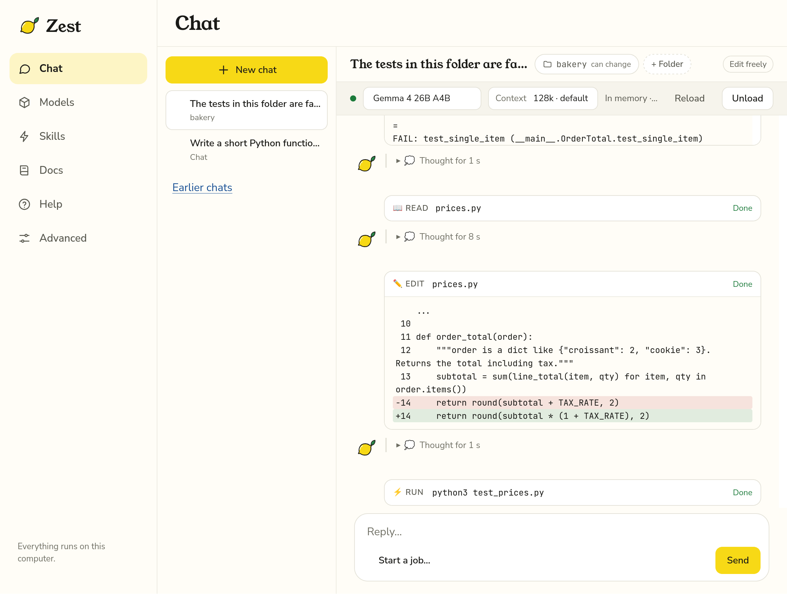
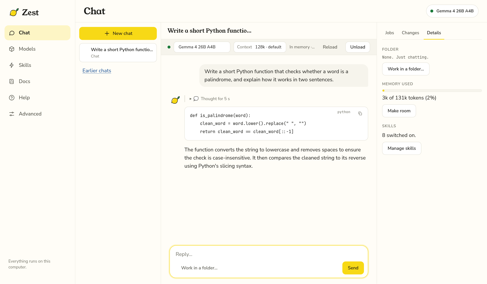
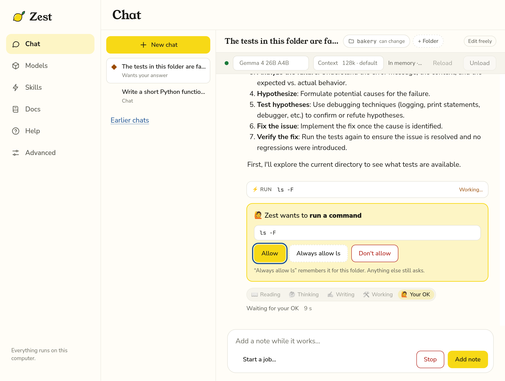
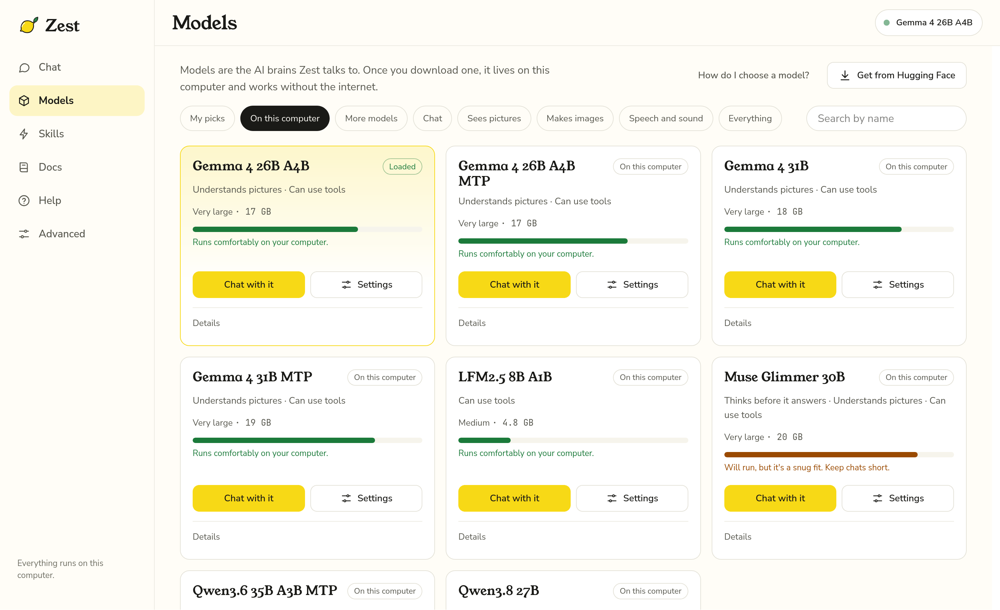
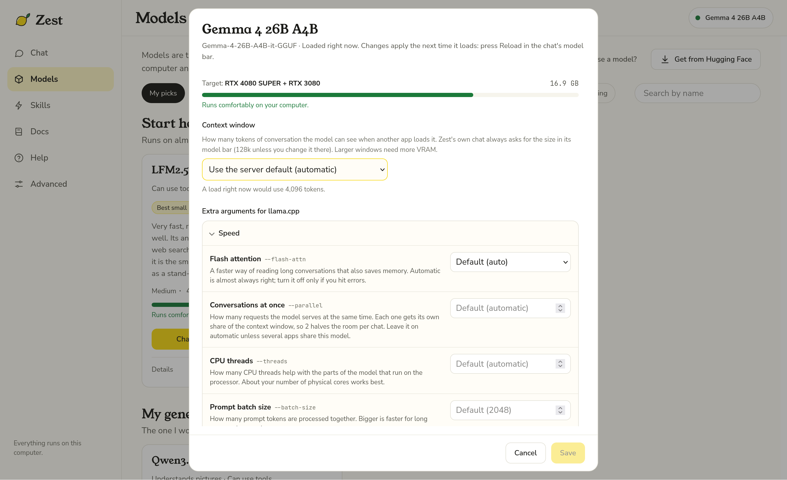
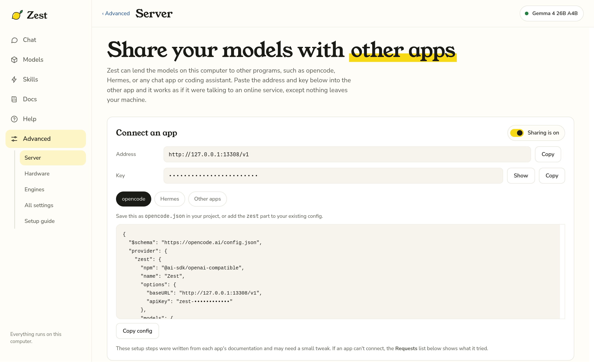

# Zest

**Run AI models on your own computer, and put them to work, with one download.** Zest is a friendly interface for [Lemonade](https://lemonade-server.ai), the open-source engine that runs language models locally, and for [Pi](https://pi.dev), a coding-agent harness. The Zest AppImage **includes both**.

The idea is to provide a user interface that people who aren't necessarily steeped in technical know-how can still navigate to get open-weights models running on their own hardware, and then do real work with them: chat, draw diagrams, write documents, or let a model read and change the files in a folder while they watch. Download Zest, and you're good to go.



*Chat, working in a folder: it read the code, fixed a bug with a one-line change (shown as a diff) and ran the tests again, step by step.*

**Contents:** [What you can do](#what-you-can-do-with-zest) · [Install and run](#install-and-run) · [Finding your way around](#finding-your-way-around) · [Your first conversation](#your-first-conversation) · [Choosing and managing models](#choosing-and-managing-models) · [Skills](#skills) · [Use your models in other apps](#use-your-models-in-other-apps) · [Keeping everything up to date](#keeping-everything-up-to-date) · [Advanced tools](#advanced-tools) · [Your data and privacy](#your-data-and-privacy) · [Screenshots](#screenshots) · [For developers](#for-developers)

## What you can do with Zest

- **Chat with an AI that runs on your own computer.** Nothing you type leaves it.
- **Let it work on your files.** Choose a folder and the model can read, search, edit and run things there while you watch. It asks before it changes anything.
- **Hand it a bigger job.** A job keeps working in the background, round after round, and checks its own progress. You review what it changed before anything touches your folder.
- **Draw diagrams and write documents.** Ask for a picture or a README and get one, shown right in the chat.
- **Teach it new tricks with skills.** Short instruction sheets that make small models far more dependable. Add more by pasting a link.
- **Pick and manage models.** Zest tells you which ones will run comfortably on your computer and downloads them for you.
- **Use your models in other apps.** Zest can share them with tools such as opencode or any app that talks to an OpenAI-style server.

Zest runs on Linux. It needs no technical setup: you download one file and follow a few short steps. The **Docs** tab inside the app explains everything in plain language (its text lives in [zest/docs.md](zest/docs.md)).

## Install and run

1. **Download** `Zest-<version>-x86_64.AppImage` from the [latest release](../../releases/latest).
2. **Run it:**

   ```bash
   chmod +x Zest-*-x86_64.AppImage
   ./Zest-*-x86_64.AppImage
   ```

3. **Follow the welcome steps.** Zest opens in your browser and walks you through four short steps in plain language, one screen at a time:

   | Step | What happens |
   | --- | --- |
   | **Helper** | Zest starts its own private copy of Lemonade. Nothing to choose. |
   | **Your computer** | Zest looks at your graphics card and downloads the program that suits it (CUDA for NVIDIA, Vulkan for most cards, the processor as a fallback). One button. |
   | **A model** | Suggestions in three tiers. Quick is LFM2.5 8B A1B (fast, to the point, good with tools, happy on almost any computer). Balanced is Qwen3.6 35B A3B MTP or Gemma 4 26B A4B. Thorough is Qwen3.6 27B MTP or Gemma 4 31B MTP. Press Download on one. If a model is too big for your computer, **See every model** has smaller ones. |
   | **Chat** | Press Start chatting. Type a question, or press **Work in a folder…** to let the model work on your files. |

   People who already have models, or run their own Lemonade, can skip to **Advanced > Setup guide**, which keeps the full set of choices: where models are stored, models you already have (LM Studio, Ollama, llama.cpp and others are found for you), and Lemonade updates.

### What you need

- **Linux, x86_64.** The built-in Lemonade needs a reasonably recent system (glibc 2.38 or newer: Ubuntu 24.04, Debian 13, Fedora 39 or later). On an older system Zest tells you so and you can connect it to a Lemonade you install yourself instead.
- A few common system libraries that almost every desktop Linux already has (OpenSSL 3, zstd, libdrm). If one is missing, Zest names it.
- For GPU use, your graphics driver. Zest and Lemonade download everything else.
- Internet access for the first-run downloads (the backend and your models).

If your system has no FUSE support, run `./Zest-*-x86_64.AppImage --appimage-extract-and-run` instead. Closing the browser tab quits Zest (and its Lemonade) after about three minutes; launching it again while it's running just reopens the page.

## Finding your way around

The left-hand menu has six places. Everything a newcomer needs is in the first five; everything technical sits behind **Advanced**.

| Menu item | What it is for |
| --- | --- |
| **Chat** | Talk to a model, or choose a folder and let it work on your files. |
| **Models** | See which models will run on your computer, download them, load and unload them. |
| **Skills** | Switch skills on and off, and add more from a GitHub link. |
| **Docs** | A plain-language guide to all of this, inside the app. |
| **Help** | Short answers to common questions, and a button to repeat the welcome steps. |
| **Advanced** | Server, Hardware, Engines, All settings and the Setup guide. You never need these just to chat. |

## Your first conversation

Open **Chat** and type. The bar under the title shows which model will answer and whether it is in memory. If it isn't, Zest loads it when you send your first message, so that answer takes a little longer.

**Chat** runs on [Pi](https://pi.dev), a coding-agent harness that ships inside Zest. Ask anything and it answers like a normal chat. Press **Work in a folder…** and the same conversation becomes a co-working session: the model reads, searches, edits and runs commands in that folder while you watch, and asks before it changes anything (tool cards show each step; edits show a diff). Choose how careful it is per chat (**Ask first**, **Edit freely**, **Do everything**, **Look only**), add more folders it can look at or change, switch models, watch how much of the context window is used, and add notes while it works.

For bigger work, press **Start a job…**. Say what should get done and how Zest can tell it is done, such as a test command that passes. The job runs in the background, round after round, and stops when the check passes, when it hits its round or time limit, or when it stops making progress. By default it works on a copy of your folder; the **Changes** tab shows what it changed and you apply what you want. Jobs are listed under their chat, and you can keep chatting while they work. Chats and jobs are saved and pick up where they left off. See [docs/COWORK.md](docs/COWORK.md).

## Choosing and managing models

Lemonade handles models; Zest gives you the choices.

**Getting them**

- **Where they live.** The default is the **Hugging Face cache** (`~/.cache/huggingface/hub`, or wherever `HF_HOME` points), so downloads are shared with other AI tools. Or choose **any folder** as the place new downloads go.
- **Models you already have.** **Look on this computer** checks the usual places (LM Studio, llama.cpp's cache, GPT4All, Jan, Ollama, `~/models`, `~/Downloads`) and lists what it finds. Tick what you want, or add any folder yourself. **Nothing is copied**: Zest gives Lemonade a folder of links to your files, so there's no extra disk use and your originals stay where they are.
- **Downloading.** Press **Get it** on any model, or **Get from Hugging Face** to paste a link to a GGUF model and choose a version. It runs in the background with a progress bar, and you can keep using Zest. Zest's suggestions are the models that fit your hardware's free memory.

**Choosing the right one**

- **Models**: shows you what models you can run and one sentence on whether it will run comfortably on your computer. The fit comes from the memory that is actually *free* on your graphics cards right now, so you can tell before loading whether another program is in the way. The default page, **My picks**, leads with the models I've tested and recommend. **More models** shows the rest of what Lemonade offers that will run well on your computer. A **Details** fold on each card holds the technical names and **Settings for this model**: context window, backend, devices and the llama-server options (flash attention, cache precision, expert layers in system RAM, GPU splitting, thinking, speculative decoding) as tick boxes and dropdowns with plain explanations, checked against your own `llama-server` before you load.
- **Context window: 128k by default.** Chat always loads a model with a 128k (131,072-token) context window, a good threshold for usefulness in long chats and agentic work. The context menu in the chat's model bar changes it for every chat. A size saved under **Settings for this model** is used when other apps load the model through the Server page. A bigger window needs more graphics memory.
- **How do I choose a model?** A button on Models (and an entry in Help) explains how to pick: will it fit, what is it for, how much it needs to remember. It then links to places to compare and learn about various models: Luke's Dev Lab, Artificial Analysis, LMArena, Aider, the Berkeley Function-Calling Leaderboard, SWE-bench, LiveBench, BenchLM, LLM Stats, r/LocalLLaMA and the Level1Techs forum.

**Loading, unloading and adding**

- **Load, unload and reload live in the chat.** A bar under the chat's title shows the model, the context size and whether the model is in memory, with **Load**, **Unload** and **Reload** next to them. Pick a different model there, or change the context size (128k by default; the choice is remembered) and a loaded model is reloaded at the new size. Sending a message to a model that isn't in memory loads it for you, at that size. The **Models** page is for downloading models and editing their settings: each downloaded card has **Chat with it** and **Settings**. **Delete from this computer** is under **Details**; it asks first, says how much disk it frees, unloads the model if it is running, and you can download it again later.
- **Get from Hugging Face** takes a link or `org/name`, lists the GGUF versions in the repository with their sizes and a plain label (for example "A good balance"), marks which ones fit your computer, and hands the download to Lemonade.

## Skills

**Skills** are short instruction sheets the model reads when a job calls for them. Zest comes with Superpowers (a trimmed copy of [obra/superpowers](https://github.com/obra/superpowers): ask what you really want, plan, test first, find a bug's cause before fixing it, prove it works before saying so), a diagrams skill (the model writes Mermaid and Zest draws it in the chat, with Copy and Save as image; if it doesn't draw, one button asks the model to fix it) and a markdown-writing skill. **To add more, open Skills, paste a link to a GitHub repository (or to one folder in it) and press Add skills.** Any repository that follows the [Agent Skills](https://agentskills.io) format works; [Hermes Atlas](https://hermesatlas.com/ecosystem/) lists many. Switch skills on and off one by one, or by set, and type `/` in a folder conversation to pick one. Only add skills from people you trust. See [docs/COWORK.md](docs/COWORK.md).

## Use your models in other apps

**Advanced > Server** gives you an address, a key and copy-paste setup for tools such as [opencode](https://opencode.ai) and Hermes, or any chat app, coding assistant or agent that can talk to an OpenAI-compatible server. Paste the address (`http://127.0.0.1:13308/v1` by default), the key and a model name, and the other app uses the models on your computer.

The same page shows what those apps are doing:

- **Right now.** A card for each request that is running, with the app's name, a glass that bubbles while the model thinks and fills with lemon as the answer is written, and a line such as "Thought for 7.2 s, about 415 words". With **Show what models are saying** on, each card also quotes the line the model is on. The count of requests today sits underneath.
- **The last minute.** One lane per app, with a pill for each request split into reading the question (grey), thinking (dotted) and writing the answer (lemon), so you can see who was waiting for whom.
- **Requests.** A list with the app, the model, how long it took and whether it worked, filtered by app. Zest labels each app from the `User-Agent` it sends (for example "Hermes agent" or "opencode"), or from an `X-Zest-App` header if the app sets one.
- **Show what models are saying** is off by default. When on, you can open a request to read the question and answer. The text is held in memory only and is gone when Zest closes.

Other apps never talk to Zest's own page. Zest opens a second, much smaller door on its own port (13308) that serves only the chat-style `/v1` endpoints (models, chat, completions, embeddings, responses, audio, images, reranking, and loading or unloading a model). It **always asks for the key**, and pulling, deleting, installing or changing settings are not reachable through it. It listens on this computer only. **Other devices on my network** turns on listening on your local network; anyone there who has the key can then use your models, and the traffic is not encrypted, so use it on a network you trust. **Make a new key** invalidates the old one at once.

## Keeping everything up to date

Updating Zest itself is just downloading a newer AppImage. The two parts inside it, Lemonade and Pi, can be updated from inside Zest without a new download.

### Lemonade

The AppImage ships with a recent Lemonade, but Lemonade moves quickly, so Zest can update its own copy without you downloading a new Zest.

- Press **Check for Lemonade updates** on the Setup guide page (Advanced > Setup guide). If a newer stable release exists, one button downloads it, **checks it against the checksum GitHub publishes for that file**, installs it and offers to restart Lemonade onto it.
- Zest can also look for an update when it opens and put a dot on **Advanced** if there is one. You can switch that off with the checkbox.
- Updates are kept in your own data folder, because the AppImage itself is read-only. The version that came with Zest is never touched, so **"Go back to the version that came with Zest"** is always one click away.

### Pi, the agent helper

Pi is the part that lets a model read files, make edits and run steps. It is updated separately, from **Advanced > Setup guide**, at the bottom, under **The agent helper**.

- Press **Check for Pi updates**. If a newer release exists, one button downloads it from the npm registry, **checks it against the checksum npm publishes**, unpacks it, and starts it once to make sure it works with Zest. Only a Pi that passes is offered; otherwise nothing is installed.
- Your next message uses the new Pi. A task that is working right now finishes on the old one.
- Downloads live in your own data folder. The Pi that came with Zest is never touched, so **"Go back to the version that came with Zest"** is always one click away.
- Zest only offers updates within the same major version of Pi, because that is what it has been tested with. A release that needs a newer Node.js than the one inside Zest waits for a newer Zest.
- The same "Look for updates when Zest opens" checkbox covers both.

## Advanced tools

Everything under **Advanced** is optional.

- **Advanced > Server** lets other apps use your models (see below), with a live picture of what they ask for. The address and key to paste into those apps are at the top, and the Lemonade **activity log** (filter and follow mode) sits at the bottom of the same page.
- **Advanced > Hardware** shows every device llama.cpp can see as a live VRAM tank with utilisation, temperature, power, a short history, and which processes are holding its memory. Pick which devices to use and put them in order, then apply.
- **Advanced > Engines** explains what an engine is (the program that runs one kind of model) and what each backend means (CUDA, ROCm, Vulkan, CPU), then lists every Lemonade engine (llama.cpp, Whisper.cpp, StableDiffusion.cpp and more) with the backends each supports (CUDA, Vulkan, ROCm, CPU). Choose one per engine, or install and update missing ones.
- **Advanced > All settings** edits everything in Lemonade's own configuration, searchable, with a reset-to-default for every value.
- **Advanced > Setup guide** is the full version of the welcome steps. That is where you update Lemonade and Pi, add a backend, bring in models you already have, or change where models live. **Help > Run the welcome steps again** repeats the short tour.

### Using a Lemonade you already run

Already have Lemonade Server installed (for example as a system service)? On Advanced > Setup guide choose **A Lemonade I already run**, enter its address and, if needed, its API key. Zest will use it instead of starting its own, and won't touch the built-in copy. Switching back later is one click. Starting Zest with `--lemonade HOST:PORT` does the same without saving anything.

A few things work differently with a Lemonade you run yourself: Zest can't update it (use your package manager), and if it runs as a system service it may not be allowed to read model files in your home folder.

## Your data and privacy

### Where Zest keeps things

| What | Where |
| --- | --- |
| Zest's settings, including the built-in Lemonade's API key and the key for other apps (file mode `600`) | `~/.config/zest/settings.json` |
| Lemonade updates you've downloaded | `~/.local/share/zest/lemonade/<version>/` |
| The built-in Lemonade's own config and the backends it installs | `~/.local/share/zest/lemonade-data/` |
| Its log (shown on the Logs page) | `~/.local/share/zest/lemond.log` |
| Links to models you chose to bring in | `~/.local/share/zest/imported-models/` |
| Models you download | the Hugging Face cache, or the folder you chose |
| Skills you added and which are switched on | `~/.local/share/zest/skills/` |
| Newer versions of Pi that you downloaded | `~/.local/share/zest/pi/<version>/` |
| Chat conversations, jobs, their transcripts, the folders Zest has worked in (and the commands you always allow there), work copies of folders awaiting review, and Pi's configuration (rewritten at each start) | `~/.local/share/zest/cowork/` |
| Display preferences | your browser's local storage |

(`XDG_CONFIG_HOME` and `XDG_DATA_HOME` are respected.) To start from scratch, delete `~/.config/zest` and `~/.local/share/zest`. Downloaded models are not in there unless you chose a folder inside it.

### Privacy

Nothing you type into a chat leaves your computer. A chat with a folder runs entirely locally: Pi is started offline, with telemetry and update checks off, and talks only to your Lemonade. If you add your own extensions, MCP servers or web tools to Pi, those can reach the network.

Zest and Lemonade do contact the following services:

- **codeload.github.com**: only when you paste a link under Skills, to download that repository's skills.
- **registry.npmjs.org**: looking for and downloading Pi updates (the same automatic-check switch covers it).
- **api.github.com and github.com**: looking for and downloading Lemonade updates (the automatic check can be switched off), and Lemonade downloading the backends you install.
- **Hugging Face**: Lemonade downloading the models you choose, and Zest reading a repository's public file list when you use **Get from Hugging Face**. Gated models, which need a login, are not supported yet.
- **Benchmark and community sites**: the links in **How do I choose a model?** open in your browser only when you click them. Zest never contacts those sites itself.

## Screenshots

### Chat
Replies stream in as they are written. The bar under the title shows which model answers, how much context it has (128k by default) and whether it is in memory, with **Load**, **Unload** and **Reload**. A reasoning model's thinking appears live above its answer and folds away when it is done. Markdown and code blocks come with copy buttons, and a small strip shows what the model is doing: 📖 reading, 🤔 thinking, ✍️ writing, 🛠️ working.



### Working in a folder
Press **Work in a folder…** and the same chat can read, search, edit and run things there. Tool cards show each step, edits show a diff, and in **Ask first** and **Edit freely** modes it stops and asks before it runs a command. Here it was asked to fix a folder whose tests were failing: it read the tests and the code, made a one-line change and ran the tests again to confirm.




### Models
The Models page is for downloading models and editing how they run. **My picks** leads with the models I've tested and recommend; **On this computer** lists what you have. The meter on each card shows what will fit in the memory that is free on your graphics cards right now; if another program is using it, Zest warns you and names it.



- **Start here: LFM2.5 8B A1B.** Very fast, runs on almost anything, calls tools well, and keeps answers short.
- **My general pick: Qwen3.6 35B A3B MTP.** Fast and competent at everyday tasks, research and agent work.
- **If Qwen 3.6 won't run: GLM 4.7 Flash.** Fast, but it makes things up, so it comes with a warning.
- **Bigger and slower, dense models: Gemma 4 31B MTP and Qwen3.8 27B.** Good answers, but slow. With a GPU and 64 GB of RAM, try Strata instead.
- **For advanced users: Strata and Maya,** separate inference engines built for huge models, with a clear warning that they run outside Zest and Lemonade.
- **Make any model better:** OpenChamber as the app I recommend, and obra/superpowers for skills.

**Get from Hugging Face** is for experts. It lists the GGUF versions in a repository, with a plain label, the size, and whether each fits. When Lemonade or llama.cpp refuses a model (for example because its architecture isn't supported yet, it needs a login, it can't be found, or memory or disk is short), Zest shows a plain-language message with the technical details tucked underneath, and offers to open Engines when an update may help. **How do I choose a model?** explains what to look for and links to benchmark sites and communities.

### Settings for one model
Press **Settings** on any downloaded card. Set the backend and devices, and tune `llama-server` with tick boxes and dropdowns instead of flags. Rows you have changed are highlighted, the exact arguments Zest will pass are shown, and anything your `llama-server` does not understand is flagged. **Save** keeps it; for a model that is in memory, press **Reload** in the chat's model bar to use the new settings.



### Server: share your models with other apps
Address, key and copy-paste setup for opencode, Hermes and any OpenAI-compatible app. The key is hidden until you press **Show**, including in the code samples. While an app is working you see a card with a glass that fills as it writes, a pill timeline of the last minute, and a request list. The Lemonade activity log is at the bottom of the same page.



### The rest of Advanced
- **Hardware:** select GPUs and set their order. Each card shows free VRAM, utilisation, temperature, power and which processes hold memory. Nothing changes until you press **Apply**.
- **Engines:** each engine says in plain words what it does, and a short guide explains which backend to pick. Choose one per engine, or install and update the ones you need.
- **All settings:** Lemonade's own configuration, searchable and saved as you edit.
- **Setup guide:** the full set of choices behind the welcome steps: which Lemonade to use, backends, where models live, and updates.

## For developers

### Running from source

Python 3, standard library only (developed on 3.12):

```bash
git clone https://github.com/yudhanjaya/Zest.git
cd Zest
python3 zest/server.py
```

Diagrams in Chat need Mermaid: run `./packaging/fetch-vendor.sh` once (a 26 MB download, checked against its published checksum); the AppImage already includes it.

Chat's agent features need [Pi](https://pi.dev) (Node 22.19 or newer): `npm install -g @earendil-works/pi-coding-agent`, or point `ZEST_PI` at a `pi` binary. The AppImage already includes both.

Then open <http://127.0.0.1:13306> (it opens automatically unless you pass `--no-browser`). A source checkout doesn't include Lemonade: on the welcome screen or Advanced > Setup guide, **Download Lemonade** fetches it (about 7 MB), or you can connect to one you already run.

| Flag | Environment variable | Default | Meaning |
| --- | --- | --- | --- |
| `--port` | `ZEST_PORT` | `13306` | Port Zest listens on |
| `--host` | `ZEST_HOST` | `127.0.0.1` | Address Zest listens on |
| `--lemonade HOST:PORT` | `LEMONADE_API_KEY` for its key | the choice saved in Zest's settings | Use this Lemonade and skip the welcome screen |
| `--no-browser` | | | Don't open a browser tab |
| `--app` | | | Quit automatically once the tab is closed (the AppImage does this) |
| (none) | `ZEST_LEMONADE_DIR` | none | A folder containing a `lemond` to use as the built-in Lemonade |

> **Security.** Zest's own page has no login and can change Lemonade's configuration, so it listens on `127.0.0.1` only by default and refuses requests whose `Host` header isn't this computer (a defence against DNS-rebinding). Its built-in Lemonade is private: its own port, protected by a random API key that only Zest knows. Other apps use the separate key-protected door described above, never the page itself. Only use `--host 0.0.0.0` on a network you trust.

### How it works

Zest is a small Python program with no dependencies (`zest/server.py` plus a few modules) and one HTML page (`zest/index.html`).

- `zest/gateway.py` is the door for other apps and the request recorder. Both it and Zest's own chat forward through one function that streams the answer back untouched while noting whether the model is waiting, thinking (`reasoning_content`, or text inside `<think>` tags) or writing.
- `zest/agent.py` runs Pi (`pi --mode rpc`, one process per task) against Lemonade through Zest's own `/api/v1` proxy, and relays its JSON events to the page as server-sent events. `zest/pi/zest-gate.js` is the Pi extension that makes it ask before editing or running commands. Details in [docs/COWORK.md](docs/COWORK.md).
- `zest/hf.py` reads a Hugging Face repository's file list and groups GGUF files by quantisation.
- `/api/*` is passed straight through to Lemonade, so the page needs no CORS changes. Chat uses the OpenAI-compatible `/api/v1/chat/completions` stream, and model downloads use Lemonade's background download jobs.
- Everything Zest changes in Lemonade goes through Lemonade's own HTTP API: `/internal/config` and `/internal/set` for settings, `/v1/models/{id}/options` for per-model options, `/v1/install` for backends. Zest does not need the `lemonade` command-line tool.
- The built-in Lemonade is the project's official "embeddable" build, started as `lemond <data folder> --port … --no-broadcast` with a random `LEMONADE_API_KEY`. If a previous Zest left one running, the new Zest reuses it instead of starting a second.
- Device order matters: llama.cpp numbers devices differently from `nvidia-smi` (CUDA puts the fastest card first). Zest asks the llama.cpp binary for its own list so the names and IDs line up.
- Live GPU numbers come from `nvidia-smi` for NVIDIA cards and from the Linux `amdgpu` driver's sysfs files for AMD cards (VRAM used and total, load, temperature, power, fan, and which processes hold memory). The log is Lemonade's own output (or `journalctl -u lemond` for a system service).

### Good to know

- **Live telemetry covers NVIDIA and AMD (on Linux).** Intel devices are listed and selectable, but show capacity without live usage, and the fit meter treats them as empty. The AMD numbers come from the kernel, so they need no extra tools, but they have so far been tested only against a simulated amdgpu sysfs tree and a screenshot from a two-Radeon VII machine, not on AMD hardware here. Two identical AMD cards are matched to llama.cpp's devices by order, so their usage can appear swapped.
- **The Hugging Face download is handed to Lemonade as a custom model** (`user.<name>-<quant>`, with the checkpoint `org/repo:QUANT` and the `llamacpp` recipe). Check it against your Lemonade version, since this part of its API has changed before.
- **Process names are shown on the Hardware page.** They come from `nvidia-smi` or the amdgpu driver (name only, not the full path) and are only displayed in your own browser.
- **Devices appear once a backend is installed**, because Zest asks llama.cpp itself for the list rather than guessing.
- Tested on Linux with NVIDIA GPUs. The Vulkan and ROCm paths follow Lemonade's own backend data but haven't been tried on real hardware yet. Reports welcome.

### Building the AppImage

```bash
./packaging/build-appimage.sh
```

This downloads a relocatable Python, Node.js, the Pi agent, Lemonade's official embeddable build, and `appimagetool` (all pinned by SHA-256), assembles the image and writes `dist/Zest-<version>-x86_64.AppImage` plus a checksum. To bundle a newer Lemonade, change the version and checksum at the top of the script. Pushing a tag that starts with `v` runs the same script in GitHub Actions and attaches the result to the release.

To cut a release: bump `VERSION` in `zest/server.py`, then `git tag vX.Y.Z && git push --tags`.

## Zest is built on:

- **[Lemonade](https://github.com/lemonade-sdk/lemonade)** (Apache-2.0, © AMD and contributors) is bundled unmodified in the AppImage; its licence is included alongside it.
- **llama.cpp** (MIT) and the other backends are downloaded by Lemonade when you install them, not bundled.
- **[Python](https://www.python.org)** (PSF licence), via a relocatable build from [python-build-standalone](https://github.com/astral-sh/python-build-standalone), is bundled so the AppImage needs no system Python.

## License

Zest is [MIT](LICENSE) licensed.
