<h1 align="center">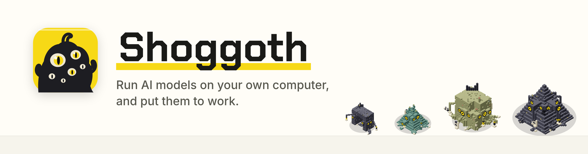</h1>

<p align="center">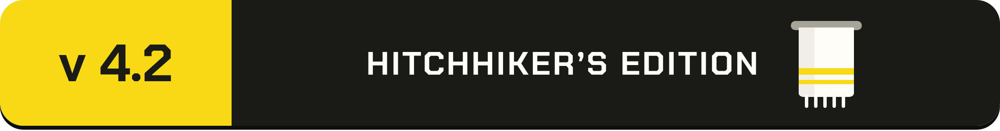</p>

[](https://github.com/yudhanjaya/Shoggoth/releases)
[](https://github.com/yudhanjaya/Shoggoth/releases)
[](LICENSE)

[](https://github.com/yudhanjaya/Shoggoth)

# Run AI on your own computer, and put it to work.

**Shoggoth is one download that runs open-weights language models on your own hardware.** Chat with them, draw diagrams, write documents, or let a model read and change the files in a folder while you watch. No cloud account, no technical know-how, and nothing you type leaves your machine.

**[⬇ Download for Linux](../../releases/latest)** · [Install in three steps](#install) · [Read the docs](shoggoth/docs.md)

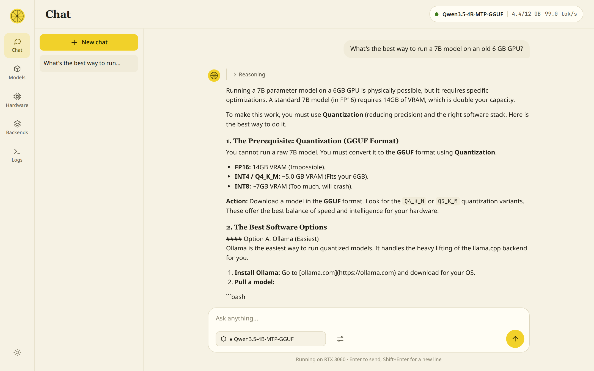

*Working in a folder: the model found why two tests failed, fixed it with a one-line change (shown as a diff) and ran the tests again.*

---

## What you get

| | |
| --- | --- |
| **Private by default** | Chats run on your computer. The one exception is web search, and the model asks before every search. |
| **It works on your files** | Choose a folder. The model reads, searches, edits and runs things there while you watch, and asks before it changes anything. |
| **Bigger jobs, in the background** | Describe the work and how to tell it is done, such as a passing test. The job runs round after round. You review its changes before they touch your folder. |
| **Diagrams and documents** | Ask for a picture or a README, and it appears in the chat. |
| **Skills** | A skill is a short instruction sheet that makes small models far more dependable. Add more by pasting a GitHub link. |
| **Models that fit your computer** | Shoggoth tells you which models will run well on your hardware, and downloads them for you. |
| **Small to enormous** | Small and medium models run on [Lemonade](https://lemonade-server.ai). Very large ones run on [Strata](https://github.com/Niko1221/Strata). Shoggoth starts the right one. |
| **Use your models in other apps** | Share them with opencode, Hermes, or anything that talks to an OpenAI-style server. |

## Install

1. **Download** `Shoggoth-<version>-x86_64.AppImage` from the [latest release](../../releases/latest).
2. **Run it:**

   ```bash
   chmod +x Shoggoth-*-x86_64.AppImage
   ./Shoggoth-*-x86_64.AppImage
   ```

3. **Follow the Getting ready screen.** It opens in your browser, asks where your models should live, sets up the engine for your graphics card (CUDA, Vulkan or CPU), and suggests a first model per size. Press **Get it**, then start chatting.

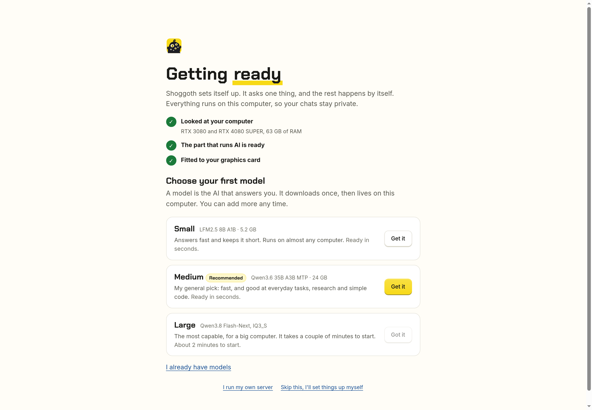

**You need:** Linux on x86_64, a few common libraries (OpenSSL 3, zstd, libdrm), your graphics driver if you want the GPU, and internet for the first-run downloads. The AppImage runs on older systems such as Ubuntu 22.04. No FUSE? Run it with `--appimage-extract-and-run`.

Closing the browser tab quits Shoggoth after about three minutes. Already have models, or your own Lemonade or Strata? Shoggoth finds them.

## Picking a model

Shoggoth suggests one model per size on first run, and keeps a tested list on the Models page.

| Size | Pick | Why |
| --- | --- | --- |
| **Small** | LFM2.5 8B A1B | Very fast, calls tools well, keeps answers short, runs on almost anything. Start here. |
| **Medium** | Qwen3.6 35B A3B MTP, or Gemma 4 26B A4B | The general pick for everyday tasks, research and agent work. |
| **Large** | Qwen3.8 Flash-Next (IQ3_S) | For computers with a GPU and about 64 GB of RAM. Runs models far bigger than your graphics card. Slower, and takes a couple of minutes to start. |

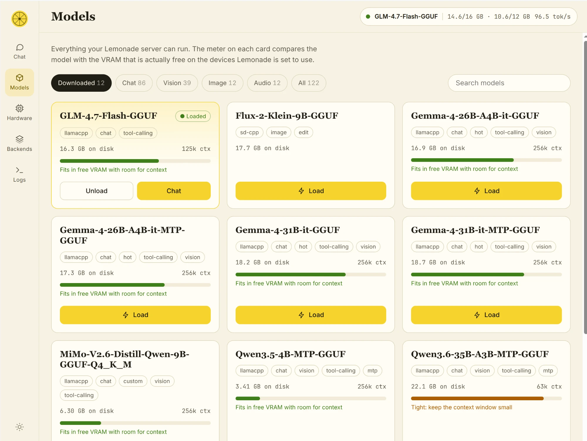

## Models you can see

Shoggoth draws every model as a many-eyed creature in a glass tube, wired to a bench of lab equipment. A model's name decides its shape and colour, and the bigger the model, the bigger the creature, with more eyes and more hands. You can turn them off.

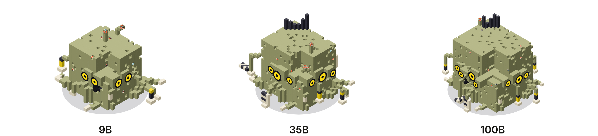

The **Hardware** page puts your graphics cards on the bench, and the **Server** page shows which apps are asking your models for what.

| | |
| --- | --- |
| 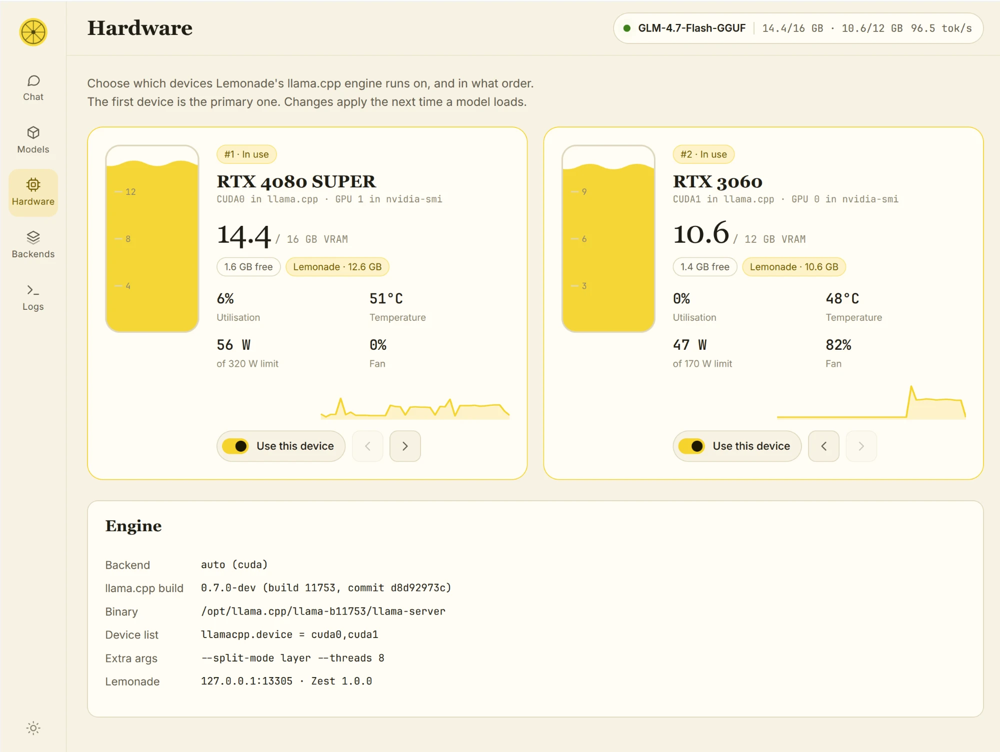 | 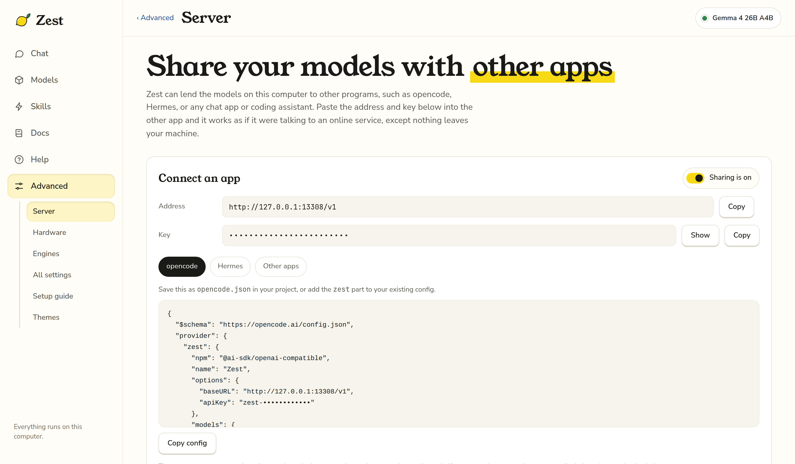 |
| **Hardware**: memory, load and heat for every card. | **Server**: every request from every app, live. |

## You stay in control

- **Four levels of care in every chat:** Ask first, Edit freely, Do everything, or Look only.
- **Jobs work on a copy** of your folder by default. The **Changes** tab shows what they did, and you apply what you want.
- **Tool cards** show each step, and edits show a diff.

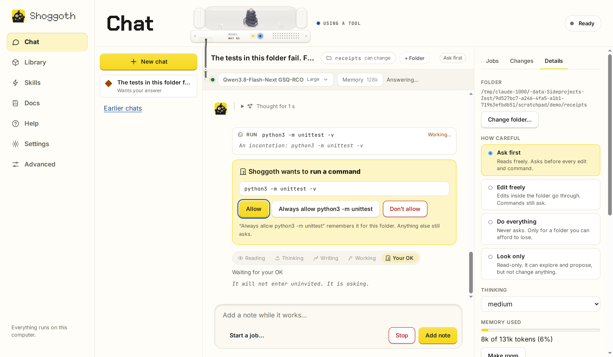

## Make it yours

Fifteen themes, from the calm cream default to Braun T3, Teenage Engineering, Monokai Pro, Dracula and Catppuccin.

| | |
| --- | --- |
| 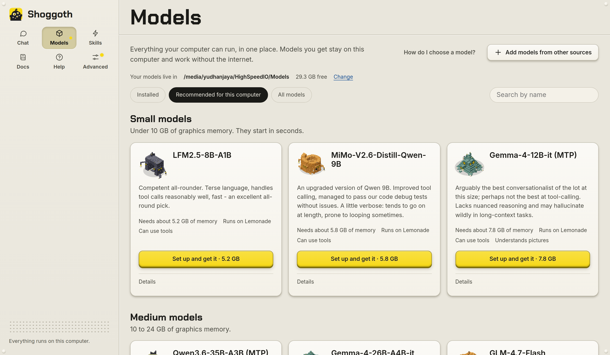 | 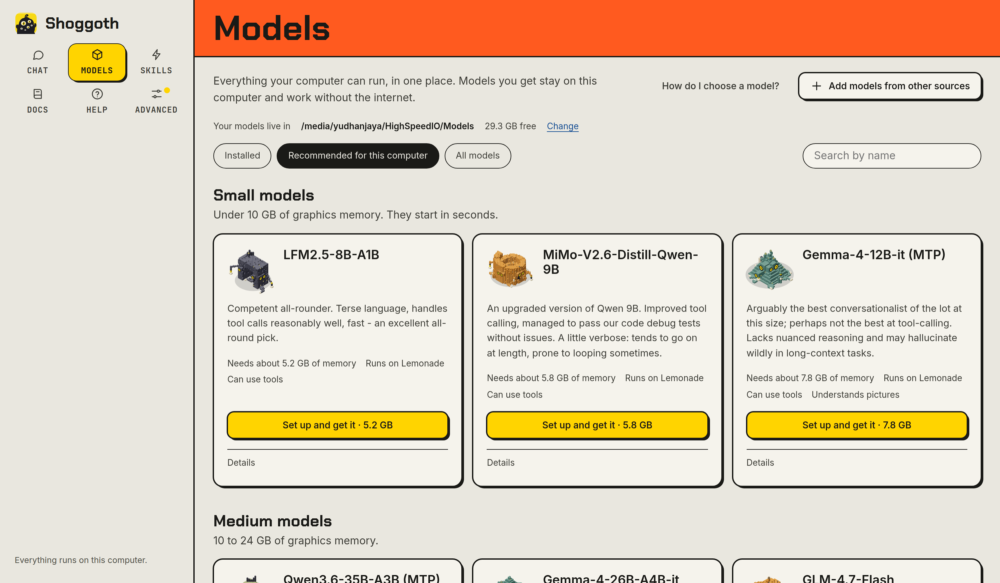 |
| **Braun T3**: matte warm plastic, a glowing lamp and a speaker grille. | **Teenage Engineering**: hard shadows, thick outlines and an orange bar. |
| 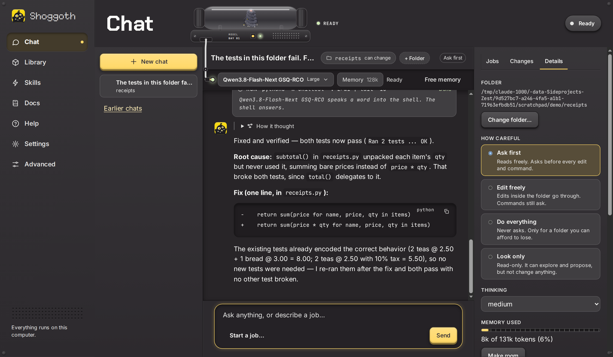 | 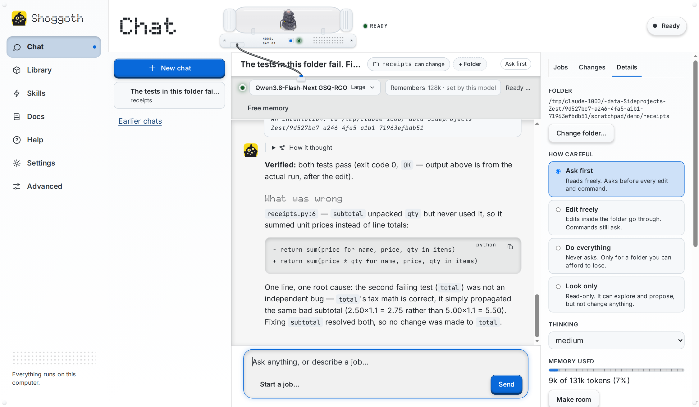 |
| **Monokai Pro**: dark and warm, with raised keys and a recessed chat. | **GitHub Light**: clean and bright, in GitHub's blue. |

## Why the name?

Because the large language models we run are, effectively, shoggoths:

<sub>Source: [Know Your Meme](https://knowyourmeme.com/sensitive/memes/shoggoth-with-smiley-face-artificial-intelligence)</sub>

indescribable alien intelligences that deal in madness and inhumane logics. See also: (https://en.wikipedia.org/wiki/Shoggoth) and (https://www.stilldrinking.org/programming-sucks) for why what we're doing is insane.

And because I love it. (Shoggoth used to be called Zest.)

## Under the hood

Shoggoth drives three open-source programs, so you don't have to:

- [Lemonade](https://lemonade-server.ai) runs small and medium models.
- [Strata](https://github.com/Niko1221/Strata) runs very large ones.
- [Pi](https://pi.dev) lets a model read files, edit them and run commands.

The AppImage includes Lemonade and Pi, and sets up Strata the first time you want a large model. Everything updates from **Advanced > Engines** with one button, checked against published checksums.

## Your data and privacy

Everything stays on your computer. Chats, jobs, skills and settings live in `~/.local/share/shoggoth/` and `~/.config/shoggoth/`. Shoggoth goes online only to download models and updates you ask for, to fetch skills when you paste a link, and for web search, which asks first and shows the exact words. Full details: [docs/PRIVACY.md](docs/PRIVACY.md).

## Learn more

| | |
| --- | --- |
| [User guide](shoggoth/docs.md) | The in-app guide: chat, jobs, models, tuning, skills, troubleshooting. |
| [Architecture](docs/ARCHITECTURE.md) | Components, request flow, engine integration, platform support. |
| [Agent runtime](docs/AGENT-RUNTIME.md) | Pi integration, approval gate, jobs, work copies, skills. |
| [Engines](docs/ENGINES.md) | Add an engine with a `provider.yaml`. |
| [Security model](docs/SECURITY.md) | Authentication, network exposure, and the limits of the approval gate. |
| [Privacy and data](docs/PRIVACY.md) | On-disk layout and every network destination. |
| [Development](docs/DEVELOPMENT.md) | Run from source, test, build, release. |

Linux with NVIDIA GPUs is what's tested so far. Vulkan and ROCm paths follow Lemonade's own data but haven't run on real hardware yet, and reports are welcome as [issues](https://github.com/yudhanjaya/Shoggoth/issues).

## Shoggoth is built on

- **[Pi](https://github.com/earendil-works/pi)** (MIT), bundled unmodified in the AppImage. Its licence is included alongside it.
- **[Lemonade](https://github.com/lemonade-sdk/lemonade)** (Apache-2.0), bundled unmodified in the AppImage. Its licence is included alongside it.
- **[llama.cpp](https://github.com/ggml-org/llama.cpp)** (MIT) and the other backends, which Lemonade downloads when you install them.
- **[Strata](https://github.com/Niko1221/Strata)** (MIT) which does some ingenious stuff to make larger models work on consumer hardware.
- **[Chakra Petch](https://github.com/m4rc1e/Chakra-Petch), [Doto](https://github.com/oliverlalan/Doto), [Inter](https://rsms.me/inter/) and [JetBrains Mono](https://www.jetbrains.com/lp/mono/)** (SIL Open Font License), embedded in the page. Their licences are in `docs/plans/assets/fonts` and ship in the AppImage.
- **[Python](https://www.python.org)** (PSF licence), via a relocatable build from [python-build-standalone](https://github.com/astral-sh/python-build-standalone), bundled so the AppImage needs no system Python.

## License

Shoggoth is [MIT](LICENSE) licensed.
