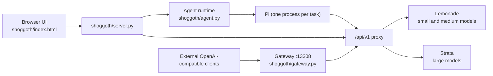

# Architecture

Shoggoth is a single-process Python service (standard library only) that serves one HTML page, supervises inference engines, and hosts an agent runtime. It has no third-party Python dependencies.

## Components

| Component | Responsibility |
| --- | --- |
| `shoggoth/server.py` | HTTP server, UI authentication, routing, lifecycle (including the idle watchdog). |
| `shoggoth/index.html` | The entire front end, in one file. Fonts and Mermaid are served from `shoggoth/vendor`. |
| `shoggoth/gateway.py` | The second listener for external clients (default port 13308), and the request recorder behind the Server page. |
| `shoggoth/agent.py` | Runs Pi and the job loop. See [AGENT-RUNTIME.md](AGENT-RUNTIME.md). |
| `shoggoth/providers/`, `provbase.py`, `registry.py` | Engine abstraction. See [ENGINES.md](ENGINES.md). |
| `shoggoth/lem.py`, `strata.py`, `engine.py` | Lemonade and Strata control, and engine selection. |
| `shoggoth/hardware.py`, `gguf.py`, `modelmeta.py` | Device discovery and telemetry, GGUF header parsing, and the memory-fit estimate. |
| `shoggoth/library.py`, `modelscan.py`, `hf.py` | The unified model library, import from other tools' folders, and Hugging Face file listings. |
| `shoggoth/lemtune.py`, `tuning.py` | Model tuning for llama.cpp models. Strata's own tuner handles large models. |
| `shoggoth/skills.py`, `workcopy.py`, `folders.py`, `websearch.py` | Skills, work copies, per-folder trust, and the web search tool. |
| `shoggoth/piup.py`, `zestup.py` | Updates for Pi and for Shoggoth itself. |

## Request flow

All model traffic passes through one forwarding function. It streams the upstream response unmodified and classifies each chunk as waiting, thinking (`reasoning_content`, or text inside `<think>` tags), or writing. The Server page and the per-reply speed figure are derived from that classification.

- The UI's chat and Pi both call `/api/v1`, an authenticated proxy inside the UI server. Their requests are recorded alongside external ones.
- External clients call the gateway. It exposes only the OpenAI-style endpoints (models, chat, completions, embeddings, responses, audio, images, reranking, and model load and unload), always requires the API key, and listens on loopback unless LAN access is enabled.
- `/api/*` passes through to Lemonade unchanged, so the page needs no CORS configuration.

## Engine integration

Each engine is a provider (`provider.yaml`, optionally `provider.py`). The registry selects the provider that can run a model, stops what Shoggoth started in any conflicting memory group, starts the target, and routes requests to its endpoint.

**Lemonade.** Shoggoth uses the official embeddable build and starts it as `lemond <data folder> --port … --no-broadcast` with a random `LEMONADE_API_KEY`. A `lemond` left running by a previous Shoggoth is reused. All configuration goes through Lemonade's HTTP API: `/internal/config` and `/internal/set` for settings, `/v1/models/{id}/options` for per-model options, and `/v1/install` for backends. The `lemonade` CLI is not required.

**Hugging Face downloads.** A download is registered with Lemonade as a custom model: id `user.<name>-<quant>`, checkpoint `org/repo:QUANT`, recipe `llamacpp`. This part of Lemonade's API has changed between releases; `providers doctor` detects drift.

**Strata.** Large models run on Strata. Shoggoth installs it on first use from the published installer after verifying the published checksum. A Strata instance started by the user is detected and used, but never stopped, restarted, or updated.

## Hardware discovery

- Device lists come from the llama.cpp binary itself, not from enumeration. llama.cpp orders devices differently from `nvidia-smi` (CUDA places the fastest device first), so querying it keeps names and indices consistent. Devices therefore appear only after a backend is installed.
- Live telemetry is read from `nvidia-smi` (NVIDIA) and from sysfs for the `amdgpu` driver (AMD): memory used and total, load, temperature, power, fan, and the processes holding memory. Process names only; full paths are not collected.
- The Lemonade log is read from its own log file, or from `journalctl -u lemond` when it runs as a system service.

## Platform support and known limitations

- **Supported OS:** Linux x86_64. The AppImage bundles a glibc 2.38 loader because the embedded Lemonade requires it, so it runs on older distributions such as Ubuntu 22.04.
- **Tested hardware:** NVIDIA GPUs. The Vulkan and ROCm paths follow Lemonade's backend data and have not been exercised on real hardware.
- **AMD telemetry** has been verified only against a simulated amdgpu sysfs tree and a screenshot from a two-Radeon VII system. Two identical AMD devices are matched to llama.cpp devices by order, so their usage may be reported swapped.
- **Intel devices** are listed and selectable, but report capacity without live usage, and the fit estimate treats them as idle.
- **Gated Hugging Face models** (those requiring a login) are not supported.
