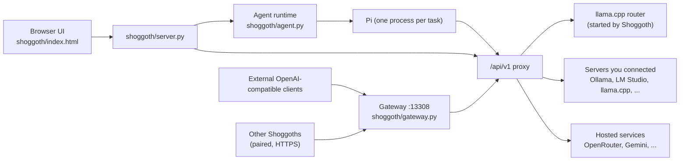

# Architecture

Shoggoth is a single-process Python service (standard library only) that serves one HTML page, supervises inference engines, and hosts an agent runtime. It has no third-party Python dependencies.

## Components

| Component | Responsibility |
| --- | --- |
| `shoggoth/server.py` | HTTP server, UI authentication, routing, lifecycle (including the idle watchdog). |
| `shoggoth/index.html` | The entire front end, in one file. Fonts and Mermaid are served from `shoggoth/vendor`. |
| `shoggoth/gateway.py` | The second listener for external clients (default port 13308), the LAN side when sharing is on, and the request recorder behind the Server page. |
| `shoggoth/agent.py` | Runs Pi and the job loop. See [AGENT-RUNTIME.md](AGENT-RUNTIME.md). |
| `shoggoth/engines.py`, `engines.d/` | Engine definitions: what each engine or service is, where it listens, and how to recognise it. Data only. |
| `shoggoth/providers/`, `provbase.py`, `registry.py` | The engine abstraction that starts, stops and serves models. See [ENGINES.md](ENGINES.md). |
| `shoggoth/llamacpp.py`, `servers.py`, `scan.py` | Shoggoth's own llama.cpp (download, start, router), the servers a person connected, and finding running ones. |
| `shoggoth/lan.py` | Sharing models with other Shoggoths: beacon, TLS listener, pairing and revocation. |
| `shoggoth/hardware.py`, `gguf.py`, `modelmeta.py` | Device discovery and telemetry, GGUF header parsing, and the memory-fit estimate. |
| `shoggoth/library.py`, `modelscan.py`, `hf.py`, `recs.py` | The unified model library, import from other tools' folders, Hugging Face listings and downloads, and the recommended catalog. |
| `shoggoth/llamatune.py`, `tuning.py` | Model tuning for llama.cpp models, measured with `llama-bench`. |
| `shoggoth/skills.py`, `pipkgs.py`, `filetypes.py` | Skills (bundled, added and written by models), checked Pi packages, and the attachment handler map. |
| `shoggoth/workcopy.py`, `folders.py`, `websearch.py` | Work copies, per-folder trust, and the web search tool. |
| `shoggoth/speech.py`, `tts.py` | Speech to text with whisper.cpp, and read aloud with Piper. Both start on demand and stop when idle. |
| `shoggoth/piup.py`, `zestup.py` | Updates for Pi and for Shoggoth itself. |

## Request flow

All model traffic passes through one forwarding function. It streams the upstream response unmodified and classifies each chunk as waiting, thinking (`reasoning_content`, or text inside `<think>` tags), or writing. The Server page and the per-reply speed figure are derived from that classification.

- The UI's chat and Pi both call `/api/v1`, an authenticated proxy inside the UI server. Their requests are recorded alongside external ones.
- External clients call the gateway. It exposes only the OpenAI-style endpoints (models, chat, completions, embeddings, responses, audio, images, reranking, and model load and unload), always requires the API key, and listens on loopback unless LAN access is enabled.
- `/api/*` serves only those same OpenAI-style endpoints (plus Google's own format for Gemini); nothing else is forwarded.
- A model on a hosted service is sent to that service directly, with the API format its definition names. A local server is sent to the address the person connected.

## Sources and engine definitions

`GET /ui/sources` lists what can answer: Shoggoth's own llama.cpp first (`kind: "builtin"`), then each connected server (`engine`), each paired Shoggoth (`shoggoth`) and each hosted service (`cloud`). Each source carries its state (`ready`, `needs_key`, `offline`, `not_installed`), its models, whether a request leaves this computer, and any error.

`scan.py` finds engines already running on this computer. It reads `/proc/net/tcp`, matches listening ports to processes where it may read `/proc`, and sends each port one `GET /v1/models`. `shoggoth/engines.d/*.yaml` then decides what answered: the process name or working folder (`match`, `cwd`), then a signature in a reply (`identify`), then the category the candidates share. A port several engines use becomes "Inference engine on port N". The scan only reads and sends GETs; it never starts, stops or looks at another computer. `scan.sources()` returns both the connected sources and `found`, the servers that answered but are not connected yet. A paired Shoggoth that stops answering keeps its place with `state: "offline"`, and the beacon listener re-finds it by certificate fingerprint.

## Engine integration

Each engine is a provider (`provider.yaml`, optionally `provider.py`). The registry selects the provider that can run a model, stops what Shoggoth started in any conflicting memory group, starts the target, and routes requests to its endpoint.

**llama.cpp.** Shoggoth downloads llama.cpp's official Linux build for the graphics card (checked against the checksum GitHub publishes) and runs `llama-server` in router mode: one process on 127.0.0.1 with its own key, `--models-dir <data>/views/llamacpp`, `--models-preset <data>/llamacpp/presets.ini` and `--models-max` from the "keep up to N models loaded" setting. The router starts one process per loaded model. The models folder holds only links: `library.sync_views` links every library file routed to llama.cpp (a split or vision model as a folder of links), and `migrate5.py` links what a 4.x Lemonade downloaded. A router left running by a previous Shoggoth is adopted (`llamacpp/run.json`). The AppImage carries the processor-only build so the first run works offline.

**Hugging Face downloads** go straight into the library folder (`hf.py`), verified against the file's sha256.

**Connected servers.** A server the person runs (Ollama, LM Studio, llama-server, Strata, Maya, Unsloth, or any OpenAI-style server) is saved by address under Advanced > Engines and becomes an address-only engine. Shoggoth reads its model list and sends requests to it. It never installs, starts, stops, updates or tunes it.

**Hosted services.** OpenRouter, Nous Portal, OpenCode, Command Code and Google Gemini are definitions with `category: hosted`. A key is saved in the settings file (mode 600) and the page sees only its last four characters. Each definition lists the API formats it speaks; `engines.api_for()` picks one per model from the optional `match` pattern, and `engines.pi_base_url()` gives Pi the base address its client for that format expects. A chat on one of these models says it leaves the computer.

## Speech

`GET /ui/speech/status` reports the whisper.cpp engine and model. `POST /ui/speech/setup` installs the official processor-only build and its model in the background, with progress in `speech.UPD`. `POST /ui/speech/transcribe` takes 16 kHz mono WAV and returns text; the mic in the composer records that WAV in the page, so no ffmpeg is needed. `whisper-server` starts on demand and stops after 5 idle minutes.

Read aloud lives in `tts.py` and uses Piper. `GET /ui/speech/read` reports it, `POST /ui/speech/read/setup` and `/read/config` install and choose a voice, and `POST /ui/speech/speak` returns WAV. The gateway serves the same as `POST /v1/audio/speech`. It is off until someone turns it on: while off, it refuses and downloads nothing. The page has no Read aloud button yet.

## Sharing with other Shoggoths

`lan.py` runs the beacon and the pairing protocol; the gateway serves the models over HTTPS. When sharing is on, the gateway listens on every address and uses a self-signed certificate made once. A UDP beacon on port 13309 every 2 seconds carries the computer's name, profile id, version, port, certificate fingerprint and model count, and nothing else. Pairing shows a 6-digit code on the server and takes it on the client; the exchange runs inside the TLS connection the client has already pinned to the beacon's fingerprint. Each client gets its own key, the server keeps only its hash, and **Remove** revokes it at once. The beacon listener updates a saved address only after a TLS handshake against the pinned certificate, never on the beacon alone. See [SECURITY.md](SECURITY.md).

## Hardware discovery

- Device lists come from the llama.cpp binary itself, not from enumeration. llama.cpp orders devices differently from `nvidia-smi` (CUDA places the fastest device first), so querying it keeps names and indices consistent. Devices therefore appear only after a backend is installed.
- Live telemetry is read from `nvidia-smi` (NVIDIA) and from sysfs for the `amdgpu` driver (AMD): memory used and total, load, temperature, power, fan, and the processes holding memory. Process names only; full paths are not collected.
- The engine log is llama.cpp's own (`<data>/llamacpp/llama-server.log`), which also holds what each model's process printed.

## Platform support and known limitations

- **Supported OS:** Linux x86_64 with glibc 2.38 or newer (Ubuntu 24.04, Debian 13, Fedora 39 or Linux Mint 22 and later): llama.cpp's official builds need it, and the router can't run through a bundled loader because it starts each model's process from its own executable.
- **Tested hardware:** NVIDIA GPUs. The Vulkan and ROCm builds have not been exercised on real hardware.
- **AMD telemetry** has been verified only against a simulated amdgpu sysfs tree and a screenshot from a two-Radeon VII system. Two identical AMD devices are matched to llama.cpp devices by order, so their usage may be reported swapped.
- **Intel devices** are listed and selectable, but report capacity without live usage. The fit estimate treats them as idle.
- **Gated Hugging Face models** (those requiring a login) are not supported.
- **Read aloud** has no button in the page yet; its routes and the gateway endpoint work. Piper has been run on x86_64 only, not on aarch64 or armv7l.
- **Pi packages:** every entry shipped with 5.0 is `enabled: false` until it has been tested with Shoggoth, so the Tools section explains why it cannot be installed yet.
- **LAN sharing** has not been exercised between two real machines. Pairing, revocation and the offline state are covered by unit tests with fakes.
