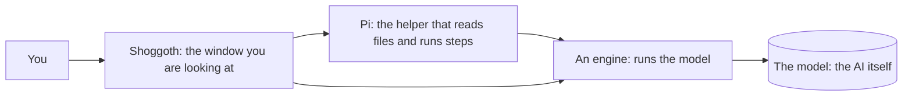

## What Shoggoth is

Shoggoth lets you use local AI on your own computer. You talk to it like a chat app, but the AI, your conversations and your files stay here. Two things can leave: web search, and a chat you start on a model another computer serves, where your message goes to that computer. Both are your choice. If the model wants to search, it asks first and shows the words it will use.

Every chat is a working session.

You can ask a question, get an answer, think something through, draw a diagram, draft some writing.

The AI works in a folder: it can look at the files in it, change them, and run commands in a terminal, while you watch. It asks your permission before it changes anything, unless you tell it not to.

Everything else in Shoggoth (Models, Skills, Advanced) exists to make those two things work well.

## The components

Four things work together. You only ever see Shoggoth, but it helps to know who does what.

| Part | What it does |
| --- | --- |
| **Shoggoth** | The window you are using. It shows the conversation, asks your permission, and manages everything else. |
| **Pi** | A helper that lets a model do things: read a file, edit it, run a command, follow a skill. It comes bundled inside Shoggoth. |
| **An engine** | A program that loads a model into your computer's memory and gets answers out of it. Shoggoth picks the right one for each model, starts it, and frees the memory when you switch, so you never have to. Shoggoth runs llama.cpp for you. It also finds engines already running on this computer, such as Ollama or LM Studio, and you can connect one under **Advanced > Engines**. |
| **The model** | The AI. A large file, usually a few gigabytes (a lot more for the Large ones), that you download once and keep. |

A model can also come from another computer: one on your network, or a server online you connected with its address and key. Shoggoth shows where every model comes from, and a chat on a model that leaves this computer says so before you send anything.

## Your first minutes

The first time you open Shoggoth it gets itself ready on one screen. It asks where your models should live. One click accepts the disk with the most room. Then it works through a short checklist by itself. It looks at your computer, gets the part that runs AI, and fits it to your graphics card. If you already have models or a setup, Shoggoth finds them and skips what it doesn't need. Then you choose a first model (one suggestion per size: Small, Medium or Large) and press **Start chatting**.

If you pick the recommended model you will be chatting within minutes, depending on your connection.

You can see the first-run screen again any time: go to **Help**, then **Run the welcome steps again**.

Closing the browser tab quits Shoggoth within about two seconds, unless a job is still working.

## Model pictures

Shoggoth draws every model as a creature, so you can tell your models apart at a glance. A creature is grown from the model's name, so the same model always looks the same:

- **Shape and colour** come from the name. Models of one family share them, whatever their size. There are 17 shapes.
- **Size** follows the biggest number before a "B" in the name (the parameter count). The bigger the model, the bigger the creature.
- **Camera eyes.** Every creature has large camera eyes. It gets more of them as it grows.
- **Hands.** Every creature holds pens. Bigger ones have more hands. They take up papers and then keyboards.
- **Skin** shows compression. Rougher skin is smaller and a little less exact.

They are pictures, not measurements: the eyes and hands say nothing about what a model can see or do. The model's card says that.

The creature for the chat's model sits in a glass tube at the top of the Chat page, wired to the model bar. The tube is empty until a model is loaded. The creature drops in when it loads. The liquid shows how full your graphics memory is. Click the tube to open the model list, which is the same as the model menu in the bar.

The **Hardware** and **Server** pages use the same creatures, on a lab bench. Don't like them? Turn them off with the **Model pictures** switch in the chat's right sidebar. Everything still works the same way.

## Chatting

Open **Chat** and type. The bar under the title shows which model will answer and whether it is in memory. Choose a model there to get it ready, or just send a message and Shoggoth loads it first.

Models are loaded into your graphics memory (primarily) and your RAM.

The first answer takes a little longer; subsequent answers arrive much faster. **Unload** in the same bar frees your graphics memory. While the model works, a small strip under the reply shows what it is doing: reading your message, thinking, writing or using a tool. It also shows loading, and waiting for your OK, when those happen. A line in italics under the strip says the same thing in a more unsettling way. Its thinking appears above the reply and folds away when it is done.

- Your conversations are listed on the left, with any jobs they started nested underneath. Click one to carry on where you left off, even after closing Shoggoth. To delete one, hover over it and press the cross.
- Speed: the pill at the top shows how fast the model is writing, in tokens per second. You can think of tokens as being roughly analogous to words. Anything above about 5 is comfortable to read, but you should ideally run faster models.
- How it thought: some models think before they answer. A small *How it thought* fold shows that thinking if you are curious.
- Adding a note: if an answer is taking a while, you can type again. Your note is passed along when the AI is ready for it. Press **Stop** to cancel what it is doing.
- The side panel (top right) has three tabs. **Jobs** shows background jobs, **Changes** shows what a job changed, and **Details** shows the folder, how careful it is, which model is answering, how full its memory is, and which skills are on.

A new chat works in your **home folder** unless you choose another. It says so at the top. Your home folder holds everything you own, so it starts on **Ask first** and a job (which works on a copy of a folder) needs a project folder. For focused work, choose the project's folder with the folder button under the message box.

**Web search.** When a question needs something recent or the AI is unsure, it can search the web. Every search asks first and shows the exact words it wants to search for, so you decide what leaves your computer. Choose **Allow for this session** to stop being asked in that chat. You get only the titles, links and short snippets of the top results. 

By default it uses DuckDuckGo. DuckDuckGo needs no key but has no official search service, so it can refuse. When that happens, Shoggoth does not keep retrying, so it doesn't spam DuckDuckGo. It tells you the search failed and carries on.

For search that works every time, get a free key from [Brave Search](https://brave.com/search/api/) or [Tavily](https://app.tavily.com/), then open the **Details** panel, find **Web search**, choose the provider, paste the key and press **Test search**. The key is kept on this computer and never shown again. You can also switch web search off there.

## Working in a folder

You can choose a folder with the folder button under the message box (or change it from the chip at the top of the chat). The AI can:

- look at files and search them,
- write new files and edit existing ones (you see exactly what changes),
- run commands, such as running a test or listing what is in a folder.

Try asking: *"Look through this folder and tell me what it's for"*, *"Write a README for this project"*, or *"Find where the settings are saved and explain it"*.

Every step appears as a small card in the conversation: what it read, what it changed, what it ran, and what came back. Click a card to open it. Edits show the old line and the new line, in red and green.

You can give Shoggoth a folder at any point, or change its folder from the Details tab. To let it see another folder as well, press **+ Folder** at the top. A new folder is **look only** by default: the AI can read it but not change it. Click the appropriate permissions label to let it change files there too.

Delete a conversation and the files it changed stay exactly as they are.

## Pictures and files

Some models can look at pictures: their card says **Understands pictures**. With one of those chosen, press **Add a picture…** next to the message box, or paste or drag pictures in (up to four). Say what you want to know, then send. Shoggoth shrinks large pictures first so they don't use up the model's memory. The button doesn't appear for models that can't see.

The paperclip, **Attach a file**, adds a file to the next message. Drag a file onto the message box or drop it there. The file is saved in the chat's folder under `attachments/`, and a small chip says how it will be read: text and code as they are, a PDF as text, or an image for a model that can see. A PDF needs `pdftotext` for text; without it, Shoggoth can turn its pages into images for a model that understands pictures. Spreadsheets and Word documents say they need a tool that isn't installed yet. A file you attach is never run. If a model can't see images, an image chip says it won't be sent.

## Speech

The microphone button beside the message box turns your voice into text. Hold it to talk, or click it to start and click again to stop. The words appear in the message box. They are not sent until you send them, so you can correct them first.

The first time, Shoggoth downloads whisper.cpp and a speech model for the processor, and shows how far along it is in the button. Speech runs on this computer: the recording goes to the local engine, is turned into text, and is not kept. If whisper.cpp cannot run, the button says so in plain words.

Recording happens in the page at 16 kHz mono, so no other program is needed.

## Jobs

A **job** is a bigger piece of work that the AI keeps going on its own while you do something else. Use it when one answer is not enough, such as "make the tests pass" or "tidy up these notes".

Press **Start a job…** under the message box (it is always there), or describe the work in the chat: the AI asks what done looks like, then fills the form in for you. It never starts the job itself. Either way, you fill in or check:

- **What should it get done?** Describe the goal in plain words.
- **Done when.** Either a command that succeeds, such as `python3 -m pytest -q`, or a description in your own words. Shoggoth runs the command itself after every round, so it does not depend on the AI saying it is finished.
- **Limits.** The most rounds and the most time it may use.
- **Where it works.** The safe choice is **a copy**: your folder stays untouched while the job runs. Choose **the folder itself** only for something you can roll back.
- **Wait for my OK after each round**, if you want to look in between.

The job appears as a card in the conversation and under its chat in the list. The card shows the round, how the check is going, and what the AI is doing right now. You can **Pause**, **Resume** or **Stop** it, or **Open** it to read everything it did and add a note for the next round. A job also stops by itself if the check stops improving, so it does not go round in circles.

When a job on a copy finishes, open the **Changes** tab. Click a file to see exactly what changed, tick the ones you want, and press **Apply**. A file you changed yourself in the meantime is skipped, never overwritten. **Throw away** deletes the copy. For a job that worked in the folder itself, the tab shows what changed, but the changes are already there.

If you close Shoggoth while a job is working, it comes back as **Interrupted** and **Continue** picks up where it stopped. Shoggoth stays open while a job is working, even if you close the tab.

Smaller models make mistakes. They can misread a file, invent details, or fail to use a tool at all. That is why Shoggoth asks before it acts. So keep a copy of any folder you ask it to work in.

## Staying in control

Under **How careful** in the Details panel, choose how much the AI may do without asking:

| Setting | What happens |
| --- | --- |
| **Ask first** (the usual) | It may look at things freely. Before every edit, new file or command, a card asks you: **Allow**, **Allow for this session**, or **Don't allow**. For a command you can also choose **Always allow**. |
| **Edit freely** | Edits to files inside the folder go ahead without asking. Commands, and anything outside the folder, still ask. |
| **Do everything** | It never asks. Use this only for a folder you can afford to lose. |
| **Look only** | It can read and propose, but cannot change anything. Good for "review this and tell me what you'd do". |

You can change the setting while a task is running. If the AI asks permission outside the folder you chose, the card says so in plain words.

**Always allow** remembers a command for that folder, such as `python3 -m pytest`. It only counts when the whole line is made of commands you allowed. It is never offered for commands that can do anything, like `rm`, `curl` or `sh`. To take one back, click the folder name at the top and press **Remove**. A folder set to **look only** can never be changed, in any setting except **Do everything**.

This structure helps, but it cannot stop a harmful command that you allow. If you allow a command, remember that it runs with your own permissions, the same as if you had typed it. Read what the card shows before pressing Allow.

## Skills

A **skill** is a short instruction sheet the AI reads when a job calls for it, like a recipe card: how to plan before building, how to hunt down a bug, how to draw a diagram, how to write good documents. Small models become much more dependable when they follow one.

Shoggoth comes with:

- **Superpowers**: a working method. Ask what the person really wants, make a plan, test first, find the cause of a bug before fixing it, and prove something works before saying so.
- **Diagrams**: draws pictures in the chat.
- **Markdown writing**: writes clear documents (READMEs, notes, changelogs, how-tos).
- **Start a job**: turns a bigger request into a filled-in job form for you to review.

Open **Skills** to switch any of them on or off, one at a time or a whole set at once.

**To add more skills, paste a link.** On the Skills page, paste the web address of a GitHub page that has skills in it, for example `https://github.com/owner/repository`. Then press **Add skills**. You can also link to one folder inside a repository: open the folder on GitHub and copy the address. Shoggoth finds every skill in it and adds them. A skill is just a folder with a file called `SKILL.md`. [Hermes Atlas](https://hermesatlas.com/ecosystem/) lists many.

**Skills you made yourself** go in a folder called `mine` inside Shoggoth's data folder (`~/.local/share/shoggoth/skills/mine`). Put a folder with a `SKILL.md` file in it and it shows up on the Skills page as **My skills**, switched on, from the next message. No other files are needed.

**Skills your models write.** When a model works out a procedure worth keeping, it can propose a skill. A card shows the whole skill and any extra files, and asks **Save**, **Save and turn on**, or **Don't save**. It asks in every mode, even *Do everything*. Saved ones appear under **Written by your models**, where you can edit the text in a plain box or delete one. In a chat's menu, **Make a skill from this chat** asks the model to distil what worked.

**Tools.** The Skills page has a **Tools** section for a few checked Pi packages that add abilities, such as reading spreadsheets. They run code on your computer, so Shoggoth offers only the packages on its own list, at an exact version checked against the publisher's checksum. None is switched on in this version until it has been tested with Shoggoth; the card says why it can't be installed yet. Installing or removing one restarts idle chats, so it applies from your next message.

Good to know:

- **Only add skills from people you trust.** A skill is instructions the AI follows. Some include scripts. While you are on *Ask first*, every command still asks you.
- Fewer is better for small models. Every skill you switch on adds a line the AI reads before every answer. A handful of well-chosen skills beats a hundred.
- In a conversation with a folder, type `/` to pick a skill by name and make the AI use it. You can see when it used one: a **Skill** card appears in the conversation.
- Skills work in every chat.
- Changes apply from your next message.

## Diagrams and documents

Ask for a picture and say what you want shown: *"Draw how someone logs in to a website"*, *"Diagram the steps of this project"*, *"Show how these tables relate"*. Shoggoth turns the AI's answer into a real picture in the chat, with **Copy code** and **Save as image** buttons.

Small models sometimes get the drawing code slightly wrong. If a diagram fails, Shoggoth shows what went wrong and a button, **Ask the model to fix it**.

Replies can also contain tables, lists, links, quotes and code blocks, shown neatly. In a conversation with a folder, ask it to write a document to a file and it will save it there.

## Choosing and managing models

Open **Models**. It lists every model on your computer, whichever program runs it. Models are grouped by size. **Small** ones use under 10 GB of graphics memory and are ready in seconds. **Medium** ones use 10 to 24 GB. **Large** ones are for big computers and take a couple of minutes to start.

The strip at the top of the page shows where models come from: llama.cpp on this computer, engines Shoggoth found already running, servers you connected, servers online, and other Shoggoths. The model picker in the chat bar groups them the same way. A source that is offline keeps its place, greyed out, so a chat's model does not silently disappear.

- **Installed** is what you have. **Recommended for this computer** has the models I have tried and recommend on systems from 10 GB of VRAM to 26 GB of VRAM, and any Large model that will fit yours. The Large picks are Qwen3.8 Flash-Next (IQ3_S, and the smaller IQ2_XS), plus Coder (code only) and Swift 1.5, which are offered but never suggested. You can pick one before llama.cpp is installed: Shoggoth sets llama.cpp up, then gets the model. Models that aren't ready yet are greyed out under **Coming soon**. **All models** is everything your engines report, tested or not, with a filter for pictures, speech and sound. Each model shows whether it is tuned.
- **Very large models.** Shoggoth runs large models through llama.cpp. Only the ones llama.cpp can serve are listed. For models with over a hundred billion parameters, llama.cpp is not yet as good as [Strata](https://github.com/Niko1221/Strata), [Basalt](https://github.com/jesdga95/basalt) and [Maya](https://github.com/mw00/project-maya). That is true as of November 2026. It will change. To run models that size, set one of those up yourself. Then connect it under Advanced, Connect a server.
- **Get it** downloads a model in the background while you carry on. Every download shows together in one "Getting models" strip. A model that needs something extra (the first Large model, for example) sets that up for you as part of the same step.
- **Add models from other sources** brings in a model from a Hugging Face link, from a folder you choose, or from the usual places other programs keep them (LM Studio, Ollama and so on). Nothing is copied.
- **Chat with it** starts a chat with a model. **Settings** on a model edits how it runs. Choosing a model in the chat gets it ready, and frees the memory of whatever else was running.
- Shoggoth keeps your models in one folder you choose (change it at the top of the **Models** page), with a subfolder for each engine. It moves nothing you already have. The name of the engine that runs a model is shown, small, at the foot of its card.

- Will it fit? Shoggoth compares a model's size with the memory that is free on your graphics card right now. Its card says **Runs well**, **Tight**, or **Too big for this computer**.
- For working in a folder, pick a model that handles tools well. Look for tool-calling in its description. The recommended ones lean that way. Models that are very small can still chat well but often fumble tools.
- Memory (the context window): this is how much the AI can keep in mind at once. Shoggoth sets a roomy 128k by default. Working in a folder can use a lot of it, because the AI reads files. The Details panel shows how full it is, with a **Make room** button that tidies the older part of the conversation. The **Memory** menu in the chat's model bar changes the size.
- **Settings for one model** (the **Settings** button on its card) let you change which devices it uses, backend options and more. The defaults are fine for nearly everyone. Chat always loads a model with the context size in its model bar.

## Connecting a server of your own

Shoggoth runs llama.cpp by itself. If you already run another server, you can use its models in Chat and in your other apps.

- Open **Advanced > Engines** and find **Connect a server**. Pick Ollama, LM Studio, llama.cpp, Strata, Maya, Unsloth, or **Another server** for anything that speaks the OpenAI API.
- The address fills in with the usual one for that server. Change it if yours is different, and add the API key if it has one. Then press **Probe and connect**. Shoggoth looks at that address and at the usual address of each server in the list. It connects the ones that answer. It skips any that want a key (add those with the form) and any you already connected.
- Its models appear in the model picker as `<server name>/<model>`.
- **Shoggoth never starts, stops, updates or installs a connected server.** Start it yourself first. It does not free memory for it either, so if it shares a graphics card with Shoggoth's llama.cpp, you manage that. **Remove** forgets the address and leaves the server alone.

## Models online

Shoggoth doesn't come with any paid services built in: their prices and terms change faster than Shoggoth is released. If you want a model that runs on someone else's computers, connect it like any other server.

- Under **Advanced > Engines**, **Connect a server** takes its address and your key. Choose **Another server** for anything that speaks the OpenAI API.
- To have Shoggoth recognise a service by name, or use the Anthropic or Google API format for some of its models, put a definition in `~/.local/share/shoggoth/engines.d/`. No new copy of Shoggoth is needed. `docs/ENGINES.md` describes the file.
- A key is kept on this computer and is shown only by its last four characters after you save it.
- A chat on a model online carries a **Leaves your computer: <server>** chip, so you always know. Your message goes to that server. Everything else in the chat still runs here.
- Shoggoth never chooses a model online for you. You pick it from the model bar like any other.

## Other computers on your network

A second computer running Shoggoth can use the models on this one, and this copy can use the models on it. Both computers make the choice; nothing is shared until you pair them.

- On the **Server** page, turn on **Share my models**, and give this computer a name if you like.
- The other computer finds this one under **Other Shoggoths**. Ask to pair. This computer shows a six-digit code and the other computer's name. Type the code there.
- Once paired, the two check a short fingerprint with **Check this matches on the other computer**. Each paired computer gets its own key.
- Paired computers speak over HTTPS only. **Remove** on either side stops that key at once.
- Requests from the other computer appear on the Server page like any other app's, so you can see what it asks for.

Sharing is only for Shoggoth. If you want another program to use your models, use the address and key on the **Server** page instead.

## Tuning

**Advanced > Tuning** makes a model answer faster on your computer. It measures the model as it is, tries changes one at a time, and keeps only those that clearly help. Answers stay the same: tuning never changes how a model is compressed.

- **Models on llama.cpp** are tuned by Shoggoth: batch sizes, flash attention, threads, which backend and which graphics cards. Each is tried by loading the model with it, and a change is kept only if it beats the measuring noise (and at least 3%). **Undo** puts the old settings back.
- Every model shows one of four states: tuned (with its speed and gain), tuned but the standard settings were already the fastest, out of date, or not tuned. **Test speed** measures a small or medium model without changing anything. Every model card has **Leave some graphics memory free**. Each reply in Chat shows how fast it was written.
- Tuning needs the graphics cards to itself, so Shoggoth shows the plan first (time, and what it will stop) and waits for your go-ahead. It stops what Shoggoth started. It waits while a chat is answering. It will not start while a large model you started yourself is running. You can cancel at any time and nothing is changed.

## Using your models in other apps

**Advanced**, then **Server**, gives you an address and a key to paste into other tools (coding assistants, chat apps, anything that talks to an OpenAI-style server). The same page shows live what those apps are asking for: the model sits in a jar on a bench. Each app's request is a flask that bubbles while the model thinks and fills as it writes. **Send a test message** shows one. It only listens on this computer unless you turn on sharing.

## Advanced, page by page

Everything in **Advanced** is optional.

- **Hardware** is a lab bench. Each machine at the back is one graphics card, with lights for how hard it is working and the name of the model on it. The beaker shows memory used across all your cards. The gauge shows the hottest card. The coil and radio show how hard they compute. Below the bench you choose which cards Shoggoth uses, and in what order.
- **Engines** has a card for llama.cpp, with its version, whether it is running, an update check, and which build it uses (CUDA, Vulkan, ROCm or the processor). Under it, **Connect a server** adds one you run yourself. Each connected server has its own card. To teach Shoggoth a new engine, put a definition file in `engines.d` in the data folder; it can say how to recognise the engine but cannot run anything. A definition file that failed to load is shown in the Models page's sources strip with the line to fix. To add an engine Shoggoth starts for you, put a folder with a `provider.yaml` in the engines folder shown at the bottom of the page, then press **Reload**. Shoggoth asks once before an engine you added runs a program. The repository's `docs/ENGINES.md` explains both files. `engines check <file>` and `providers check <folder>` (run the AppImage with those words) tell you what to fix before you reload.
- **Engine settings** is every setting the engine has, searchable.
- **Themes** changes how Shoggoth looks. **Light Touch** is the default; **Braun T3** and **Teenage Engineering** are softer and bolder takes on the same idea. The rest borrow colour schemes from popular code editors (Dracula, Nord, Monokai Pro, GitHub Light and more). Nothing moves when you switch. Your choice is remembered on this computer.
- **Check and update everything**, on the Engines page, updates Shoggoth, llama.cpp and Pi together.

## Where things live, and privacy

Your chats, jobs, skills and settings are saved on your computer. As the opening section says, only web search and a chat on a model from another computer send anything out, and both are your choice.

- **Conversations and what the AI did** are saved in Shoggoth's own folder (`~/.local/share/shoggoth/cowork/`). That includes the copies that jobs work on until you apply or throw them away. Files you attach are in `attachments/` inside the chat's folder, or in the chat's scratch folder when it has no folder.
- **Skills you added** are in `~/.local/share/shoggoth/skills/`. Skills your models wrote are under `sets/own/`.
- **Speech to text** puts whisper.cpp and its model in `~/.local/share/shoggoth/whisper/`. **Read aloud**, when it is turned on, puts Piper and its voices in `~/.local/share/shoggoth/piper/`.
- **Pi packages** you install are in `~/.local/share/shoggoth/pi-packages/`.
- **Newer versions of Pi** that you download are in `~/.local/share/shoggoth/pi/`.
- **Sharing** keeps the certificate, its key and the hashes of paired computers' keys in `~/.local/share/shoggoth/lan/`.
- **Models** are in the folder you chose (the **Models** folder, with a subfolder for each engine), or in the Hugging Face cache (`~/.cache/huggingface/hub`) if you kept that. Models you added from elsewhere stay where they are.
- **Settings and keys** are in `~/.config/shoggoth/`.

Shoggoth goes online only to: download models you ask for, download the speech engine or voice you set up, check for Shoggoth, engine and Pi updates (you can turn that off), fetch skills when you paste a link, install a checked Pi package you pick, search the web when you allow it, and talk to a server you connected. Sharing sends a small beacon on your own network and nothing else. Pi runs offline and sends nothing anywhere. To start from scratch, delete `~/.config/shoggoth` and `~/.local/share/shoggoth`.

**Coming from Zest?** Shoggoth used to be called Zest. The first time it starts, it moves `~/.config/zest` and `~/.local/share/zest` to the new names. It keeps your chats, skills, settings and keys. Apps that use a `zest-` key keep working.

**Coming from 4.x?** The first time 5.0 starts, it moves a 4.x setup to llama.cpp and leaves every model file where it is: it links the models 4.x downloaded, maps old model names to new ones, carries each model's saved context size and options into llama.cpp's presets, and stops the engine 4.x started itself (one you started is left alone). It then counts the space 4.x's own files take, and **Advanced > Engines** offers to delete them. That never deletes a model. The move is safe to run again, and nothing is deleted without asking.

## When something goes wrong

**The answer never starts, or it is very slow.** The model may still be loading, or it may be too big for your graphics card. Close games and other heavy programs, or pick a smaller model in the **Models**.

**The model seems to have very little memory.** Look at the bar under the chat's title: it shows how much context the model has. Pick 128k from the **Memory** menu there and Shoggoth reloads the model, which takes a moment.

**It printed something that looks like code instead of doing the task.** The model did not manage to use its tools. Try asking again more simply, or switch to a stronger model in the Details panel.

**It keeps asking permission.** That is *Ask first* doing its job. Choose **Allow for this session** for edits, **Always allow** for a command you run often, or switch to **Edit freely** for a folder you trust.

**A diagram did not draw.** Press **Ask the model to fix it**. If it still fails, ask for a simpler diagram with fewer boxes.

**The microphone does not work.** The first press sets up whisper.cpp and downloads its model; the button shows the progress and asks for another press when it is done. The browser must be allowed to use the microphone. If the button still says it cannot run, whisper.cpp may not start on this computer; the message says why.

**An attached PDF is not read.** Reading a PDF as text needs `pdftotext` from poppler (`poppler-utils` on most Linux systems). Without it, Shoggoth can turn the PDF's pages into pictures for a model that understands pictures. The chip on the file says which will happen.

**A tool cannot be installed.** Every package in the Tools list is off until it has been tested with Shoggoth, and the card says so. Shoggoth only installs the packages on that list, at the exact version in it.

**Another computer does not appear under Other Shoggoths.** Both computers must be on the same network, sharing must be on for the one sharing its models, and the network must allow the small UDP beacon on port 13309. Pairing is the only way to connect; a code from one computer is typed on the other.

**"The Pi agent isn't installed."** This only happens when running Shoggoth from source rather than the AppImage. [docs/DEVELOPMENT.md](https://github.com/yudhanjaya/Shoggoth/blob/main/docs/DEVELOPMENT.md) explains how to add it.

**The app won't open.** Shoggoth needs Linux on x86_64 with a few common libraries: OpenSSL 3, zstd and libdrm. If the AppImage fails with a FUSE error, run it with `./Shoggoth-*-x86_64.AppImage --appimage-extract-and-run` instead.

**Something else is off.** **Advanced**, then **Server**, shows the activity log at the bottom. **Help**, then **Restart the helper** restarts the engine Shoggoth started.

## Terms used

- **Model**: the AI itself, a big file on your computer.
- **Source**: where a model comes from: llama.cpp on this computer, an engine Shoggoth found, a server you connected, or another Shoggoth.
- **Engine**: a program that runs the model. Shoggoth runs llama.cpp. A server you run yourself and connect also counts as an engine. Shoggoth never starts or stops it.
- **Model online**: a model that runs on a server somewhere else, often a company's, and usually needs a key. A chat on one leaves your computer and goes to that server.
- **Pi package**: code added to Pi that gives it new tools or skills. It runs on this computer, so only Shoggoth's checked list can be installed.
- **Attachment**: a file you add to a message. It is saved in the chat's folder and never run.
- **Small, Medium, Large**: how Shoggoth groups models by what they need. Small fits under 10 GB of graphics memory, Medium 10 to 24 GB, and Large needs more than that.
- **Models**: the list of every model on your computer, and where you get new ones.
- **Pi**: the helper that lets a model read files, make edits and run steps.
- **Agent**: an AI that can take steps on its own (look, edit, run) instead of only talking.
- **Skill**: a short instruction sheet the AI follows for a particular kind of job.
- **Token**: a small piece of a word. About 4 tokens make 3 words. Speed and memory are measured in them.
- **Context window**: how many tokens the AI can keep in mind at once. Its working memory.
- **Tool**: something the AI can use, such as reading a file or running a command.
- **Backend**: the part of an engine that runs a model on your hardware (CUDA, Vulkan, ROCm, processor).
- **Folder (task)**: a conversation where the AI works in a folder you chose.
- **Job**: a goal the AI works on in the background, round after round, until a check you chose passes.
