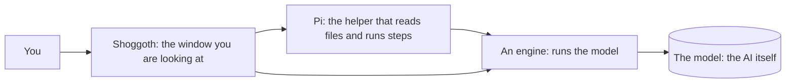

## What Shoggoth is

Shoggoth lets you use local AI on your own computer. You talk to it like a chat app, but nothing leaves your machine: the AI, your conversations and your files all stay here. The one exception is web search, which you control - if the model wants to look something up, it asks first and shows the words it will search for.

Every chat is a working session.

You can ask a question, get an answer, think something through, draw a diagram, draft some writing.

The AI works in a folder: it can look at the files in it, change them, and run commands in a terminal, while you watch. It asks your permission before it changes anything, unless you tell it not to.

Everything else in Shoggoth (Library, Skills, Settings, Advanced) exists to make those two things work well.

## The components

Four things work together. You only ever see Shoggoth, but it helps to know who does what.

| Part | What it does |
| --- | --- |
| **Shoggoth** | The window you are using. It shows the conversation, asks your permission, and manages everything else. |
| **Pi** | A helper that lets a model do things: read a file, edit it, run a command, follow a skill. It comes bundled inside Shoggoth. |
| **An engine** | A program that loads a model into your computer's memory and gets answers out of it. Shoggoth picks the right one for each model, starts it, and frees the memory when you switch, so you never have to. Small and medium models run on one engine and large models on another; **Advanced > Engines** names them if you are curious. |
| **The model** | The AI. A large file, usually a few gigabytes (a lot more for the Large ones), that you download once and keep. |

## Your first minutes

The first time you open Shoggoth it gets itself ready on one screen. It asks where your models should live. One click accepts the disk with the most room. Then it works through a short checklist by itself. It looks at your computer, gets the part that runs AI, and fits it to your graphics card. If you already have models or a setup, Shoggoth finds them and skips what it doesn't need. Then you choose a first model (one suggestion per size: Small, Medium or Large) and press **Start chatting**.

If you pick the recommended model you will be chatting within minutes, depending on your connection.

You can see the first-run screen again any time: go to **Help**, then **Run the welcome steps again**.

## Model pictures

Shoggoth draws every model as a creature. Each one is made from the model itself, so the same model always looks the same:

- **Eyes** show how much it remembers (its context window). More eyes, more memory.
- **Size** shows how many parameters it has.
- **Skin** shows how tightly it is compressed. Rougher skin is smaller and a little less exact.
- **Hands holding pens** mean it can use tools.
- Models from the same family share a body shape and colour.

The creature for the chat's model sits in a glass tube at the top of the Chat page, wired to the model bar. It wakes up when the model is loading, thinking or writing. Click the tube (or **Open the machine** in the model menu) to open **the Machine**: a drawer with one slot for each engine and a shelf of every model you have. Load and unload models there if you like seeing what is in memory.

The **Hardware** and **Server** pages use the same creatures, on a lab bench. Don't like them? Turn them off under **Settings › Look**. Everything still works the same way.

## Chatting

Open **Chat** and type. The bar under the title shows which model will answer and whether it is in memory. Choose a model there to get it ready, or just send a message and Shoggoth loads it first.

Models are loaded into your graphics memory (primarily) and your RAM.

The first answer takes a little longer; subsequent answers arrive much faster. **Free memory** in the same bar frees your graphics memory. While the model works, a small strip under the reply shows what it is doing: reading your message, thinking, writing or using a tool. It also shows loading, and waiting for your OK, when those happen. A line in italics under the strip says the same thing in a more unsettling way. Its thinking appears above the reply and folds away when it is done.

- Your conversations are listed on the left, with any jobs they started nested underneath. Click one to carry on where you left off, even after closing Shoggoth. To delete one, hover over it and press the cross.
- Speed: the pill at the top shows how fast the model is writing, in tokens per second. You can think of tokens as being roughly analogous to words. Anything above about 5 is comfortable to read, but you should ideally run faster models.
- How it thought: some models think before they answer. A small *How it thought* fold shows that thinking if you are curious.
- Adding a note: if an answer is taking a while, you can type again. Your note is passed along when the AI is ready for it. Press **Stop** to cancel what it is doing.
- The side panel (top right) has three tabs. **Jobs** shows background jobs, **Changes** shows what a job changed, and **Details** shows the folder, how careful it is, which model is answering, how full its memory is, and which skills are on.

A new chat works in your **home folder** unless you choose another, and says so at the top. Your home folder holds everything you own, so it starts on **Ask first** and a job (which works on a copy of a folder) needs a project folder. For focused work, choose the project's folder with the folder button under the message box.

**Web search.** When a question needs something recent or the AI is unsure, it can search the web. Every search asks first and shows the exact words it wants to search for, so you decide what leaves your computer. Choose **Allow for this session** to stop being asked in that chat. You get only the titles, links and short snippets of the top results. 

By default it uses DuckDuckGo. DuckDuckGo needs no key but has no official search service, so it can refuse. When that happens, Shoggoth does not keep retrying - we don't want to spam DuckDuckGo. It will tell you the search failed and carry on.

For search that works every time, get a free key from [Brave Search](https://brave.com/search/api/) or [Tavily](https://app.tavily.com/), then open the **Details** panel, find **Web search**, choose the provider, paste the key and press **Test search**. The key is kept on this computer and never shown again. You can also switch web search off there.

## Working in a folder

You can choose a folder with the folder button under the message box (or change it from the chip at the top of the chat). The AI can:

- look at files and search them,
- write new files and edit existing ones (you see exactly what changes),
- run commands, such as running a test or listing what is in a folder.

Try asking: *"Look through this folder and tell me what it's for"*, *"Write a README for this project"*, or *"Find where the settings are saved and explain it"*.

Every step appears as a small card in the conversation: what it read, what it changed, what it ran, and what came back. Click a card to open it. Edits show the old line and the new line, in red and green.

You can give Shoggoth a folder at any point, or change its folder from the Details tab. To let it see another folder as well, press **+ Folder** at the top. A new folder is **look only** by default: the AI can read it but not change it. Click the appropriate permissions label to let it change files there too.

Delete a conversation and the files it changed stay exactly as they are.

## Jobs

A **job** is a bigger piece of work that the AI keeps going on its own while you do something else. Use it when one answer is not enough, such as "make the tests pass" or "tidy up these notes".

Press **Start a job…** under the message box, then fill in:

- **What should it get done?** Describe the goal in plain words.
- **Done when.** Either a command that succeeds, such as `python3 -m pytest -q`, or a description in your own words. Shoggoth runs the command itself after every round, so it does not depend on the AI saying it is finished.
- **Limits.** The most rounds and the most time it may use.
- **Where it works.** The safe choice is **a copy**: your folder stays untouched while the job runs. Choose **the folder itself** only for something you can roll back.
- **Wait for my OK after each round**, if you want to look in between.

The job appears as a card in the conversation and under its chat in the list. The card shows the round, how the check is going, and what the AI is doing right now. You can **Pause**, **Resume** or **Stop** it, or **Open** it to read everything it did and add a note for the next round. A job also stops by itself if the check stops improving, so it does not go round in circles.

When a job on a copy finishes, open the **Changes** tab. Click a file to see exactly what changed, tick the ones you want, and press **Apply**. A file you changed yourself in the meantime is skipped, never overwritten. **Throw away** deletes the copy. For a job that worked in the folder itself, the tab shows what changed, but the changes are already there.

If you close Shoggoth while a job is working, it comes back as **Interrupted** and **Continue** picks up where it stopped. Shoggoth stays open while a job is working, even if you close the tab.

Smaller models make mistakes. They can misread a file, invent details, or fail to use a tool at all. That is why Shoggoth asks before it acts. Because of this, it's always worth maintaining a copy of whatever folder you ask it to work in. 

## Staying in control

Under **How careful** in the Details panel, choose how much the AI may do without asking:

| Setting | What happens |
| --- | --- |
| **Ask first** (the usual) | It may look at things freely. Before every edit, new file or command, a card asks you: **Allow**, **Allow for this session**, or **Don't allow**. For a command you can also choose **Always allow**. |
| **Edit freely** | Edits to files inside the folder go ahead without asking. Commands, and anything outside the folder, still ask. |
| **Do everything** | It never asks. Use this only for a folder you can afford to lose. |
| **Look only** | It can read and propose, but cannot change anything. Good for "review this and tell me what you'd do". |

You can change the setting while a task is running. If the AI asks permission outside the folder you chose, the card says so in plain words.

**Always allow** remembers a command for that folder, such as `python3 -m pytest`. It only counts when the whole line is made of commands you allowed, and it is never offered for commands that can do anything, like `rm`, `curl` or `sh`. To take one back, click the folder name at the top and press **Remove**. A folder set to **look only** can never be changed, in any setting except **Do everything**.

This structure helps, but it cannot stop a harmful command that you allow. If you allow a command, remember that it it runs with your own permissions, the same as if you had typed it. Read what the card shows before pressing Allow.

## Skills

A **skill** is a short instruction sheet the AI reads when a job calls for it, like a recipe card: how to plan before building, how to hunt down a bug, how to draw a diagram, how to write good documents. Small models become much more dependable when they follow one.

Shoggoth comes with:

- **Superpowers**: a working method. Ask what the person really wants, make a plan, test first, find the cause of a bug before fixing it, and prove something works before saying so.
- **Diagrams**: draws pictures in the chat.
- **Markdown writing**: writes clear documents (READMEs, notes, changelogs, how-tos).

Open **Skills** to switch any of them on or off, one at a time or a whole set at once.

**To add more skills, paste a link.** On the Skills page, paste the web address of a GitHub page that has skills in it, for example `https://github.com/owner/repository`, and press **Add skills**. You can also link to one folder inside a repository: open the folder on GitHub and copy the address. Shoggoth finds every skill in it and adds them. A skill is just a folder with a file called `SKILL.md`. [Hermes Atlas](https://hermesatlas.com/ecosystem/) lists many. 

**Skills you made yourself** go in a folder called `mine` inside Shoggoth's data folder (`~/.local/share/shoggoth/skills/mine`). Put a folder with a `SKILL.md` file in it and it shows up on the Skills page as **My skills**, switched on, from the next message. No other files are needed.

Good to know:

- **Only add skills from people you trust.** A skill is instructions the AI follows, and some include scripts. While you are on *Ask first*, every command still asks you.
- Fewer is better for small models. Every skill you switch on adds a line the AI reads before every answer. A handful of well-chosen skills beats a hundred.
- In a conversation with a folder, type `/` to pick a skill by name and make the AI use it. You can see when it used one: a **Skill** card appears in the conversation.
- Skills work in every chat.
- Changes apply from your next message.

## Diagrams and documents

Ask for a picture and say what you want shown: *"Draw how someone logs in to a website"*, *"Diagram the steps of this project"*, *"Show how these tables relate"*. Shoggoth turns the AI's answer into a real picture in the chat, with **Copy code** and **Save as image** buttons.

Small models sometimes get the drawing code slightly wrong. If a diagram fails, Shoggoth shows what went wrong and a button, **Ask the model to fix it**.

Replies can also contain tables, lists, links, quotes and code blocks, shown neatly. In a conversation with a folder, ask it to write a document to a file and it will save it there.

## Choosing and managing models

Open **Library**. It lists every model on your computer, whichever program runs it. Models are grouped by size. **Small** ones use under 10 GB of graphics memory and are ready in seconds. **Medium** ones use 10 to 24 GB. **Large** ones are for big computers and take a couple of minutes to start.

- **Installed** is what you have. **Recommended for this computer** has the models I have tried and recommend on systems from 10 GB of VRAM to 26 GB of VRAM, and any Large model that will fit yours. **Everything** is the full list, with a filter for pictures, speech and sound.
- **Get it** downloads a model in the background while you carry on. Every download shows together in one "Getting models" strip, and a model that needs something extra (the first Large model, for example) sets that up for you as part of the same step.
- **Add models** brings in a model from a Hugging Face link, from a folder you choose, or from the usual places other programs keep them (LM Studio, Ollama and so on). Nothing is copied.
- **Chat with it** starts a chat with a model, and **Settings** on a model edits how it runs. Choosing a model in the chat gets it ready, and frees the memory of whatever else was running.
- Shoggoth keeps your models in one folder you choose (change it in **Settings**), with a subfolder for each engine, and moves nothing you already have. The name of the engine that runs a model is shown, small, at the foot of its card.

- Will it fit? Shoggoth compares a model's size with the memory that is free on your graphics card right now, and marks it comfortable, snug or too big.
- For working in a folder, pick a model that handles tools well. Look for tool-calling in its description. The recommended ones lean that way. Models that are very small can still chat well but often fumble tools.
- Memory (the context window): this is how much the AI can keep in mind at once. Shoggoth sets a roomy 128k by default. Working in a folder can use a lot of it, because the AI reads files. The Details panel shows how full it is, with a **Make room** button that tidies the older part of the conversation. The **Memory** menu in the chat's model bar changes the size.
- **Settings for one model** (the **Settings** button on its card) let you change which devices it uses, backend options and more. The defaults are fine for nearly everyone. Chat always loads a model with the context size in its model bar.

## Large models

Some models are far too big for a graphics card. Shoggoth can still run them, by keeping part of the model in your RAM and on your SSD. They're slower than a model that fits, and they take a couple of minutes to start. They also need plenty of disk and a lot of RAM: the Large group is meant for computers with about 64 GB. They sit in the **Large** group of the Library, and you use them like any other model.

- **Choosing one is the same as choosing any model.** Under **Recommended for this computer**, Shoggoth looks at your RAM, graphics memory and free disk and suggests the best Large model that fits. **Get it** downloads it. The first time, Shoggoth also sets up the program that runs large models for you: it downloads it, checks it against the checksum its authors publish, and fits it to your computer. There is nothing to configure. Choose the model in Chat and a card shows it starting.
- **Memory is shared.** Only one big model runs at a time. When you pick a Large model, Shoggoth frees whatever else was running first. Before it starts, Shoggoth checks there is enough free memory and, if not, says how much is missing and which programs are using the most (with a **Start anyway** button). Picking a smaller model later frees the big one again, unless it is answering right now.
- **It frees itself.** A large model Shoggoth started is stopped after 20 idle minutes, and the next chat starts it again. Change this under **Memory** in **Settings**, or set 0 to keep it ready.
- **Updates come with everything else.** **Check and update everything** in Settings includes the large-model program. If the one Shoggoth started is running, Shoggoth stops it, updates it and starts it again when a chat needs it.
- **If you already run one yourself.** If you have already installed that program, or already have a big model running (started in a terminal, by its own app, or by hand), Shoggoth finds it and lists those models in the Library with no setup. When it has been idle, it frees its model's memory; Shoggoth keeps listing the model, and your next message wakes it. Shoggoth never stops, restarts or updates one you started yourself, and won't start a second big model beside it. It has a **Stop** button (with a confirmation) only when you ask for one.

The program is [Strata](https://github.com/Niko1221/Strata). Its saved setups, a way to connect to one on another computer, and its installer are all under **Advanced > Engines**.

## Tuning

**Advanced > Tuning** makes a model answer faster on your computer. It measures the model as it is, tries changes one at a time, and keeps only those that clearly help. Answers stay the same: tuning never changes how a model is compressed.

- **Large models** are tuned by their own engine's tuner, quick (about 20 minutes) or thorough (up to 2 hours), for chat or for coding with long prompts. The result is saved and used every time the model starts. **Switch off** keeps it but goes back to the standard settings.
- **Small and medium models** are tuned by Shoggoth: batch sizes, flash attention, threads, which backend and which graphics cards. Each is tried by loading the model with it, and a change is kept only if it beats the measuring noise (and at least 3%). **Undo** puts the old settings back.
- Tuning needs the graphics cards to itself, so Shoggoth shows the plan first (time, and what it will stop) and waits for your go-ahead. It stops what Shoggoth started, and waits while a chat is answering. It will not start while a large model you started yourself is running. You can cancel at any time and nothing is changed.

## Using your models in other apps

**Advanced**, then **Server**, gives you an address and a key to paste into other tools (coding assistants, chat apps, anything that talks to an OpenAI-style server). The same page shows live what those apps are asking for: the model sits in a jar on a bench, and each app's request is a flask that bubbles while the model thinks and fills as it writes. **Send a test message** shows one. It only listens on this computer unless you turn on sharing.

## Under the bonnet

Everything in **Advanced** is optional.

- **Hardware** is a lab bench. Each machine at the back is one graphics card, with lights for how hard it is working and the name of the model on it. The beaker shows memory used across all your cards, the gauge shows the hottest card, and the coil and radio show how hard they compute. Below the bench you choose which cards Shoggoth uses, and in what order.
- **Engines** has a card for each program Shoggoth uses to run models: [Lemonade](https://lemonade-server.ai) for small and medium models, Strata for Large ones, and any you add. Each card shows its version, whether it is running and who started it, an update check, and a Stop button for ones Shoggoth started. Each card also holds that engine's own details. Lemonade's shows which hardware each kind of model uses (CUDA, Vulkan, ROCm or the processor). Strata's has your saved setups, a link to a Strata on another computer, and its installer. You can add your own engine by putting a folder with a `provider.yaml` file in the engines folder shown at the bottom of the page, then pressing **Reload**. Shoggoth asks once before an engine you added runs a program. The repository's `docs/ENGINES.md` explains how, and `providers check <folder>` (run the AppImage with those words) tells you what to fix before you reload.
- **Engine settings** is every setting Lemonade has, searchable.
- **Themes** changes how Shoggoth looks. **Light Touch** is the default; **Braun T3** and **Teenage Engineering** are softer and bolder takes on the same idea, and the rest borrow colour schemes from popular code editors (Dracula, Nord, Monokai Pro, GitHub Light and more). Nothing moves when you switch, and your choice is remembered on this computer.
- **Settings** (in the main menu, not under Advanced) is where you choose where your models live, how long large models stay in memory, and how much a chat remembers. **Check and update everything** is there too. Its **My own server** section is for the rare case where you run Lemonade yourself, for example as a system service: connect Shoggoth to it there instead of using the one Shoggoth starts.

## Where things live, and privacy

Everything stays on your computer.

- **Conversations and what the AI did** are saved in Shoggoth's own folder (`~/.local/share/shoggoth/cowork/`). That includes the copies that jobs work on until you apply or throw them away.
- **Skills you added** are in `~/.local/share/shoggoth/skills/`.
- **Newer versions of Pi** that you download are in `~/.local/share/shoggoth/pi/`.
- **Models** are in the folder you chose (the **Models** folder, with a subfolder for each engine), or in the Hugging Face cache (`~/.cache/huggingface/hub`) if you kept that. Models you added from elsewhere stay where they are.
- **Settings and keys** are in `~/.config/shoggoth/`.

Shoggoth goes online only to: download models you ask for, check for Shoggoth, engine and Pi updates (you can turn that off), and fetch skills when you paste a link. Pi runs offline and sends nothing anywhere. To start from scratch, delete `~/.config/shoggoth` and `~/.local/share/shoggoth`.

**Coming from Zest?** Shoggoth used to be called Zest. The first time it starts, it moves `~/.config/zest` and `~/.local/share/zest` to the new names, and keeps your chats, skills, settings and keys. Apps that use a `zest-` key keep working.

## When something goes wrong

**The answer never starts, or it is very slow.** The model may still be loading, or it may be too big for your graphics card. Close games and other heavy programs, or pick a smaller model in the **Library**.

**The model seems to have very little memory.** Look at the bar under the chat's title: it shows how much context the model has. Pick 128k from the **Memory** menu there and Shoggoth reloads the model, which takes a moment.

**It printed something that looks like code instead of doing the task.** The model did not manage to use its tools. Try asking again more simply, or switch to a stronger model in the Details panel.

**It keeps asking permission.** That is *Ask first* doing its job. Choose **Allow for this session** for edits, **Always allow** for a command you run often, or switch to **Edit freely** for a folder you trust.

**A diagram did not draw.** Press **Ask the model to fix it**. If it still fails, ask for a simpler diagram with fewer boxes.

**"The Pi agent isn't installed."** This only happens when running Shoggoth from source rather than the AppImage. The README explains how to add it.

**Something else is off.** **Advanced**, then **Server**, shows the activity log at the bottom. **Help**, then **Restart the helper** restarts the engine Shoggoth started.

## Terms used

- **Model**: the AI itself, a big file on your computer.
- **Engine**: a program that runs the model. Shoggoth picks and starts the right one for each model. (Lemonade runs small and medium models; Strata runs Large ones.)
- **Small, Medium, Large**: how Shoggoth groups models by what they need. Small fits under 10 GB of graphics memory, Medium 10 to 24 GB, and Large is for big computers with lots of RAM.
- **Library**: the list of every model on your computer, and where you get new ones.
- **Pi**: the helper that lets a model read files, make edits and run steps.
- **Agent**: an AI that can take steps on its own (look, edit, run) instead of only talking.
- **Skill**: a short instruction sheet the AI follows for a particular kind of job.
- **Token**: a small piece of a word. About 4 tokens make 3 words. Speed and memory are measured in them.
- **Context window**: how many tokens the AI can keep in mind at once. Its working memory.
- **Tool**: something the AI can use, such as reading a file or running a command.
- **Backend**: the part of an engine that runs a model on your hardware (CUDA, Vulkan, ROCm, processor).
- **Folder (task)**: a conversation where the AI works in a folder you chose.
- **Job**: a goal the AI works on in the background, round after round, until a check you chose passes.
