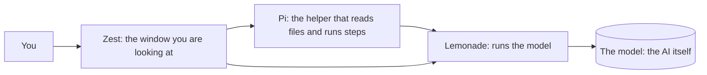

## What Zest is

Zest lets you use AI on your own computer. You talk to it like a chat app, but nothing leaves your machine: the AI, your conversations and your files all stay here.

You can use it in two ways, and switch between them whenever you like:

- **Just chat.** Ask a question, get an answer, think something through, draw a diagram, draft some writing.
- **Work in a folder.** Pick a folder and the AI can look at the files in it, change them, and run commands, while you watch. It asks your permission before it changes anything, unless you tell it not to.

Everything else in Zest (Models, Skills, Advanced) exists to make those two things work well.

## The parts, in plain words

Four things work together. You only ever see Zest, but it helps to know who does what.

| Part | What it does |
| --- | --- |
| **Zest** | The window you are using. It shows the conversation, asks your permission, and manages everything else. |
| **Pi** | A helper that lets a model do things: read a file, edit it, run a command, follow a skill. It comes inside Zest. |
| **Lemonade** | The engine that loads a model into your computer's memory and gets answers out of it. It also comes inside Zest. |
| **The model** | The AI. A large file, usually a few gigabytes, that you download once and keep. |

## Your first minutes

The first time you open Zest it walks you through four short steps: start the helper, check your graphics card, download a model, start chatting. Each is one button. If you pick the suggested model (Quick, Balanced or Thorough) you will be chatting within minutes, depending on your connection.

You can repeat the tour any time: **Help**, then **Run the welcome steps again**.

## Chatting

Open **Chat** and type. The first answer takes a little longer because the model has to be loaded into memory. After that, answers start quickly.

- **Your conversations** are listed on the left. Click one to carry on where you left off, even after closing Zest. To delete one, hover over it and press the cross.
- **Speed.** The pill at the top shows how fast the model is writing, in words per moment (tokens per second). Anything above about 5 is comfortable to read.
- **How it thought.** Some models think before they answer. A small *How it thought* fold shows that thinking if you are curious.
- **Add a note while it works.** If an answer is taking a while, you can type again. Your note is passed along when the AI is ready for it. Press **Stop** to cancel what it is doing.
- **Details** (top right) opens a side panel: the folder, how careful it is, which model is answering, how full its memory is, which skills are on, and which files it has changed.
- **Earlier chats** (link at the bottom of the list) holds conversations from before version 3. They stay in your browser and still work.

A chat with no folder is a plain conversation. The AI cannot see or change anything on your computer.

## Working in a folder

Press **Work in a folder…** under the message box and choose a folder. From then on, the AI can:

- **Look** at files and search them,
- **Write** new files and **edit** existing ones (you see exactly what changes),
- **Run commands**, such as running a test or listing what is in a folder.

Try asking: *"Look through this folder and tell me what it's for"*, *"Write a README for this project"*, or *"Find where the settings are saved and explain it"*.

Every step appears as a small card in the conversation: what it read, what it changed, what it ran, and what came back. Click a card to open it. Edits show the old line and the new line, in red and green.

You can give a conversation a folder at any point, or change its folder from the Details panel. Delete a conversation and the files it changed stay exactly as they are.

**A word of honesty.** Smaller models make mistakes. They can misread a file, invent details, or fail to use a tool at all. That is why Zest asks before it acts, and why it is worth trying a folder you have a copy of first.

## Staying in control

Under **How careful** in the Details panel, choose how much the AI may do without asking:

| Setting | What happens |
| --- | --- |
| **Ask first** (the usual) | It may look at things freely. Before every edit, new file or command, a card asks you: **Allow**, **Allow for this session**, or **Don't allow**. |
| **Edit freely** | Edits to files inside the folder go ahead without asking. Commands, and anything outside the folder, still ask. |
| **Do everything** | It never asks. Use this only for a folder you can afford to lose. |
| **Look only** | It can read and propose, but cannot change anything. Good for "review this and tell me what you'd do". |

You can change the setting while a task is running. If the AI asks permission outside the folder you chose, the card says so in plain words.

**Important:** these questions are a safety net, not a wall. If you allow a command, it runs with your own permissions, the same as if you had typed it. Read what the card shows before pressing Allow, and keep copies of anything precious.

## Skills

A **skill** is a short instruction sheet the AI reads when a job calls for it, like a recipe card: how to plan before building, how to hunt down a bug, how to draw a diagram, how to write good documents. Small models become much more dependable when they follow one.

Zest comes with:

- **Superpowers**: a working method. Ask what the person really wants, make a plan, test first, find the cause of a bug before fixing it, and prove something works before saying so.
- **Diagrams**: draws pictures in the chat.
- **Markdown writing**: writes clear documents (READMEs, notes, changelogs, how-tos).

Open **Skills** to switch any of them on or off, one at a time or a whole set at once.

**To add more skills, paste a link.** On the Skills page, paste the web address of a GitHub page that has skills in it, for example `https://github.com/owner/repository`, and press **Add skills**. You can also link to one folder inside a repository: open the folder on GitHub and copy the address. Zest finds every skill in it and adds them. A skill is just a folder with a file called `SKILL.md`. [Hermes Atlas](https://hermesatlas.com/ecosystem/) lists many.

Good to know:

- **Only add skills from people you trust.** A skill is instructions the AI follows, and some include scripts. While you are on *Ask first*, every command still asks you.
- **Fewer is better for small models.** Every skill you switch on adds a line the AI reads before every answer. A handful of well-chosen skills beats a hundred.
- In a conversation with a folder, type `/` to pick a skill by name and make the AI use it. You can see when it used one: a **Skill** card appears in the conversation.
- The diagrams and writing skills also work in a plain chat. The others need a folder.
- Changes apply from your next message.

## Diagrams and documents

Ask for a picture and say what you want shown: *"Draw how someone logs in to a website"*, *"Diagram the steps of this project"*, *"Show how these tables relate"*. Zest turns the AI's answer into a real picture in the chat, with **Copy code** and **Save as image** buttons.

Small models sometimes get the drawing code slightly wrong. If a diagram fails, Zest shows what went wrong and a button, **Ask the model to fix it**. One press and it tries again.

Replies can also contain tables, lists, links, quotes and code blocks, shown neatly. In a conversation with a folder, ask it to write a document to a file and it will save it there.

## Choosing and managing models

Open **Models**. **Our picks** are the models we have tried and recommend, with a sentence on whether each will run comfortably on your computer. **More models** shows the rest of what Lemonade offers that will run well. **Get it** downloads a model in the background while you carry on. **Get from Hugging Face** adds one from a link.

- **Will it fit?** Zest compares a model's size with the memory that is free on your graphics card right now, and marks it comfortable, snug or too big.
- **For working in a folder, pick a model that handles tools well.** Look for tool-calling in its description. Our picks lean that way. Models that are very small can still chat well but often fumble tools.
- **Memory (the context window).** This is how much the AI can keep in mind at once. Zest sets a roomy 128k by default. Working in a folder uses a lot of it, because the AI reads files. The Details panel shows how full it is, with a **Make room** button that tidies the older part of the conversation. If a model has very little room, Zest tells you and offers to give it more.
- **Settings for one model** (under *Details* on its card) let you change its context window, which devices it uses and more. The defaults are fine for nearly everyone.

## Using your models in other apps

**Advanced**, then **Server**, gives you an address and a key to paste into other tools (coding assistants, chat apps, anything that talks to an OpenAI-style server). The same page shows live what those apps are asking for. It only listens on this computer unless you turn on sharing, and it always needs the key.

## Under the bonnet

Everything in **Advanced** is optional.

- **Hardware** shows your graphics cards filling up as models load, and lets you choose which to use.
- **Engines** shows the programs that run models, and which one each uses (CUDA, Vulkan, ROCm or the processor).
- **All settings** is every setting Lemonade has, searchable.
- **Setup guide** updates Lemonade, brings in models you already have from other apps, or connects Zest to a Lemonade you run yourself.

## Where things live, and privacy

Everything stays on your computer.

- **Conversations and what the AI did** are saved in Zest's own folder (`~/.local/share/zest/cowork/`). Older chats are in your browser.
- **Skills you added** are in `~/.local/share/zest/skills/`.
- **Models** are in the Hugging Face cache (`~/.cache/huggingface/hub`), or the folder you chose.
- **Settings and keys** are in `~/.config/zest/`.

Zest goes online only to: download models you ask for, check for Lemonade updates (you can turn that off), and fetch skills when you paste a link. Pi runs offline and sends nothing anywhere. To start from scratch, delete `~/.config/zest` and `~/.local/share/zest`.

## When something goes wrong

**The answer never starts, or it is very slow.** The model may still be loading, or it may be too big for your graphics card. Close games and other heavy programs, or pick a smaller model under **Models**.

**"…only has 4,096 tokens of room."** The model was loaded with very little memory. Press the button in the banner to give it 64k or 128k. It reloads the model, which takes a moment.

**It printed something that looks like code instead of doing the task.** The model did not manage to use its tools. Try asking again more simply, or switch to a stronger model in the Details panel.

**It keeps asking permission.** That is *Ask first* doing its job. Choose **Allow for this session** for that kind of action, or switch to **Edit freely** for a folder you trust.

**A diagram did not draw.** Press **Ask the model to fix it**. If it still fails, ask for a simpler diagram with fewer boxes.

**"The Pi agent isn't installed."** This only happens when running Zest from source rather than the AppImage. The README explains how to add it.

**Something else is off.** **Advanced**, then **Server**, shows the activity log at the bottom. **Help**, then **Restart the helper** restarts Lemonade.

## Words explained

- **Model**: the AI itself, a big file on your computer.
- **Lemonade**: the engine that runs the model.
- **Pi**: the helper that lets a model read files, make edits and run steps.
- **Agent**: an AI that can take steps on its own (look, edit, run) instead of only talking.
- **Skill**: a short instruction sheet the AI follows for a particular kind of job.
- **Token**: a small piece of a word. About 4 tokens make 3 words. Speed and memory are measured in them.
- **Context window**: how many tokens the AI can keep in mind at once. Its working memory.
- **Tool**: something the AI can use, such as reading a file or running a command.
- **Backend (or engine)**: the program that runs a model on your hardware (CUDA, Vulkan, ROCm, processor).
- **Folder (task)**: a conversation where the AI works in a folder you chose.
