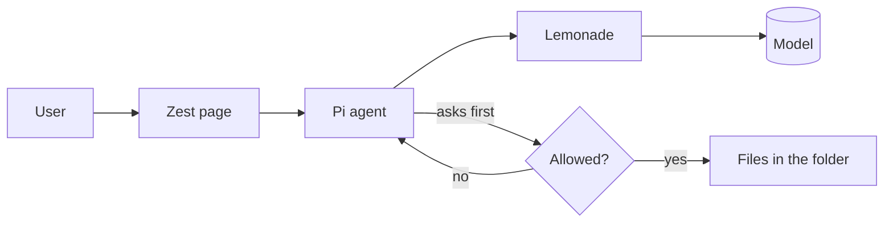
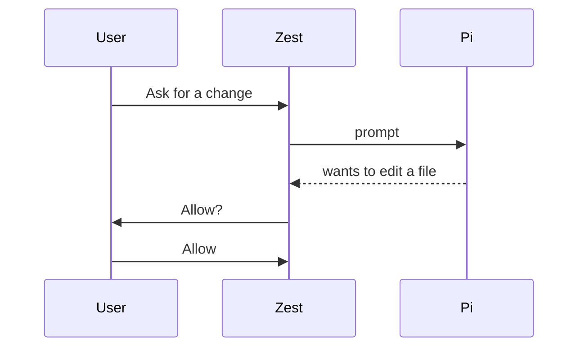

# Diagrams

Zest turns a fenced `mermaid` block in your reply into a picture, with Copy and Save buttons. You write the text; Zest draws it. Do not describe a diagram in words when a block would show it.

## Steps

1. Pick the type from the table. If unsure, use `flowchart`.
2. Keep it small: at most about 12 nodes. Split big systems into several diagrams.
3. Write the block, then one or two sentences saying what it shows. Do not repeat the diagram as a list.
4. If the user is working in a folder and wants the diagram kept, also save the same Mermaid text to a file such as `docs/architecture.mmd` (and embed it in Markdown with the same fenced block).
5. If Zest says a diagram failed to render, read the error, fix the syntax and send the whole block again.

## Pick a type

| The user wants | Start the block with |
| --- | --- |
| steps, decisions, how parts connect | `flowchart TD` (top down) or `flowchart LR` (left to right) |
| who calls whom, in order | `sequenceDiagram` |
| tables and how they relate | `erDiagram` |
| states and transitions | `stateDiagram-v2` |
| classes and inheritance | `classDiagram` |
| a schedule | `gantt` |
| ideas grouped under a topic | `mindmap` |
| events over time | `timeline` |

## Flowchart, the one you will use most

````

````

- Give every node a short id (`app`, `db1`) and put the readable text in quotes: `app["Zest page"]`.
- Shapes: `id["box"]`, `id("rounded")`, `id{"decision"}`, `id[("database")]`, `id(("circle"))`.
- Arrows: `-->` plain, `-->|label|` with a label, `-.->` dotted, `==>` thick.
- Group with `subgraph name["Title"]` ... `end`.

## Sequence diagram

````

````

`->>` solid arrow, `-->>` dashed reply. Declare participants first so the order is yours.

## Mistakes that break the picture

- **Always quote labels** that contain spaces, brackets, parentheses, colons, slashes or quotes: `a["Read file (safe)"]`. Unquoted `a[Read file (safe)]` fails.
- Never use the lowercase word `end` as a node id or label; write `done` or `End` instead.
- Node ids are letters, digits and underscores only. No spaces or dashes in ids.
- One statement per line. Indent with spaces, not tabs.
- No HTML, no Markdown inside labels. Use `<br/>` only if you must break a line.
- Do not put the text `%%` or backticks inside the block.
- Use plain words a non-expert understands. Name things the way the user does.

## When Mermaid is not enough

For a simple illustration that is not a graph (a logo, an icon, a rough layout) you may write an `svg` fenced block with a complete `<svg viewBox="0 0 400 300" xmlns="http://www.w3.org/2000/svg">...</svg>`. Zest shows it as an image. Keep it simple: rectangles, circles, lines, text. Scripts do nothing there.
